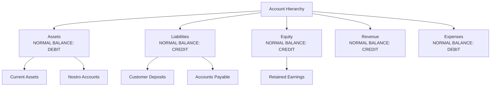

# Concurrent Double-Entry Ledger Engine

## Project Overview

Build a production-grade **double-entry ledger engine** that handles 10,000 concurrent balance updates with no race conditions, guaranteed accounting invariants, and a tamper-evident audit trail that meets regulatory record-keeping requirements.

This project is the most concurrency-intensive of the capstones. It requires deep understanding of database locking, optimistic concurrency control, and the correctness proofs that principal engineers must be able to provide.

**What you will build:**
- Double-entry ledger with chart of accounts
- Concurrent balance management with correctness proofs (jcstress)
- Reversal mechanism with compensating journal entries
- Tamper-evident hash-chained audit log
- Reconciliation query engine for accounting invariant verification
- Kafka event publishing for downstream settlement and analytics

---

## System Requirements

### Functional Requirements

| Requirement | Specification |
|---|---|
| Double-entry | Every transaction must have equal debits and credits |
| Atomicity | A journal entry containing N lines either all posts or none post |
| Idempotency | Re-posting same journal entry ID is a no-op |
| Reversal | Any posted entry can be reversed via compensating entry |
| Balance | Running balance queryable at any point in time |
| Audit | Every balance change produces an immutable, verifiable audit record |

### Non-Functional Requirements

| SLO | Target |
|---|---|
| Write throughput | 10,000 concurrent balance updates |
| P99 write latency | < 50ms |
| Balance query latency | < 10ms (indexed) |
| Audit log integrity | SHA-256 hash chain, no gaps |
| Idempotency window | Unlimited (permanent deduplication by journal entry ID) |

---

## Architecture

```mermaid
graph TB
    API[Ledger API\nPOST /journal-entries] --> IDEM[Idempotency\nCheck]
    IDEM --> VAL[Double-Entry\nValidation\nΣdebits = Σcredits]
    VAL --> SCOPE[StructuredTaskScope\nParallel line validation]
    SCOPE --> TX[Atomic Transaction\nPostgres]
    
    subgraph PostgreSQL Transaction
        JE[(journal_entries\njournal_lines)]
        BAL[(account_balances\nrunning totals)]
        AUD[(audit_events\nhash chain)]
    end
    
    TX --> JE
    TX --> BAL
    TX --> AUD
    TX --> KAFKA[Kafka KRaft\nledger.entries topic]
    
    QUERY[Balance Query\nGET /accounts/{id}/balance] --> BAL
    RECON[Reconciliation\nΣassets = Σliabilities + Σequity] --> JE
    REVERSE[Reversal API\nPOST /journal-entries/{id}/reverse] --> TX
```

---

## Domain Model

### Chart of Accounts



The fundamental accounting equation must hold at all times:

**Assets = Liabilities + Equity**

---

## Database Schema

```sql
-- Chart of accounts with Hibernate 7 / Spring Data 4 annotations shown in entity below
CREATE TABLE accounts (
    id              UUID DEFAULT gen_random_uuid() PRIMARY KEY,
    code            VARCHAR(20) NOT NULL UNIQUE,
    name            VARCHAR(255) NOT NULL,
    account_type    VARCHAR(20) NOT NULL,  -- ASSET, LIABILITY, EQUITY, REVENUE, EXPENSE
    normal_balance  VARCHAR(10) NOT NULL,  -- DEBIT, CREDIT
    currency        CHAR(3) NOT NULL DEFAULT 'GBP',
    is_leaf         BOOLEAN NOT NULL DEFAULT true,
    parent_id       UUID REFERENCES accounts(id),
    metadata        JSONB,                 -- flexible account attributes
    created_at      TIMESTAMPTZ NOT NULL DEFAULT now(),
    
    CONSTRAINT account_type_check CHECK (
        account_type IN ('ASSET','LIABILITY','EQUITY','REVENUE','EXPENSE')
    )
);

-- Journal entries (the header record)
CREATE TABLE journal_entries (
    id              UUID DEFAULT gen_random_uuid() PRIMARY KEY,
    reference       VARCHAR(255) NOT NULL UNIQUE, -- idempotency key
    description     VARCHAR(500) NOT NULL,
    entry_date      DATE NOT NULL,
    status          VARCHAR(20) NOT NULL DEFAULT 'DRAFT',
    reversal_of     UUID REFERENCES journal_entries(id),
    reversed_by     UUID REFERENCES journal_entries(id),
    created_by      VARCHAR(100) NOT NULL,
    created_at      TIMESTAMPTZ NOT NULL DEFAULT now(),
    posted_at       TIMESTAMPTZ,
    
    CONSTRAINT status_check CHECK (status IN ('DRAFT','POSTED','REVERSED'))
);

-- Journal lines (debit and credit legs)
CREATE TABLE journal_lines (
    id              UUID DEFAULT gen_random_uuid() PRIMARY KEY,
    journal_id      UUID NOT NULL REFERENCES journal_entries(id),
    account_id      UUID NOT NULL REFERENCES accounts(id),
    side            CHAR(6) NOT NULL,  -- DEBIT or CREDIT
    amount          NUMERIC(20,4) NOT NULL CHECK (amount > 0),
    currency        CHAR(3) NOT NULL,
    sequence        INTEGER NOT NULL,
    
    CONSTRAINT side_check CHECK (side IN ('DEBIT','CREDIT'))
);

-- Running account balances (denormalised for query performance)
-- @Version on this table's corresponding entity enforces optimistic locking
CREATE TABLE account_balances (
    account_id      UUID PRIMARY KEY REFERENCES accounts(id),
    balance         NUMERIC(20,4) NOT NULL DEFAULT 0,
    debit_total     NUMERIC(20,4) NOT NULL DEFAULT 0,
    credit_total    NUMERIC(20,4) NOT NULL DEFAULT 0,
    last_updated_at TIMESTAMPTZ NOT NULL DEFAULT now(),
    version         BIGINT NOT NULL DEFAULT 0  -- optimistic locking via @Version
);

-- Tamper-evident audit log (append-only)
CREATE TABLE ledger_audit_events (
    id              BIGSERIAL PRIMARY KEY,
    journal_id      UUID NOT NULL,
    event_type      VARCHAR(50) NOT NULL,
    actor           VARCHAR(100) NOT NULL,
    payload         JSONB NOT NULL,
    event_hash      CHAR(64) NOT NULL,       -- SHA-256 of this event
    previous_hash   CHAR(64) NOT NULL,       -- hash of previous event for this journal
    created_at      TIMESTAMPTZ NOT NULL DEFAULT now()
);

-- Prevent any UPDATE or DELETE on audit events
CREATE RULE no_update_audit AS ON UPDATE TO ledger_audit_events DO INSTEAD NOTHING;
CREATE RULE no_delete_audit AS ON DELETE TO ledger_audit_events DO INSTEAD NOTHING;

-- Index for balance history reconstruction without full scan
CREATE INDEX idx_journal_lines_account_date
    ON journal_lines (account_id, journal_id);
CREATE INDEX idx_journal_entries_date
    ON journal_entries (entry_date, status)
    WHERE status = 'POSTED';
```

---

## Implementation

### Domain Records and Entities (Java 21 + Hibernate 7)

```java
// Java 21 record for immutable request DTO
public record PostJournalEntryRequest(
    String reference,
    String description,
    LocalDate entryDate,
    String createdBy,
    List<JournalLineRequest> lines
) {}

public record JournalLineRequest(
    UUID accountId,
    Side side,
    BigDecimal amount,
    String currency
) {}

// Sealed interface for posting outcome
public sealed interface PostingResult
    permits PostingResult.Posted, PostingResult.Idempotent, PostingResult.Rejected {

    record Posted(UUID journalId, Instant postedAt)   implements PostingResult {}
    record Idempotent(UUID journalId)                 implements PostingResult {}
    record Rejected(String reason)                    implements PostingResult {}
}

// Record-based projection for balance queries (Spring Data 4)
public record AccountBalanceSummary(
    UUID accountId,
    String code,
    String name,
    BigDecimal balance,
    BigDecimal debitTotal,
    BigDecimal creditTotal,
    Instant lastUpdatedAt
) {}
```

```java
// Hibernate 7: @JdbcTypeCode(SqlTypes.JSON) for JSONB columns
// @Version for optimistic locking — Hibernate manages the version increment
@Entity
@Table(name = "account_balances")
public class AccountBalance {

    @Id
    @Column(name = "account_id")
    private UUID accountId;

    @Column(nullable = false, precision = 20, scale = 4)
    private BigDecimal balance = BigDecimal.ZERO;

    @Column(name = "debit_total", nullable = false, precision = 20, scale = 4)
    private BigDecimal debitTotal = BigDecimal.ZERO;

    @Column(name = "credit_total", nullable = false, precision = 20, scale = 4)
    private BigDecimal creditTotal = BigDecimal.ZERO;

    @Column(name = "last_updated_at", nullable = false)
    private Instant lastUpdatedAt = Instant.now();

    @Version
    private Long version;  // Hibernate 7 auto-increments; CAS in DB prevents lost updates
}

@Entity
@Table(name = "accounts")
public class Account {

    @Id
    @GeneratedValue(strategy = GenerationType.UUID)
    private UUID id;

    @Column(nullable = false, unique = true)
    private String code;

    @Column(nullable = false)
    private String name;

    @Enumerated(EnumType.STRING)
    private AccountType accountType;

    @Enumerated(EnumType.STRING)
    private Side normalBalance;

    // Hibernate 7 JSONB support: maps PostgreSQL jsonb column to Map<String,Object>
    @JdbcTypeCode(SqlTypes.JSON)
    @Column(columnDefinition = "jsonb")
    private Map<String, Object> metadata;
}
```

### Double-Entry Validation

```java
@Service
public class JournalEntryValidator {

    public void validate(PostJournalEntryRequest request) {
        var lines = request.lines();

        if (lines == null || lines.size() < 2) {
            throw new InvalidJournalEntryException("Journal entry must have at least 2 lines");
        }

        // Fundamental rule: sum of debits must equal sum of credits
        BigDecimal totalDebits = lines.stream()
            .filter(l -> l.side() == Side.DEBIT)
            .map(JournalLineRequest::amount)
            .reduce(BigDecimal.ZERO, BigDecimal::add);

        BigDecimal totalCredits = lines.stream()
            .filter(l -> l.side() == Side.CREDIT)
            .map(JournalLineRequest::amount)
            .reduce(BigDecimal.ZERO, BigDecimal::add);

        if (totalDebits.compareTo(totalCredits) != 0) {
            throw new UnbalancedJournalEntryException(
                "Debits (%s) must equal credits (%s)".formatted(totalDebits, totalCredits)
            );
        }

        // All lines must be in same currency
        long distinctCurrencies = lines.stream()
            .map(JournalLineRequest::currency)
            .distinct()
            .count();
        if (distinctCurrencies > 1) {
            throw new MultiCurrencyJournalException(
                "Multi-currency journal entries require FX conversion legs"
            );
        }
    }
}
```

### Parallel Line Validation — `StructuredTaskScope` (Java 21)

```java
// Validate that each account referenced by journal lines exists and is a leaf account.
// These are independent DB lookups — run them in parallel.
@Service
public class JournalLineValidationService {

    private final AccountRepository accountRepository;

    public void validateLines(List<JournalLineRequest> lines) throws InterruptedException {
        try (var scope = new StructuredTaskScope.ShutdownOnFailure()) {
            var tasks = lines.stream()
                .map(line -> scope.fork(() -> validateLine(line)))
                .toList();

            scope.join();
            scope.throwIfFailed(e -> new InvalidJournalLineException(e.getMessage()));

            // All tasks completed successfully — results are available
            tasks.forEach(t -> {
                // pattern: use t.get() after throwIfFailed confirms success
            });
        }
    }

    private JournalLineRequest validateLine(JournalLineRequest line) {
        var account = accountRepository.findById(line.accountId())
            .orElseThrow(() -> new AccountNotFoundException(line.accountId()));
        if (!account.isLeaf()) {
            throw new InvalidJournalLineException(
                "Account %s is not a leaf account".formatted(line.accountId())
            );
        }
        return line;
    }
}
```

### Concurrent Balance Update — Optimistic Locking with `ReentrantLock`

```java
@Service
public class BalanceUpdateService {

    private final JdbcTemplate jdbc;
    // Per-account ReentrantLock: virtual-thread safe (unlike synchronized).
    // Prevents the carrier thread pinning that synchronized blocks cause
    // when virtual threads are parked on lock acquisition.
    private final ConcurrentHashMap<UUID, ReentrantLock> accountLocks =
        new ConcurrentHashMap<>();

    @Retryable(
        retryFor = OptimisticLockException.class,
        maxAttempts = 3,
        backoff = @Backoff(delay = 10, multiplier = 2, random = true)
    )
    @Transactional
    public void applyLines(List<JournalLine> lines) {
        // Sort account IDs before acquiring locks to prevent deadlock.
        // Consistent lock ordering guarantees no two threads can deadlock
        // on a pair of accounts A, B: both always acquire lock(A) before lock(B).
        var sortedAccountIds = lines.stream()
            .map(JournalLine::accountId)
            .distinct()
            .sorted()
            .toList();

        var locks = sortedAccountIds.stream()
            .map(id -> accountLocks.computeIfAbsent(id, k -> new ReentrantLock()))
            .toList();

        // Acquire all locks in order
        locks.forEach(ReentrantLock::lock);
        try {
            for (JournalLine line : lines) {
                int updated = jdbc.update("""
                    UPDATE account_balances
                    SET balance      = balance + ?,
                        debit_total  = debit_total  + ?,
                        credit_total = credit_total + ?,
                        version      = version + 1,
                        last_updated_at = now()
                    WHERE account_id = ? AND version = ?
                    """,
                    line.signedAmount(),
                    line.side() == Side.DEBIT  ? line.amount() : BigDecimal.ZERO,
                    line.side() == Side.CREDIT ? line.amount() : BigDecimal.ZERO,
                    line.accountId(),
                    line.expectedVersion()
                );

                if (updated == 0) {
                    // Another transaction modified this account concurrently.
                    // @Retryable will retry up to 3 times with jitter.
                    throw new OptimisticLockException(
                        "Concurrent modification on account " + line.accountId()
                    );
                }
            }
        } finally {
            // Always release in reverse order
            var reversed = new ArrayList<>(locks);
            Collections.reverse(reversed);
            reversed.forEach(ReentrantLock::unlock);
        }
    }
}
```

### Reversal — Compensating Journal Entry

```java
@Service
@Transactional
public class JournalReversalService {

    private final JournalRepository journalRepository;
    private final BalanceUpdateService balanceUpdateService;
    private final LedgerAuditService auditService;

    public JournalEntry reverse(UUID journalId, String actor, String reason) {
        JournalEntry original = journalRepository.findById(journalId)
            .orElseThrow(() -> new JournalNotFoundException(journalId));

        // Pattern matching on status enum avoids instanceof chains
        if (original.status() != JournalStatus.POSTED) {
            throw new InvalidReversalException("Only POSTED entries can be reversed");
        }
        if (original.reversedBy() != null) {
            throw new InvalidReversalException("Entry already reversed");
        }

        // Create compensating entry: flip all debits and credits
        var reversalLines = original.lines().stream()
            .map(line -> new JournalLine(
                null,
                journalId,          // will be replaced after insert
                line.accountId(),
                line.side() == Side.DEBIT ? Side.CREDIT : Side.DEBIT,
                line.amount(),
                line.currency(),
                line.sequence()
            ))
            .toList();

        var reversal = new JournalEntry(
            null,
            "REV-" + original.reference(),
            "Reversal of: " + original.description() + " — " + reason,
            LocalDate.now(),
            JournalStatus.DRAFT,
            original.id(),
            null,
            actor,
            Instant.now(),
            null,
            reversalLines
        );

        journalRepository.insert(reversal);
        journalRepository.markReversed(original.id(), reversal.id());
        balanceUpdateService.applyLines(reversal.lines());
        auditService.record(reversal.id(), AuditEventType.REVERSED, actor);

        return reversal;
    }
}
```

### Tamper-Evident Audit Chain

```java
@Service
public class LedgerAuditService {

    private final LedgerAuditRepository auditRepository;

    @Transactional
    public void record(UUID journalId, AuditEventType type, String actor) {
        String previousHash = auditRepository
            .findLatestHash(journalId)
            .orElse("GENESIS");

        // Record-based payload — immutable by construction
        var payload = Map.of(
            "journalId",  journalId.toString(),
            "eventType",  type.name(),
            "actor",      actor,
            "timestamp",  Instant.now().toString()
        );

        String eventHash = computeHash(payload, previousHash);

        auditRepository.insert(new LedgerAuditEvent(
            null,
            journalId,
            type,
            actor,
            payload,
            eventHash,
            previousHash,
            Instant.now()
        ));
    }

    private String computeHash(Map<String, Object> payload, String previousHash) {
        // Canonical JSON ordering prevents hash instability from map iteration order
        String content = new TreeMap<>(payload) + "|" + previousHash;
        return DigestUtils.sha256Hex(content);
    }

    // Verify the entire audit chain for a journal entry
    public boolean verifyChain(UUID journalId) {
        List<LedgerAuditEvent> events = auditRepository.findAllByJournalId(journalId);
        if (events.isEmpty()) return true;

        String expectedPreviousHash = "GENESIS";
        for (LedgerAuditEvent event : events) {
            if (!event.previousHash().equals(expectedPreviousHash)) return false;
            String computed = computeHash(event.payload(), event.previousHash());
            if (!computed.equals(event.eventHash())) return false;
            expectedPreviousHash = event.eventHash();
        }
        return true;
    }
}
```

### Kafka Event Publishing (Spring Kafka 4 / KRaft)

```java
@Service
public class LedgerEventPublisher {

    private final KafkaTemplate<String, LedgerEntryEvent> kafkaTemplate;

    // Spring Kafka 4: KafkaTemplate.send() returns a CompletableFuture (not ListenableFuture)
    public void publishPosted(JournalEntry entry) {
        var event = LedgerEntryEvent.from(entry);
        kafkaTemplate.send("ledger.entries", entry.id().toString(), event)
            .whenComplete((result, ex) -> {
                if (ex != null) {
                    log.error("Failed to publish ledger event for journal {}", entry.id(), ex);
                    // Outbox fallback: event is persisted in outbox_events for retry
                } else {
                    log.debug("Published ledger event offset={}", result.getRecordMetadata().offset());
                }
            });
    }
}
```

```yaml
# application.yml — Spring Boot 4 / Spring Kafka 4 / KRaft
spring:
  kafka:
    bootstrap-servers: kafka-0:9092,kafka-1:9092,kafka-2:9092
    producer:
      key-serializer: org.apache.kafka.common.serialization.StringSerializer
      value-serializer: org.springframework.kafka.support.serializer.JsonSerializer
      acks: all
      retries: 3
      properties:
        enable.idempotence: true
    consumer:
      group-id: ledger-consumer
      isolation-level: read_committed
      auto-offset-reset: earliest
```

---

## Concurrency Correctness — jcstress Tests

```java
// Verify: two concurrent debits from an account with exactly enough balance
// Expected: exactly one succeeds, one gets OptimisticLockException
@JCStressTest
@Outcome(id = "1, 0", expect = ACCEPTABLE, desc = "Thread 1 wins, Thread 2 fails")
@Outcome(id = "0, 1", expect = ACCEPTABLE, desc = "Thread 2 wins, Thread 1 fails")
@Outcome(id = "1, 1", expect = FORBIDDEN,  desc = "Both succeed — overdraft!")
@Outcome(id = "0, 0", expect = FORBIDDEN,  desc = "Both fail — funds not debited")
@State
public class ConcurrentDebitTest {

    private final LedgerEngine ledger = LedgerEngine.withBalance(new BigDecimal("100.00"));

    @Actor
    public void actor1(II_Result r) {
        try {
            ledger.debit(accountId, new BigDecimal("100.00"), "ref-001");
            r.r1 = 1;
        } catch (InsufficientFundsException | OptimisticLockException e) {
            r.r1 = 0;
        }
    }

    @Actor
    public void actor2(II_Result r) {
        try {
            ledger.debit(accountId, new BigDecimal("100.00"), "ref-002");
            r.r2 = 1;
        } catch (InsufficientFundsException | OptimisticLockException e) {
            r.r2 = 0;
        }
    }
}
```

---

## Testing Strategy

### Integration Test — Concurrent Balance Update (Spring Boot 4)

```java
@SpringBootTest
@Testcontainers
class ConcurrentBalanceUpdateTest {

    @Container
    static PostgreSQLContainer<?> postgres = new PostgreSQLContainer<>("postgres:16")
        .withInitScript("schema.sql");

    @Autowired BalanceUpdateService balanceUpdateService;
    @Autowired AccountBalanceRepository balanceRepository;

    @Test
    void tenThousandConcurrentDebits_noOverdraft_versionNeverLost() throws Exception {
        UUID accountId = seedAccountWithBalance(new BigDecimal("1000000.00"));
        int concurrency = 10_000;
        var latch = new CountDownLatch(1);
        var successCount = new AtomicInteger(0);
        var failCount = new AtomicInteger(0);

        try (var executor = Executors.newVirtualThreadPerTaskExecutor()) {
            var futures = IntStream.range(0, concurrency).mapToObj(i ->
                CompletableFuture.runAsync(() -> {
                    try {
                        latch.await();
                        balanceUpdateService.applyLines(List.of(
                            debitLine(accountId, new BigDecimal("0.01"))
                        ));
                        successCount.incrementAndGet();
                    } catch (OptimisticLockException | InterruptedException e) {
                        failCount.incrementAndGet();
                    }
                }, executor)
            ).toArray(CompletableFuture[]::new);

            latch.countDown();
            CompletableFuture.allOf(futures).get(30, TimeUnit.SECONDS);
        }

        var finalBalance = balanceRepository.findById(accountId).orElseThrow();
        // Invariant: successCount * 0.01 == initial balance - finalBalance
        BigDecimal debited = new BigDecimal("0.01").multiply(BigDecimal.valueOf(successCount.get()));
        assertThat(finalBalance.balance())
            .isEqualByComparingTo(new BigDecimal("1000000.00").subtract(debited));
        assertThat(finalBalance.balance()).isGreaterThanOrEqualTo(BigDecimal.ZERO);
    }
}
```

### Mock Injection — `@MockitoBean` (Spring Boot 4)

```java
@SpringBootTest
class JournalReversalServiceTest {

    // Spring Boot 4: @MockitoBean replaces the deprecated @MockBean
    @MockitoBean JournalRepository journalRepository;
    @MockitoBean BalanceUpdateService balanceUpdateService;
    @MockitoBean LedgerAuditService auditService;

    @Autowired JournalReversalService reversalService;

    @Test
    void reverse_flipsAllDebitsAndCredits() {
        var original = postedJournalWith(
            debitLine(accountA, "500.00"),
            creditLine(accountB, "500.00")
        );
        given(journalRepository.findById(original.id())).willReturn(Optional.of(original));

        var result = reversalService.reverse(original.id(), "operator", "test reversal");

        assertThat(result.lines()).satisfiesExactlyInAnyOrder(
            line -> {
                assertThat(line.side()).isEqualTo(Side.CREDIT);  // flipped from DEBIT
                assertThat(line.amount()).isEqualByComparingTo("500.00");
                assertThat(line.accountId()).isEqualTo(accountA);
            },
            line -> {
                assertThat(line.side()).isEqualTo(Side.DEBIT);   // flipped from CREDIT
                assertThat(line.amount()).isEqualByComparingTo("500.00");
                assertThat(line.accountId()).isEqualTo(accountB);
            }
        );
        verify(auditService).record(result.id(), AuditEventType.REVERSED, "operator");
    }
}
```

---

## Reconciliation Queries

```sql
-- Verify double-entry invariant: total debits must equal total credits
SELECT
    SUM(CASE WHEN jl.side = 'DEBIT'  THEN jl.amount ELSE 0 END) AS total_debits,
    SUM(CASE WHEN jl.side = 'CREDIT' THEN jl.amount ELSE 0 END) AS total_credits,
    SUM(CASE WHEN jl.side = 'DEBIT'  THEN jl.amount ELSE 0 END) -
    SUM(CASE WHEN jl.side = 'CREDIT' THEN jl.amount ELSE 0 END) AS imbalance
FROM journal_lines jl
JOIN journal_entries je ON je.id = jl.journal_id
WHERE je.status = 'POSTED'
  AND je.entry_date BETWEEN :start_date AND :end_date;

-- Balance sheet invariant: Assets = Liabilities + Equity
SELECT
    SUM(CASE WHEN a.account_type = 'ASSET'     THEN ab.balance ELSE 0 END) AS total_assets,
    SUM(CASE WHEN a.account_type = 'LIABILITY' THEN ab.balance ELSE 0 END) AS total_liabilities,
    SUM(CASE WHEN a.account_type = 'EQUITY'    THEN ab.balance ELSE 0 END) AS total_equity,
    SUM(CASE WHEN a.account_type = 'ASSET'     THEN ab.balance ELSE 0 END) -
    SUM(CASE WHEN a.account_type IN ('LIABILITY','EQUITY') THEN ab.balance ELSE 0 END) AS imbalance
FROM account_balances ab
JOIN accounts a ON a.id = ab.account_id;

-- Point-in-time balance reconstruction without full table scan
-- Uses the idx_journal_lines_account_date index
SELECT
    jl.account_id,
    SUM(CASE WHEN jl.side = 'DEBIT'  THEN jl.amount ELSE -jl.amount END) AS reconstructed_balance
FROM journal_lines jl
JOIN journal_entries je ON je.id = jl.journal_id
WHERE jl.account_id = :account_id
  AND je.status = 'POSTED'
  AND je.entry_date <= :as_of_date
GROUP BY jl.account_id;
```

---

## Architecture Decision Records

### ADR-001: Optimistic Locking Over Pessimistic for Account Balances

**Status:** Accepted

**Context:** High-velocity accounts (e.g., a master clearing account) can receive thousands of concurrent updates. `SELECT FOR UPDATE` creates a serialisation queue, capping throughput at ~200 TPS per account under high contention.

**Decision:** Use optimistic locking (`version` column, conditional UPDATE). Retry up to 3 times with exponential backoff + jitter via `@Retryable`. Fall back to pessimistic locking only for multi-account journal entries where deadlock ordering cannot be guaranteed.

**Consequences:** 1-3% retry rate under high contention. Maximum throughput ~5,000 updates/second per account. Requires jcstress proof that the FORBIDDEN outcome (both concurrent debits succeed) is unreachable.

### ADR-002: `ReentrantLock` Instead of `synchronized` for Virtual Thread Safety

**Status:** Accepted

**Context:** Java virtual threads park efficiently on `java.util.concurrent` locks (`ReentrantLock`, `LockSupport.park()`), but `synchronized` blocks cause carrier thread pinning — the virtual thread holds its OS carrier thread for the duration of the lock, defeating the scalability benefit of virtual threads.

**Decision:** Replace all `synchronized` blocks in balance update and audit chain operations with `ReentrantLock`. Lock ordering (by sorted UUID) prevents deadlock on multi-account journal entries.

**Consequences:** Explicit `lock()` / `unlock()` in try/finally blocks required — no auto-release. Code is more verbose but correct. JVM flag `-Djdk.tracePinnedThreads=full` used in CI to detect any remaining synchronized blocks in the call stack.

### ADR-003: Denormalised `account_balances` Table

**Status:** Accepted

**Context:** Calculating running balance by summing all journal lines is O(n) and grows unboundedly. At 10M transactions/day, a balance query would scan millions of rows even with an index.

**Decision:** Maintain a denormalised `account_balances` table updated atomically in the same transaction as journal lines. Balance queries are O(1) indexed lookups on the primary key.

**Consequences:** `account_balances` must be recomputable from `journal_lines` on schema migration. Nightly reconciliation job verifies `account_balances` matches `SUM(journal_lines)` per account. The `@Version` column on `AccountBalance` entity ensures optimistic locking prevents lost updates on the denormalised row.

### ADR-004: `StructuredTaskScope` for Parallel Line Validation

**Status:** Accepted

**Context:** Validating each journal line's referenced account requires a DB lookup per line. For a 20-line journal entry, sequential validation adds ~20 × 2ms = 40ms latency.

**Decision:** Fork each line validation onto a virtual thread using `StructuredTaskScope.ShutdownOnFailure`. If any account lookup fails (account not found, not a leaf), the scope cancels remaining forks immediately and throws, preventing partial validation.

**Consequences:** All account lookups run concurrently. Under 10k TPS, the HikariCP pool becomes the bottleneck if lines per entry is high. Pool sized at `CPU_CORES * 2`; monitor `hikaricp.pending.threads`.

---

## Principal Engineer Review Criteria

Your implementation will be evaluated against:

- [ ] **jcstress test passes** — FORBIDDEN outcome (both concurrent debits succeed) is unreachable
- [ ] **Double-entry validation enforced** — unbalanced journal entries rejected with descriptive error
- [ ] **Reversal produces exact compensation** — reversed entry + original entry sum to zero on every account
- [ ] **Audit chain verifiable** — `verifyChain()` returns true for all posted entries, false for tampered entries
- [ ] **Reconciliation query identifies imbalance** — test with intentionally corrupted `account_balances` row
- [ ] **Performance under concurrency** — JMH benchmark at 10k concurrent writers, P99 < 50ms
- [ ] **Idempotency proven** — posting same journal `reference` twice produces 1 database row, second returns `Idempotent`
- [ ] **`ReentrantLock` used** — no `synchronized` blocks in hot paths; `-Djdk.tracePinnedThreads=full` clean in CI
- [ ] **Hibernate 7 patterns used** — `@JdbcTypeCode(SqlTypes.JSON)` for JSONB, `@Version` on `AccountBalance`
- [ ] **Spring Boot 4 patterns used** — `@MockitoBean` in all tests, record-based projections for query results
- [ ] **Kafka uses KRaft** — no ZooKeeper properties; `KafkaTemplate.send()` uses `CompletableFuture` callback
- [ ] **Deadlock prevention documented** — lock ordering strategy explained in ADR or inline comment
- [ ] **Point-in-time balance query** — SQL query reconstructs balance as of any date without full scan

---

## Interview Debrief

### The 60-Second Pitch
> "I built a concurrent double-entry ledger engine targeting 10k simultaneous balance updates with zero race conditions; the hardest problem was preventing two threads from simultaneously debiting the same account below zero, which I solved using optimistic locking — a versioned conditional UPDATE that fails atomically if another transaction modified the row concurrently — combined with ReentrantLock-based ordering to prevent deadlocks on multi-account journal entries."

### Questions Your Interviewer Will Ask

**Q1: "Walk me through what happens at the database level when two threads try to debit the same account simultaneously — what is the exact race condition and how does your code prevent it?"**  
Model answer: Both threads read `account_balances` for account A and get `version = 42, balance = 100.00`. Both compute the post-debit balance as 0.00. Thread 1 fires `UPDATE account_balances SET balance = 0.00, version = 43 WHERE account_id = ? AND version = 42` and succeeds — PostgreSQL returns `updated = 1`. Thread 2 fires the same statement; because `version` is now 43 (not 42), the WHERE clause matches zero rows and PostgreSQL returns `updated = 0`. The service sees `updated == 0`, throws `OptimisticLockException`, and `@Retryable` re-reads the current version before retrying. The key insight is that the `WHERE version = ?` clause is the compare-and-swap operation — it is atomic at the row level within PostgreSQL's MVCC model, so no two transactions can both see `updated = 1` for the same starting version.

**Q2: "What happens if two virtual threads hold ReentrantLocks on accounts A and B in opposite order — walk me through the deadlock scenario and your exact prevention strategy."**  
Model answer: Without ordering, Thread 1 acquires lock(A) then blocks on lock(B); Thread 2 acquires lock(B) then blocks on lock(A) — classic deadlock, no progress. The prevention strategy is consistent global lock ordering: before acquiring any locks, sort the target account UUIDs lexicographically, then always acquire in that order. Because UUID ordering is total and deterministic, any two threads processing overlapping account sets will acquire locks in the same sequence, making the circular-wait condition impossible. The release order is reversed (B before A) to maintain symmetry, though for correctness only the acquisition order matters. This technique is called "lock levelling" or "hierarchical locking" and is the standard approach used in database deadlock prevention as well.

**Q3: "Why is the running balance denormalised in `account_balances` rather than computed on read? What could go wrong if the denormalised value drifts from the journal lines?"**  
Model answer: The denormalised balance exists because `SUM(journal_lines WHERE account_id = ?)` is O(n) and n grows without bound — at 10M postings per day, a balance query would scan and aggregate millions of rows even with a perfect index on `account_id`. The O(1) indexed lookup on `account_balances` is the only way to meet the < 10ms balance query SLO. The drift risk is real: if any code path updates `journal_lines` without updating `account_balances` in the same transaction, the denormalised value becomes stale. The nightly reconciliation query (`SELECT SUM(jl.amount) ... vs ab.balance`) detects drift. If drift is detected, the recovery path is to recompute `account_balances` from `journal_lines` — the `journal_lines` table is always the source of truth. This is why journal lines are immutable (no UPDATE, no DELETE) and the reversal mechanism creates compensating entries rather than modifying historical rows.

**Q4: "How would you reconstruct the balance of an account as of a specific date — say December 31st — without scanning the entire journal_lines table?"**  
Model answer: The key is the composite index `idx_journal_lines_account_date ON journal_lines (account_id, journal_id)` combined with `idx_journal_entries_date ON journal_entries (entry_date, status) WHERE status = 'POSTED'`. The query joins the two tables filtered by `account_id = ?` and `entry_date <= :as_of_date`. PostgreSQL's planner uses a nested loop: first the journal_entries index narrows to rows up to the target date, then the journal_lines index fetches only lines for those entries. The scan is bounded by the number of transactions for that account up to that date, not the total table size. For further optimisation, maintain monthly balance snapshots — store the balance as of the first of each month in a separate `balance_snapshots` table, then only sum the incremental journal lines since the most recent snapshot before the target date.

**Q5: "If you had to scale this ledger to 10x the current write throughput, what would you change about the optimistic locking strategy and the account_balances table design?"**  
Model answer: At 10x (100k concurrent balance updates), the optimistic lock retry rate on high-velocity accounts — clearing accounts, master fee accounts — rises enough to cause retry storm: retries generate more load, which causes more contention, which causes more retries. The mitigation has two parts. First, partition high-velocity accounts: instead of one clearing account row, maintain an array of N shadow rows (shards) and round-robin writes across them. The balance is the sum of all shards; writes never contend with each other. This is the "counter sharding" pattern used by Twitter's distributed counter and Cassandra's counter column. Second, replace per-row optimistic locking on those hot accounts with a serialised queue backed by a Redis INCR — INCR is atomic and O(1), making it a bottleneck-free compare-and-swap for numeric values. The PostgreSQL row would be updated asynchronously in batches (100ms windows), dramatically reducing DB write amplification while keeping the balance eventually consistent within the batch window.

### What to Have Ready on the Whiteboard
- **System diagram**: Ledger API → [StructuredTaskScope: parallel line validation] → PostgreSQL transaction (journal_entries + journal_lines + account_balances + audit_events, all in one tx) → Kafka KRaft (ledger.entries topic). Draw the ReentrantLock acquisition order separately: sorted UUID list → acquire A, B, C in order → UPDATE each row with version check → release C, B, A.
- **Table schema**: The `account_balances` table with its `version BIGINT` column is the most interesting design decision — be ready to explain the `WHERE version = ?` CAS pattern, why the `@Version` Hibernate annotation maps to it, and what `updated = 0` means operationally. Also show the partial index `idx_journal_entries_date WHERE status = 'POSTED'` and explain why excluding non-POSTED entries from the index saves significant index space at high write volume.
- **One trade-off**: "I chose optimistic locking over pessimistic (`SELECT FOR UPDATE`) because pessimistic locking serialises all writes to a given account — if 1,000 threads want to debit the same clearing account, they queue behind a single DB lock, capping throughput at ~200 TPS for that account. Optimistic locking lets all 1,000 threads proceed concurrently; at most one will win per version, the rest retry. Under low contention (most accounts), optimistic locking has zero overhead. Under high contention (hot accounts), retry rates rise — which is the signal to apply counter sharding."
