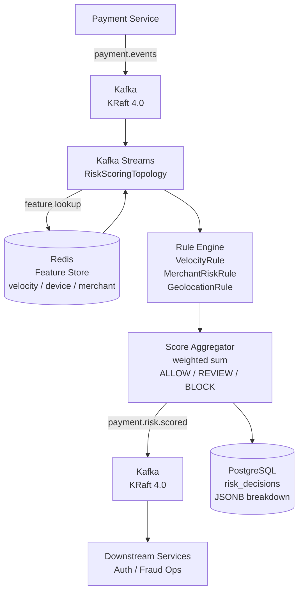
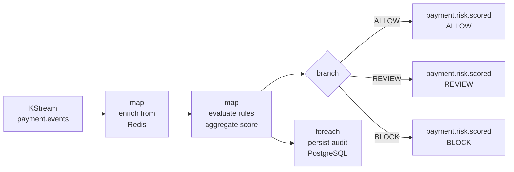

# Real-Time Transaction Risk Scoring Engine

## Project Overview

Build a real-time risk scoring service that evaluates every incoming payment event for fraud and abuse signals, produces a risk decision within 50ms (p99, excluding Kafka I/O), and writes a full rule-breakdown audit trail to PostgreSQL.

This project integrates Kafka Streams for streaming enrichment, a Redis feature store for sub-millisecond velocity lookups, a sealed-interface rule engine for composable scoring logic, and Spring Boot 4 with Java 21 virtual threads for high-throughput I/O.

**What you will build:**

- Kafka Streams topology: `PaymentEvent` → enrich from Redis feature store → evaluate rules → publish `RiskScoredEvent`
- Feature store (Redis): rolling velocity counters (1 h / 24 h / 7 d), device fingerprint scores, merchant risk tiers
- Rule engine: `RiskRule` sealed interface with `VelocityRule`, `MerchantRiskRule`, `GeolocationRule` implementations; each rule returns a `RiskDecision(score, reason)`
- Score aggregator: weighted-sum of rule scores → threshold → `ALLOW` / `REVIEW` / `BLOCK`
- Audit trail: every scoring decision persisted to PostgreSQL with full per-rule breakdown stored as JSONB
- Exactly-once processing via `processing.guarantee=exactly_once_v2`
- Latency target: p99 < 50 ms for scoring (excluding Kafka I/O)

---

## System Requirements

### Functional Requirements

| Requirement | Specification |
|---|---|
| Event ingestion | Consume `payment.events` Kafka topic; key = `paymentId` |
| Feature enrichment | Fetch velocity counters, device score, merchant tier from Redis before rule evaluation |
| Rule evaluation | Execute all active `RiskRule` implementations; collect `RiskDecision` per rule |
| Score aggregation | Weighted sum of rule scores; threshold map → ALLOW / REVIEW / BLOCK |
| Risk event publish | Produce `RiskScoredEvent` to `payment.risk.scored` topic |
| Audit persistence | Insert full rule breakdown (JSONB) into `risk_decisions` PostgreSQL table |
| Velocity counters | Atomic Redis Lua increment; TTL-based windows of 1 h, 24 h, 7 d |

### Non-Functional Requirements

| Requirement | Target |
|---|---|
| Scoring latency (p99) | < 50 ms (excluding Kafka I/O) |
| Throughput | 10 000 events/second sustained per partition |
| Exactly-once | `processing.guarantee=exactly_once_v2` throughout topology |
| Feature store SLA | Redis read < 2 ms p99 |
| Audit write durability | PostgreSQL synchronous commit; no data loss on crash |
| Kafka version | 4.0 KRaft (no ZooKeeper) |

---

## Architecture



---

## Kafka Streams Topology



---

## Implementation Checklist

### Phase 1 — Data Model

- [ ] Define `PaymentEvent` record (Java 21): `paymentId`, `customerId`, `merchantId`, `amount`, `currency`, `deviceFingerprint`, `latitude`, `longitude`, `occurredAt`
- [ ] Define `RiskScoredEvent` record: `paymentId`, `outcome`, `totalScore`, `ruleDecisions` (list), `scoredAt`
- [ ] Define `RiskDecision` record: `ruleName`, `score`, `reason`
- [ ] Create `risk_decisions` PostgreSQL table with JSONB `rule_breakdown` column
- [ ] Create `merchant_risk_tiers` lookup table seeded with test data
- [ ] Write Flyway migration scripts for all schema changes

### Phase 2 — Kafka Streams Topology

- [ ] Configure `KafkaStreamsConfig` with `exactly_once_v2`, KRaft bootstrap servers, and JSON Serdes
- [ ] Implement `RiskScoringTopology` as a `@Component` that accepts `StreamsBuilder`
- [ ] Wire enrichment step: fetch `EnrichedPaymentContext` from Redis for each event
- [ ] Wire rule evaluation step: call `RiskRuleEngine.evaluate(context)` → `ScoredPayment`
- [ ] Branch by `RiskOutcome` → three sinks on `payment.risk.scored`
- [ ] `foreach` sink to call `RiskAuditService.persist(scoredPayment)`

### Phase 3 — Rule Engine

- [ ] Declare `RiskRule` sealed interface with `permit` clause for `VelocityRule`, `MerchantRiskRule`, `GeolocationRule`
- [ ] Implement `VelocityRule`: read 1 h / 24 h counters from context; score 0–40 based on threshold breaches
- [ ] Implement `MerchantRiskRule`: look up merchant tier (LOW / MEDIUM / HIGH / BLOCKED); map to score 0–30
- [ ] Implement `GeolocationRule`: compare payment country against customer home country; impossible travel detection
- [ ] Implement `RiskRuleEngine`: collect all `RiskRule` instances via constructor injection, run all, return `List<RiskDecision>`
- [ ] Implement `ScoreAggregator`: apply weights, sum scores, apply threshold map → `RiskOutcome`

### Phase 4 — Feature Store (Redis)

- [ ] Implement `VelocityCounterService`: Lua script for atomic `INCR` + `EXPIREAT` within a Redis pipeline
- [ ] Implement `FeatureStoreClient`: read device fingerprint score and merchant tier in a single Redis pipeline call
- [ ] Implement `EnrichmentService`: combine velocity counters + device score + merchant tier → `EnrichedPaymentContext`
- [ ] Handle Redis unavailability: return degraded context, log warning; rule engine must handle null features gracefully

### Phase 5 — Observability

- [ ] Micrometer `Timer` on end-to-end scoring duration; alert if p99 exceeds 50 ms
- [ ] Counter per `RiskOutcome` (ALLOW / REVIEW / BLOCK)
- [ ] Counter per rule name for fired decisions
- [ ] Kafka Streams metrics exposed via Micrometer (`kafka.streams.*`)
- [ ] Structured logging (JSON) with `paymentId`, `outcome`, `totalScore`, `durationMs` on every decision

---

## Key Implementation Details

### Domain Records (Java 21)

```java
// Payment event consumed from Kafka
public record PaymentEvent(
    String paymentId,
    String customerId,
    String merchantId,
    BigDecimal amount,
    String currency,
    String deviceFingerprint,
    double latitude,
    double longitude,
    Instant occurredAt
) {}

// Rule output — one per rule per evaluation
public record RiskDecision(
    String ruleName,
    int score,
    String reason
) {}

// Enriched context passed into rule engine
public record EnrichedPaymentContext(
    PaymentEvent payment,
    long velocity1h,
    long velocity24h,
    long velocity7d,
    double deviceFingerprintScore,  // 0.0 (clean) – 1.0 (high risk)
    MerchantRiskTier merchantTier
) {}

// Final scored event published to Kafka
public record RiskScoredEvent(
    String paymentId,
    RiskOutcome outcome,
    int totalScore,
    List<RiskDecision> ruleDecisions,
    Instant scoredAt
) {}
```

### Sealed Rule Interface

```java
// Sealed interface: compiler enforces exhaustive pattern matching
public sealed interface RiskRule
    permits VelocityRule, MerchantRiskRule, GeolocationRule {

    RiskDecision evaluate(EnrichedPaymentContext context);
    int weight();  // contribution to weighted sum
}

@Component
public final class VelocityRule implements RiskRule {

    private static final long THRESHOLD_1H  =  5;
    private static final long THRESHOLD_24H = 20;

    @Override
    public RiskDecision evaluate(EnrichedPaymentContext ctx) {
        if (ctx.velocity1h() >= THRESHOLD_1H) {
            return new RiskDecision(
                "VELOCITY",
                40,
                "1h velocity %d exceeds threshold %d".formatted(ctx.velocity1h(), THRESHOLD_1H)
            );
        }
        if (ctx.velocity24h() >= THRESHOLD_24H) {
            return new RiskDecision("VELOCITY", 20,
                "24h velocity %d exceeds threshold %d".formatted(ctx.velocity24h(), THRESHOLD_24H));
        }
        return new RiskDecision("VELOCITY", 0, "within normal velocity");
    }

    @Override public int weight() { return 3; }
}

@Component
public final class MerchantRiskRule implements RiskRule {

    @Override
    public RiskDecision evaluate(EnrichedPaymentContext ctx) {
        return switch (ctx.merchantTier()) {
            case LOW     -> new RiskDecision("MERCHANT_RISK",  0, "low-risk merchant");
            case MEDIUM  -> new RiskDecision("MERCHANT_RISK", 10, "medium-risk merchant");
            case HIGH    -> new RiskDecision("MERCHANT_RISK", 30, "high-risk merchant");
            case BLOCKED -> new RiskDecision("MERCHANT_RISK", 100, "merchant is blocked");
        };
    }

    @Override public int weight() { return 2; }
}

@Component
public final class GeolocationRule implements RiskRule {

    @Override
    public RiskDecision evaluate(EnrichedPaymentContext ctx) {
        // Simplified: flag cross-border transactions for high-risk merchants
        // A full implementation would use customer home country + impossible-travel distance/time
        if (ctx.merchantTier() == MerchantRiskTier.HIGH
                && ctx.payment().latitude() == 0.0
                && ctx.payment().longitude() == 0.0) {
            return new RiskDecision("GEOLOCATION", 25,
                "missing geolocation for high-risk merchant");
        }
        return new RiskDecision("GEOLOCATION", 0, "geolocation acceptable");
    }

    @Override public int weight() { return 1; }
}
```

### Kafka Streams Topology

```java
@Component
public class RiskScoringTopology {

    private final EnrichmentService enrichmentService;
    private final RiskRuleEngine ruleEngine;
    private final RiskAuditService auditService;

    @Bean
    public KStream<String, PaymentEvent> buildTopology(StreamsBuilder builder) {
        KStream<String, PaymentEvent> payments = builder.stream(
            "payment.events",
            Consumed.with(Serdes.String(), paymentEventSerde())
        );

        KStream<String, RiskScoredEvent> scored = payments
            .mapValues(payment -> {
                // Enrich: fetch features from Redis
                EnrichedPaymentContext context = enrichmentService.enrich(payment);
                // Score: evaluate all rules
                List<RiskDecision> decisions = ruleEngine.evaluate(context);
                int totalScore = ruleEngine.aggregateScore(decisions);
                RiskOutcome outcome = RiskOutcome.fromScore(totalScore);
                return new RiskScoredEvent(
                    payment.paymentId(), outcome, totalScore, decisions, Instant.now());
            });

        // Persist audit before publishing to Kafka (exactly-once scope)
        scored.foreach((key, event) -> auditService.persist(event));

        // Fan-out by outcome
        Map<String, KStream<String, RiskScoredEvent>> branches = scored.split(Named.as("outcome-"))
            .branch((k, v) -> v.outcome() == RiskOutcome.ALLOW,  Branched.as("allow"))
            .branch((k, v) -> v.outcome() == RiskOutcome.REVIEW, Branched.as("review"))
            .branch((k, v) -> v.outcome() == RiskOutcome.BLOCK,  Branched.as("block"))
            .defaultBranch(Branched.as("unknown"));

        branches.get("outcome-allow") .to("payment.risk.scored", producedWith());
        branches.get("outcome-review").to("payment.risk.scored", producedWith());
        branches.get("outcome-block") .to("payment.risk.scored", producedWith());

        return payments;
    }
}
```

### Kafka Streams Configuration (KRaft + Exactly-Once)

```java
@Configuration
public class KafkaStreamsConfig {

    @Value("${spring.kafka.bootstrap-servers}")
    private String bootstrapServers;

    @Bean(name = KafkaStreamsDefaultConfiguration.DEFAULT_STREAMS_CONFIG_BEAN_NAME)
    public KafkaStreamsConfiguration streamsConfig() {
        return new KafkaStreamsConfiguration(Map.of(
            StreamsConfig.APPLICATION_ID_CONFIG,          "risk-scoring-engine",
            StreamsConfig.BOOTSTRAP_SERVERS_CONFIG,       bootstrapServers,
            StreamsConfig.PROCESSING_GUARANTEE_CONFIG,    StreamsConfig.EXACTLY_ONCE_V2,
            StreamsConfig.DEFAULT_KEY_SERDE_CLASS_CONFIG, Serdes.String().getClass(),
            StreamsConfig.NUM_STREAM_THREADS_CONFIG,      4,
            // Virtual threads for Kafka I/O — Java 21
            StreamsConfig.ROCKSDB_CONFIG_SETTER_CLASS_CONFIG,
                CustomRocksDbConfigSetter.class
        ));
    }
}
```

### Virtual Thread Task Executor (Spring Boot 4 / Java 21)

```java
@Configuration
public class ThreadConfig {

    // Spring Boot 4 auto-configures virtual threads when enabled;
    // this bean is a named override for components that need explicit wiring.
    @Bean
    public AsyncTaskExecutor applicationTaskExecutor() {
        return new TaskExecutorAdapter(
            Executors.newVirtualThreadPerTaskExecutor());
    }
}
```

### Redis Velocity Counter — Atomic Lua Script

```java
@Service
public class VelocityCounterService {

    private static final String INCR_SCRIPT = """
        local key = KEYS[1]
        local ttlSeconds = tonumber(ARGV[1])
        local current = redis.call('INCR', key)
        if current == 1 then
            redis.call('EXPIRE', key, ttlSeconds)
        end
        return current
        """;

    private final RedisTemplate<String, String> redis;
    private final RedisScript<Long> script = RedisScript.of(INCR_SCRIPT, Long.class);

    public long increment(String customerId, String window, long ttlSeconds) {
        String key = "velocity:%s:%s".formatted(customerId, window);
        Long count = redis.execute(script, List.of(key), String.valueOf(ttlSeconds));
        return count == null ? 0L : count;
    }

    public VelocityCounts getCounts(String customerId) {
        // Pipeline: three reads in one round-trip
        List<Object> results = redis.executePipelined((RedisCallback<Object>) conn -> {
            byte[] k1h  = key(customerId, "1h").getBytes();
            byte[] k24h = key(customerId, "24h").getBytes();
            byte[] k7d  = key(customerId, "7d").getBytes();
            conn.stringCommands().get(k1h);
            conn.stringCommands().get(k24h);
            conn.stringCommands().get(k7d);
            return null;
        });
        return new VelocityCounts(
            toLong(results.get(0)),
            toLong(results.get(1)),
            toLong(results.get(2))
        );
    }

    private String key(String customerId, String window) {
        return "velocity:%s:%s".formatted(customerId, window);
    }
    private long toLong(Object v) {
        return v == null ? 0L : Long.parseLong(v.toString());
    }
}
```

### Risk Audit Persistence

```java
@Service
public class RiskAuditService {

    private final JdbcClient jdbcClient;
    private final ObjectMapper objectMapper;

    @Transactional
    public void persist(RiskScoredEvent event) {
        String ruleBreakdown = toJson(event.ruleDecisions());
        jdbcClient.sql("""
            INSERT INTO risk_decisions
                (payment_id, outcome, total_score, rule_breakdown, scored_at)
            VALUES (:paymentId, :outcome, :totalScore, :ruleBreakdown::jsonb, :scoredAt)
            """)
            .param("paymentId",    event.paymentId())
            .param("outcome",      event.outcome().name())
            .param("totalScore",   event.totalScore())
            .param("ruleBreakdown", ruleBreakdown)
            .param("scoredAt",     event.scoredAt())
            .update();
    }

    private String toJson(List<RiskDecision> decisions) {
        try {
            return objectMapper.writeValueAsString(decisions);
        } catch (JsonProcessingException e) {
            throw new IllegalStateException("Failed to serialise rule decisions", e);
        }
    }
}
```

### Integration Test (Testcontainers + KRaft + @MockitoBean)

```java
@SpringBootTest
@Testcontainers
class RiskScoringTopologyIT {

    @Container
    static final KafkaContainer kafka = new KafkaContainer(
        DockerImageName.parse("apache/kafka:4.0.0"))  // KRaft; no ZooKeeper
        .withKraft();

    @Container
    static final PostgreSQLContainer<?> postgres =
        new PostgreSQLContainer<>("postgres:16");

    @Container
    static final GenericContainer<?> redis =
        new GenericContainer<>("redis:7-alpine").withExposedPorts(6379);

    @MockitoBean
    EnrichmentService enrichmentService;  // @MockitoBean — Spring Boot 4 / Mockito 5

    @Autowired
    KafkaTemplate<String, PaymentEvent> producer;

    @Autowired
    RiskDecisionRepository decisionRepository;

    @Test
    void highVelocityPayment_shouldProduceBlockDecision() throws Exception {
        var payment = new PaymentEvent(
            "pay-001", "cust-123", "merch-456",
            new BigDecimal("250.00"), "GBP",
            "fp-abc", 51.5, -0.1, Instant.now()
        );

        // Stub enrichment to return high velocity
        given(enrichmentService.enrich(any())).willReturn(
            new EnrichedPaymentContext(payment, 10L, 50L, 150L, 0.9, MerchantRiskTier.HIGH));

        producer.send("payment.events", payment.paymentId(), payment).get();

        await().atMost(Duration.ofSeconds(10))
            .untilAsserted(() -> {
                var decision = decisionRepository.findByPaymentId("pay-001");
                assertThat(decision).isPresent();
                assertThat(decision.get().outcome()).isEqualTo(RiskOutcome.BLOCK);
                assertThat(decision.get().totalScore()).isGreaterThan(70);
            });
    }
}
```

### RestClient Usage (not RestTemplate)

```java
// If the scoring service needs to call an external merchant risk API:
@Service
public class MerchantRiskApiClient {

    private final RestClient restClient;

    public MerchantRiskApiClient(RestClient.Builder builder,
                                  @Value("${merchant-risk.base-url}") String baseUrl) {
        this.restClient = builder.baseUrl(baseUrl).build();
    }

    public MerchantRiskTier fetchTier(String merchantId) {
        return restClient.get()
            .uri("/merchants/{id}/risk-tier", merchantId)
            .retrieve()
            .body(MerchantRiskTier.class);
    }
}
```

---

## Database Schema

```sql
CREATE TABLE risk_decisions (
    id             UUID DEFAULT gen_random_uuid() PRIMARY KEY,
    payment_id     VARCHAR(255) NOT NULL,
    outcome        VARCHAR(10)  NOT NULL CHECK (outcome IN ('ALLOW','REVIEW','BLOCK')),
    total_score    INTEGER      NOT NULL,
    rule_breakdown JSONB        NOT NULL,
    scored_at      TIMESTAMPTZ  NOT NULL DEFAULT now(),

    CONSTRAINT uq_risk_decisions_payment UNIQUE (payment_id)
);

CREATE INDEX idx_risk_decisions_outcome   ON risk_decisions (outcome);
CREATE INDEX idx_risk_decisions_scored_at ON risk_decisions (scored_at DESC);

CREATE TABLE merchant_risk_tiers (
    merchant_id VARCHAR(255) PRIMARY KEY,
    tier        VARCHAR(10)  NOT NULL CHECK (tier IN ('LOW','MEDIUM','HIGH','BLOCKED')),
    updated_at  TIMESTAMPTZ  NOT NULL DEFAULT now()
);
```

---

## Principal Engineer Review Criteria

- [ ] **Exactly-once end-to-end** — produce a duplicate `PaymentEvent`; confirm only one `risk_decisions` row is inserted
- [ ] **p99 latency < 50 ms** — Micrometer histogram shows p99 within budget under sustained 5 000 events/second load test
- [ ] **Sealed interface exhaustiveness** — add a new `permits` type without a `switch` arm; confirm compile error
- [ ] **Redis unavailability degrades gracefully** — shut down Redis; topology continues with degraded features, no NPE, no topology crash
- [ ] **Rule engine isolation** — unit test each `RiskRule` independently with mocked `EnrichedPaymentContext`
- [ ] **Audit completeness** — every `RiskScoredEvent` has a corresponding `risk_decisions` row with full JSONB breakdown
- [ ] **KRaft-only** — no ZooKeeper reference in any config file or Testcontainers setup
- [ ] **@MockitoBean used** — no `@MockBean` annotations anywhere in the test suite
- [ ] **Virtual threads enabled** — `spring.threads.virtual.enabled=true` in `application.properties`; confirm with thread dump under load

---

## Interview Debrief

### The 60-Second Pitch

> "I built a real-time transaction risk scoring engine on Kafka Streams that enriches payment events from a Redis feature store, runs a sealed-interface rule engine, and produces a risk decision in under 50 ms p99 — the hardest problem was guaranteeing exactly-once scoring so each payment gets exactly one audit row even under partition rebalance, which I solved using `exactly_once_v2` and scoping the PostgreSQL write inside the Streams transaction."

### Questions Your Interviewer Will Ask

**Q1: "What does `exactly_once_v2` actually guarantee, and what does it cost you?"**

Model answer: `exactly_once_v2` (EOS v2) uses a single transactional producer per Kafka Streams thread and coordinates with the broker-side transaction log so that a record is consumed, processed, and its output record committed atomically. If the application crashes mid-processing, the uncommitted output is aborted and the input offset is not advanced, so the event is reprocessed exactly once. The cost is roughly a 20–30 % throughput reduction compared to `at_least_once` because every commit flushes a transaction marker to all output partitions and the internal changelog. You also need brokers configured with `transaction.state.log.replication.factor >= 3` to avoid a transaction log single-point of failure. For a risk engine where duplicate scoring would corrupt velocity counters and produce duplicate audit rows, the correctness guarantee is worth the throughput trade-off.

**Q2: "Why a sealed interface for `RiskRule` rather than an abstract class?"**

Model answer: A sealed interface restricts which classes may implement `RiskRule` to the explicitly listed `permits` set, which means the compiler can verify that every `switch` on a `RiskRule` is exhaustive. If I add a new rule type to the `permits` clause but forget to handle it in `ScoreAggregator`, the code will not compile rather than silently scoring at zero. An abstract class cannot give you this compile-time exhaustiveness guarantee. Additionally, records cannot extend classes in Java 21, but they can implement interfaces, so using a sealed interface lets me define lightweight rule implementations as records if the state fits — keeping them immutable and free of boilerplate. The sealed interface also communicates intent: this is a closed set of known risk dimensions, not an open extension point for third-party code.

**Q3: "What happens to scoring if Redis goes down?"**

Model answer: The `EnrichmentService` wraps every Redis call in a try-catch with a circuit breaker (Resilience4j). If Redis is unavailable, it returns a `EnrichedPaymentContext` with zeroed velocity counters and a `MEDIUM` merchant tier as a conservative default. The rule engine handles null-safe contexts and will still run all rules — `VelocityRule` will score zero (no velocity data means no velocity signal), `MerchantRiskRule` will apply the default tier score, and `GeolocationRule` will operate on whatever the event carries. The net effect is that scoring continues with degraded precision rather than failing. I log a warning with the payment ID and emit a Micrometer counter `risk.enrichment.degraded` so an alert fires if the degraded rate exceeds 1 % of traffic. The key design principle is: the scoring path must never throw; it must always produce a decision, even if that decision is a conservative `REVIEW`.

**Q4: "How would you handle a schema change in `PaymentEvent` — say, adding a mandatory `ipAddress` field?"**

Model answer: Because `PaymentEvent` is serialised to Kafka using a JSON Serde, I would use a schema registry (Confluent Schema Registry or AWS Glue) with a compatibility mode set to `BACKWARD_COMPATIBLE`, which allows new optional fields but not removal of existing fields. For the transition period, I would add `ipAddress` as `@JsonProperty` with `required = false` and default to `null` in the record's compact constructor, so existing events on the topic deserialise without error while new events carry the field. Once all producers are deployed and all in-flight messages have aged out of the retention window, I would update `GeolocationRule` to use `ipAddress` for IP geolocation scoring. For a Java record, I would add an `@Nullable` annotation and use `Optional.ofNullable(ipAddress)` inside the rule rather than changing the canonical constructor signature, which would break all call sites. The migration should be tested end-to-end in a staging environment with Testcontainers running the old producer image against the new consumer image.

**Q5: "How would you scale this topology to 50 000 TPS?"**

Model answer: At 50 000 TPS, the first bottleneck is typically the Redis round-trip in the enrichment step. I would switch from individual Redis GET calls to a single pipelined request per event, batching all feature keys into one network round-trip — this alone typically halves enrichment latency. On the Kafka Streams side, I would increase `num.stream.threads` to match the partition count (e.g. 24 partitions, 24 threads per instance across 3 pods = 8 threads each). With Java 21 virtual threads, Streams I/O blocks cheaply, so thread count is not the main cost. If a single topology instance cannot sustain the load, I would split the topology into two applications: an enrichment topology that joins payment events with feature lookups and publishes enriched events to an intermediate topic, and a scoring topology that consumes enriched events and runs the rule engine — allowing independent scaling of the two stages. I would also evaluate switching the feature store reads to a local RocksDB state store populated by a Kafka Streams `GlobalKTable` backed by a compacted `merchant-risk-tiers` topic, eliminating the Redis hop entirely for the merchant tier lookup.

### What to Have Ready on the Whiteboard

- **Architecture diagram**: `PaymentEvent` → Kafka topic → Kafka Streams topology (enrich → score → branch) → `payment.risk.scored` topic + PostgreSQL audit sink, with Redis feature store as a side-input to the enrich step
- **Key schema**: `risk_decisions(payment_id, outcome, total_score, rule_breakdown JSONB, scored_at)` — point out that `rule_breakdown` is JSONB so each rule's score and reason are queryable without schema changes when new rules are added
- **Trade-off statement**: "Exactly-once processing costs roughly 25 % throughput compared to at-least-once; for this service, the correctness guarantee is non-negotiable because a duplicate scoring decision would double-count velocity and produce a spurious REVIEW or BLOCK for a legitimate payment — the customer impact outweighs the infrastructure cost."
