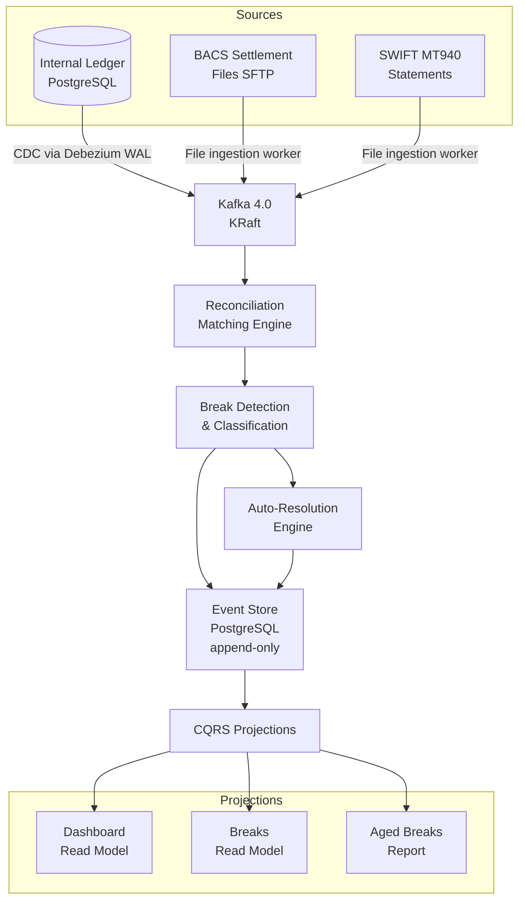
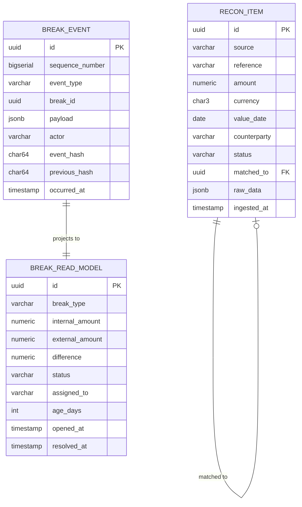

# Financial Reconciliation Engine

## Project Overview

Build a financial reconciliation system that automatically detects discrepancies between internal ledger records and external settlement reports (BACS, CHAPS, SWIFT MT940), investigates breaks, and provides real-time reconciliation dashboards.

Reconciliation is a critical but often under-engineered component of financial systems. Undetected breaks represent either missing money (operational loss) or misreported positions (regulatory risk).

**What you will build:**

- Multi-source reconciliation pipeline using CDC (Debezium) and file ingestion
- Break detection engine with configurable tolerance rules
- Event-sourced break investigation workflow
- CQRS read projections for real-time reconciliation dashboards
- Automated resolution for common break patterns
- Spring Batch 5.x parallel reconciliation steps via virtual thread `TaskExecutor`

---

## System Requirements

### Functional Requirements

| Requirement | Specification |
|---|---|
| Sources | Internal ledger (via CDC), BACS settlement files, SWIFT MT940 statements |
| Match logic | Match by transaction reference, amount (within tolerance), value date |
| Break detection | Report unmatched internal records and unmatched external records |
| Tolerance rules | Configurable per counterparty, currency, amount tier |
| Investigation | Each break tracked through lifecycle: OPEN → IN_INVESTIGATION → RESOLVED |
| Dashboard | Real-time summary: matched %, break count, total break amount |

### Non-Functional Requirements

| Requirement | Target |
|---|---|
| Settlement file processing | Within 30 minutes of file arrival |
| Break detection latency | < 60 seconds from CDC event |
| Dashboard refresh | Near real-time (< 5 seconds) via CQRS projections |
| Historical query | Any day's reconciliation queryable within 10 seconds |
| Kafka version | 4.0 KRaft (no ZooKeeper) |
| Concurrency model | Java 21 virtual threads; no reactive patterns |

---

## Architecture



---

## Domain Model

### Reconciliation Items and Breaks



---

## Database Schema

```sql
-- Reconciliation items from all sources
CREATE TABLE recon_items (
    id              UUID DEFAULT gen_random_uuid() PRIMARY KEY,
    source          VARCHAR(50)  NOT NULL,   -- INTERNAL_LEDGER, BACS, SWIFT_MT940
    reference       VARCHAR(255) NOT NULL,
    amount          NUMERIC(20,4) NOT NULL,
    currency        CHAR(3) NOT NULL,
    value_date      DATE NOT NULL,
    counterparty    VARCHAR(255),
    sort_code       CHAR(6),
    account_number  VARCHAR(20),
    status          VARCHAR(30)  NOT NULL DEFAULT 'UNMATCHED',
    matched_to      UUID REFERENCES recon_items(id),
    raw_data        JSONB NOT NULL,
    ingested_at     TIMESTAMPTZ NOT NULL DEFAULT now(),

    CONSTRAINT source_check CHECK (
        source IN ('INTERNAL_LEDGER','BACS','SWIFT_MT940','CHAPS'))
);

CREATE INDEX idx_recon_items_reference   ON recon_items (reference);
CREATE INDEX idx_recon_items_value_date  ON recon_items (value_date);
CREATE INDEX idx_recon_items_status      ON recon_items (status)
    WHERE status = 'UNMATCHED';

-- Break event store (append-only — event sourcing)
CREATE TABLE break_events (
    id              UUID DEFAULT gen_random_uuid() PRIMARY KEY,
    sequence_number BIGSERIAL NOT NULL,
    event_type      VARCHAR(50) NOT NULL,
    break_id        UUID NOT NULL,
    payload         JSONB NOT NULL,
    actor           VARCHAR(100) NOT NULL DEFAULT 'SYSTEM',
    event_hash      CHAR(64) NOT NULL,
    previous_hash   CHAR(64) NOT NULL DEFAULT 'GENESIS',
    occurred_at     TIMESTAMPTZ NOT NULL DEFAULT now()
);

-- Immutability enforced at DB level (application role cannot UPDATE or DELETE)
CREATE RULE no_update_break_events
    AS ON UPDATE TO break_events DO INSTEAD NOTHING;
CREATE RULE no_delete_break_events
    AS ON DELETE TO break_events DO INSTEAD NOTHING;

-- CQRS read model — derived from break events
CREATE TABLE break_read_models (
    id              UUID PRIMARY KEY,
    break_type      VARCHAR(50)  NOT NULL,
    internal_ref    VARCHAR(255),
    external_ref    VARCHAR(255),
    internal_amount NUMERIC(20,4),
    external_amount NUMERIC(20,4),
    difference      NUMERIC(20,4),
    currency        CHAR(3),
    value_date      DATE,
    status          VARCHAR(30)  NOT NULL DEFAULT 'OPEN',
    assigned_to     VARCHAR(100),
    resolution_code VARCHAR(50),
    opened_at       TIMESTAMPTZ NOT NULL,
    resolved_at     TIMESTAMPTZ,
    last_updated_at TIMESTAMPTZ NOT NULL
);

-- Dashboard read model — updated by CQRS projection
CREATE TABLE recon_dashboard (
    recon_date      DATE PRIMARY KEY,
    total_items     INTEGER      NOT NULL DEFAULT 0,
    matched_items   INTEGER      NOT NULL DEFAULT 0,
    open_breaks     INTEGER      NOT NULL DEFAULT 0,
    total_break_gbp NUMERIC(20,4) NOT NULL DEFAULT 0,
    match_rate_pct  NUMERIC(5,2),
    last_updated_at TIMESTAMPTZ  NOT NULL DEFAULT now()
);
```

---

## Implementation

### Domain Records (Java 21)

```java
// Reconciliation item — immutable record; no setters
public record ReconItem(
    UUID id,
    ReconSource source,
    String reference,
    BigDecimal amount,
    String currency,
    LocalDate valueDate,
    String counterparty,
    String sortCode,
    String accountNumber,
    ReconStatus status,
    UUID matchedTo,
    String rawData,
    Instant ingestedAt
) {
    // Compact constructor — defensive copy not needed; all fields are already value types
    public ReconItem {
        Objects.requireNonNull(source,    "source");
        Objects.requireNonNull(reference, "reference");
        Objects.requireNonNull(amount,    "amount");
        Objects.requireNonNull(currency,  "currency");
        Objects.requireNonNull(valueDate, "valueDate");
    }
}

// Match result — algebraic type for match / no-match
public sealed interface MatchResult
    permits MatchResult.Matched, MatchResult.Unmatched {

    record Matched(ReconItem internal, ReconItem external) implements MatchResult {}
    record Unmatched(ReconItem item)                       implements MatchResult {}
}

// Break event payload variants
public record BreakOpenedPayload(
    String breakType,
    String internalRef,
    String externalRef,
    BigDecimal internalAmount,
    BigDecimal externalAmount,
    String currency,
    LocalDate valueDate
) {}

public record InvestigatorAssignedPayload(String assignee) {}

public record BreakResolvedPayload(String resolutionCode, String notes) {}
```

### CDC with Debezium — Internal Ledger to Kafka

```java
// Debezium connector configuration (via Spring Boot auto-config)
@Bean
public DebeziumEngine<ChangeEvent<String, String>> debeziumEngine(
        ReconciliationEventHandler handler) {

    var props = io.debezium.config.Configuration.create()
        .with("connector.class",          "io.debezium.connector.postgresql.PostgresConnector")
        .with("database.hostname",         postgresHost)
        .with("database.port",             "5432")
        .with("database.user",             "debezium_replication_user")
        .with("database.dbname",           "ledger")
        .with("database.server.name",      "ledger-cdc")
        .with("plugin.name",               "pgoutput")
        .with("slot.name",                 "recon_cdc_slot")
        .with("publication.name",          "recon_cdc_publication")
        .with("table.include.list",        "public.journal_lines")
        .with("transforms",                "unwrap")
        .with("transforms.unwrap.type",
              "io.debezium.transforms.ExtractNewRecordState")
        .build();

    return DebeziumEngine.create(Json.class)
        .using(props.asProperties())
        .notifying(handler::handleChange)
        .build();
}
```

### Settlement File Ingestion — BACS (Virtual Threads)

```java
@Component
public class BacsFileIngestionWorker {

    private final KafkaTemplate<String, ReconItem> kafkaTemplate;
    private final BacsFileParser parser;

    // Called from a virtual-thread executor; blocking I/O is cheap
    public void ingest(Path bacsFile) {
        try (var stream = parser.parse(bacsFile)) {
            stream.forEach(record -> {
                var item = new ReconItem(
                    null,
                    ReconSource.BACS,
                    record.transactionReference(),
                    record.amount(),
                    "GBP",
                    record.valueDate(),
                    null, record.sortCode(), record.accountNumber(),
                    ReconStatus.UNMATCHED,
                    null,
                    record.toJson(),
                    Instant.now()
                );
                kafkaTemplate.send("recon.items.external", item.reference(), item);
            });
        } catch (Exception e) {
            dlqService.send("recon.items.dlq", bacsFile.toString(), e);
            alertingService.notify(Alert.BACS_INGESTION_FAILURE, bacsFile.toString());
        }
    }
}

// SWIFT MT940 Parser — standard cash management statement format
@Component
public class SwiftMt940Parser {

    // MT940 :61: field: value-date booking-date C/D amount reference
    private static final Pattern FIELD_61 = Pattern.compile(
        ":61:(\\d{6})(\\d{4})?([CD])(\\d+,\\d{2})\\w+\\s+(\\S+)", Pattern.MULTILINE);

    public List<Mt940Transaction> parse(String mt940Content) {
        var transactions = new ArrayList<Mt940Transaction>();
        var matcher = FIELD_61.matcher(mt940Content);
        while (matcher.find()) {
            transactions.add(new Mt940Transaction(
                parseDate(matcher.group(1)),
                matcher.group(3).equals("C") ? Side.CREDIT : Side.DEBIT,
                parseAmount(matcher.group(4)),
                matcher.group(5)
            ));
        }
        return transactions;
    }

    private LocalDate parseDate(String yyMMdd) {
        return LocalDate.parse(yyMMdd, DateTimeFormatter.ofPattern("yyMMdd"));
    }

    private BigDecimal parseAmount(String raw) {
        return new BigDecimal(raw.replace(',', '.'));
    }
}
```

### Matching Engine

```java
@Service
public class ReconMatchingEngine {

    private final ToleranceRuleRepository toleranceRules;

    public MatchResult match(ReconItem internal, List<ReconItem> candidates) {
        for (ReconItem candidate : candidates) {
            if (isMatch(internal, candidate)) {
                return new MatchResult.Matched(internal, candidate);
            }
        }
        return new MatchResult.Unmatched(internal);
    }

    private boolean isMatch(ReconItem internal, ReconItem external) {
        // Primary match key: reference must match exactly
        if (!internal.reference().equals(external.reference())) {
            return false;
        }
        // Value date tolerance: within 1 business day (BACS T+1)
        if (Math.abs(ChronoUnit.DAYS.between(
                internal.valueDate(), external.valueDate())) > 1) {
            return false;
        }
        // Amount within configured tolerance
        var tolerance = toleranceRules.getFor(internal.currency(), internal.amount());
        return internal.amount()
            .subtract(external.amount())
            .abs()
            .compareTo(tolerance.maxAbsoluteDifference()) <= 0;
    }
}
```

### Spring Batch 5.x — Parallel Reconciliation Steps

```java
@Configuration
@EnableBatchProcessing
public class ReconciliationBatchConfig {

    // Virtual thread TaskExecutor — Java 21; no reactive needed
    @Bean
    public TaskExecutor reconTaskExecutor() {
        return new TaskExecutorAdapter(Executors.newVirtualThreadPerTaskExecutor());
    }

    @Bean
    public Step ingestBacsStep(JobRepository jobRepository,
                                PlatformTransactionManager txManager,
                                BacsFileItemReader reader,
                                ReconItemWriter writer) {
        return new StepBuilder("ingest-bacs", jobRepository)
            .<BacsRecord, ReconItem>chunk(500, txManager)
            .reader(reader)
            .processor(new BacsToReconItemProcessor())
            .writer(writer)
            .taskExecutor(reconTaskExecutor())
            .build();
    }

    @Bean
    public Step matchingStep(JobRepository jobRepository,
                              PlatformTransactionManager txManager,
                              UnmatchedItemReader reader,
                              MatchingStepProcessor processor,
                              MatchResultWriter writer) {
        return new StepBuilder("match-items", jobRepository)
            .<ReconItem, MatchResult>chunk(200, txManager)
            .reader(reader)
            .processor(processor)
            .writer(writer)
            .taskExecutor(reconTaskExecutor())
            .build();
    }

    @Bean
    public Job reconciliationJob(JobRepository jobRepository,
                                  Step ingestBacsStep,
                                  Step matchingStep,
                                  Step breakDetectionStep) {
        return new JobBuilder("reconciliation-job", jobRepository)
            .start(ingestBacsStep)
            .next(matchingStep)
            .next(breakDetectionStep)
            .build();
    }
}
```

### Event-Sourced Break Investigation

```java
@Service
public class BreakEventStore {

    private final BreakEventRepository breakEventRepository;
    private final BreakProjector breakProjector;
    private final ObjectMapper objectMapper;

    @Transactional
    public void append(UUID breakId, BreakEventType type,
                       Object payload, String actor) {
        String prevHash = breakEventRepository.findLatestHash(breakId)
            .orElse("GENESIS");

        String eventHash = DigestUtils.sha256Hex(
            type.name() + payload.toString() + actor + prevHash);

        breakEventRepository.insert(new BreakEvent(
            null,
            type,
            breakId,
            objectMapper.valueToTree(payload),
            actor,
            prevHash,
            eventHash,
            Instant.now()
        ));

        // Update CQRS read model synchronously (virtual thread — blocking is fine)
        breakProjector.project(breakId, type, payload);
    }
}

@Component
public class BreakProjector {

    private final BreakReadModelRepository readModelRepo;
    private final DashboardProjector dashboardProjector;

    public void project(UUID breakId, BreakEventType type, Object payload) {
        switch (type) {
            case BREAK_OPENED -> {
                var p = (BreakOpenedPayload) payload;
                readModelRepo.create(new BreakReadModel(
                    breakId, p.breakType(), p.internalRef(), p.externalRef(),
                    p.internalAmount(), p.externalAmount(),
                    p.internalAmount().subtract(p.externalAmount()),
                    p.currency(), p.valueDate(),
                    BreakStatus.OPEN, null, null,
                    Instant.now(), null, Instant.now()
                ));
                dashboardProjector.incrementBreakCount(p.valueDate());
            }
            case INVESTIGATOR_ASSIGNED -> {
                var p = (InvestigatorAssignedPayload) payload;
                readModelRepo.updateAssignee(breakId, p.assignee());
            }
            case BREAK_RESOLVED -> {
                var p = (BreakResolvedPayload) payload;
                readModelRepo.resolve(breakId, p.resolutionCode(), Instant.now());
                dashboardProjector.decrementBreakCount(
                    readModelRepo.getValueDate(breakId));
            }
        }
    }
}
```

### Automated Break Resolution

```java
@Component
public class AutoResolutionEngine {

    private final ReconItemRepository reconItemRepository;
    private final ReconMatchingEngine matchingEngine;
    private final BreakEventStore breakEventStore;

    // Rule 1: Timing break — internal record posted 1 day before external
    public Optional<String> resolveTimingBreak(BreakReadModel b) {
        if (!b.breakType().equals("MISSING_EXTERNAL")) return Optional.empty();

        var nextDayItems = reconItemRepository.findByValueDateAndSource(
            b.valueDate().plusDays(1), ReconSource.BACS);

        var internalItem = reconItemRepository.findByReference(b.internalRef());
        return internalItem.flatMap(item ->
            switch (matchingEngine.match(item, nextDayItems)) {
                case MatchResult.Matched m -> {
                    breakEventStore.append(b.id(), BreakEventType.BREAK_RESOLVED,
                        new BreakResolvedPayload("TIMING_BREAK_T_PLUS_1", null),
                        "AUTO_RESOLUTION");
                    yield Optional.of("TIMING_BREAK_T_PLUS_1");
                }
                case MatchResult.Unmatched u -> Optional.empty();
            }
        );
    }

    // Rule 2: Penny difference — amount differs by < £0.01 (rounding in legacy system)
    public Optional<String> resolvePennyDifference(BreakReadModel b) {
        if (!b.breakType().equals("AMOUNT_MISMATCH")) return Optional.empty();

        var diff = b.difference().abs();
        if (diff.compareTo(new BigDecimal("0.01")) <= 0) {
            breakEventStore.append(b.id(), BreakEventType.BREAK_RESOLVED,
                new BreakResolvedPayload("PENNY_DIFFERENCE_ROUNDING", null),
                "AUTO_RESOLUTION");
            return Optional.of("PENNY_DIFFERENCE_ROUNDING");
        }
        return Optional.empty();
    }
}
```

### Integration Test (Testcontainers + KRaft + @MockitoBean)

```java
@SpringBootTest
@Testcontainers
class ReconciliationIntegrationTest {

    @Container
    static final KafkaContainer kafka = new KafkaContainer(
        DockerImageName.parse("apache/kafka:4.0.0"))
        .withKraft();  // KRaft — no ZooKeeper

    @Container
    static final PostgreSQLContainer<?> postgres =
        new PostgreSQLContainer<>("postgres:16");

    @MockitoBean
    AlertingService alertingService;  // @MockitoBean — Spring Boot 4 / Mockito 5

    @Autowired
    BacsFileIngestionWorker ingestionWorker;

    @Autowired
    BreakReadModelRepository breakReadModelRepository;

    @Autowired
    ReconDashboardRepository dashboardRepository;

    @Test
    void bacsFileWithUnmatchedItem_shouldCreateOpenBreak() throws Exception {
        // Arrange: ingest a BACS file with a reference that has no internal match
        var bacsFile = Path.of(
            getClass().getResource("/test-data/bacs-with-unmatched.txt").toURI());

        // Act
        ingestionWorker.ingest(bacsFile);

        // Assert: break created within 30 seconds
        await().atMost(Duration.ofSeconds(30))
            .untilAsserted(() -> {
                var breaks = breakReadModelRepository.findByStatus(BreakStatus.OPEN);
                assertThat(breaks).isNotEmpty();
                assertThat(breaks.get(0).breakType()).isEqualTo("MISSING_INTERNAL");
            });
    }

    @Test
    void matchedItems_shouldUpdateDashboardMatchRate() throws Exception {
        // Insert matching internal and external items directly
        reconItemRepository.save(internalItem("REF-001", new BigDecimal("100.00")));
        reconItemRepository.save(externalItem("REF-001", new BigDecimal("100.00")));

        // Trigger matching step
        jobLauncher.run(reconciliationJob, new JobParameters());

        await().atMost(Duration.ofSeconds(15))
            .untilAsserted(() -> {
                var dashboard = dashboardRepository.findByReconDate(LocalDate.now());
                assertThat(dashboard).isPresent();
                assertThat(dashboard.get().matchRatePct())
                    .isGreaterThanOrEqualTo(new BigDecimal("50.00"));
            });
    }

    // EmbeddedKafka variant for lightweight unit-level Kafka tests
    @SpringBootTest
    @EmbeddedKafka(
        partitions = 3,
        kraft = true,  // KRaft mode — no ZooKeeper
        topics = {"recon.items.internal", "recon.items.external"}
    )
    @Nested
    class KafkaRoutingTest {

        @MockitoBean
        ReconMatchingEngine matchingEngine;

        @Test
        void cdcEvent_routedToInternalTopic() {
            // Publish a simulated CDC change event and assert routing
        }
    }
}
```

### RestClient for External Settlement APIs

```java
// If the reconciliation engine calls an external system to fetch statements:
@Service
public class ExternalStatementClient {

    private final RestClient restClient;

    public ExternalStatementClient(RestClient.Builder builder,
                                    @Value("${settlement.api.base-url}") String baseUrl) {
        this.restClient = builder
            .baseUrl(baseUrl)
            .defaultHeader(HttpHeaders.ACCEPT, MediaType.APPLICATION_JSON_VALUE)
            .build();
    }

    public List<ExternalTransaction> fetchStatement(LocalDate valueDate) {
        return restClient.get()
            .uri("/statements?date={date}", valueDate)
            .retrieve()
            .body(new ParameterizedTypeReference<>() {});
    }
}
```

---

## Architecture Decision Records

### ADR-001: Event Sourcing for Break Investigation (Not Mutable Status)

**Status:** Accepted

**Context:** Regulatory auditors need a complete history of every action taken on a break: who assigned it, what investigation steps were taken, why it was resolved. A mutable `status` column loses this history.

**Decision:** Break lifecycle stored as an immutable event log. CQRS read model derived from events for query performance. The event store is the system of record; the read model can be rebuilt by replaying events. Immutability enforced at the PostgreSQL layer with `CREATE RULE` so even a DBA cannot modify historical events.

### ADR-002: Debezium CDC for Internal Ledger (Not Polling)

**Status:** Accepted

**Context:** Polling the ledger database for new transactions adds load and introduces latency. At 50k TPS, polling would require a high-frequency query that competes with write workload.

**Decision:** Debezium reads the PostgreSQL WAL via logical replication. Zero additional read load on the primary. Sub-second latency from ledger write to reconciliation stream. Requires a dedicated replication slot and careful monitoring of WAL retention.

### ADR-003: Virtual Threads over Reactive (Spring Boot 4)

**Status:** Accepted

**Context:** The original design used Project Reactor for non-blocking I/O in the ingestion pipeline. Spring Boot 4 with Java 21 virtual threads makes reactive patterns unnecessary: blocking JDBC and blocking Kafka calls are cheap under a virtual thread executor.

**Decision:** Replaced all `Flux`/`Mono` chains with straightforward imperative code on a `VirtualThreadPerTaskExecutor`. Code is easier to read, debug with standard stack traces, and test without reactive test utilities. Performance is equivalent or better for I/O-bound workloads.

---

## Principal Engineer Review Criteria

- [ ] **End-to-end flow works** — BACS file arrives → items ingested → matched/unmatched in < 30 minutes
- [ ] **CDC events produce recon items** — journal line inserted in ledger → recon item in Kafka within 1 second
- [ ] **Break detection is correct** — amount tolerance, timing tolerance, and reference matching all tested
- [ ] **Event-sourced breaks are replayable** — drop and rebuild `break_read_models` by replaying `break_events`; row count must match
- [ ] **Auto-resolution handles timing breaks** — T+1 BACS items matched to previous day's internal records
- [ ] **Dashboard reflects breaks in near real-time** — CQRS projection updates within 5 seconds of break event
- [ ] **MT940 parser handles malformed records** — test with real SWIFT statement samples including edge cases
- [ ] **Spring Batch 5.x parallel steps** — `ingestBacsStep` and `matchingStep` use virtual thread `TaskExecutor`; no `@Deprecated` Batch APIs
- [ ] **KRaft-only** — no ZooKeeper reference in any config file or Testcontainers setup
- [ ] **@MockitoBean used** — no `@MockBean` annotations anywhere in the test suite
- [ ] **No reactive imports** — `reactor.core` not on the classpath; virtual threads used throughout
- [ ] **Java 21 records for DTOs** — `ReconItem`, `MatchResult`, `BreakOpenedPayload`, and all other data carriers are records

---

## Interview Debrief

### The 60-Second Pitch

> "I built a financial reconciliation engine that detects discrepancies between internal ledger records and external settlement files within 60 seconds using Debezium CDC and a Spring Batch matching pipeline — the hardest problem was detecting breaks without locking the entire recon_items table, which I solved by using a partial index on unmatched rows combined with optimistic locking so the matching engine could process thousands of items in parallel without contention."

### Questions Your Interviewer Will Ask

**Q1: "How do you detect discrepancies without locking the entire table?"**

Model answer: The matching engine never issues a full-table lock. Instead, I query only unmatched rows using a partial index (`WHERE status = 'UNMATCHED'`), which keeps the index small and the scan fast regardless of how many matched rows accumulate over time. The matching step uses optimistic locking: when two parallel Batch threads attempt to claim the same unmatched item, only one succeeds because the `UPDATE recon_items SET status = 'MATCHED', matched_to = ? WHERE id = ? AND status = 'UNMATCHED'` statement updates exactly one row (the second thread sees zero rows updated and skips). This means I can run the matching step with 20 parallel virtual-thread workers without any explicit table-level or row-level locking, and the correctness guarantee comes from PostgreSQL's MVCC semantics rather than application-level coordination. For the break detection step, items that remain `UNMATCHED` after the matching window closes are promoted to breaks in a single batch INSERT, again using the partial index to avoid scanning matched history.

**Q2: "What does 'reconciliation' mean at the database level versus event level?"**

Model answer: At the database level, reconciliation means joining two sets of rows — internal ledger entries and external settlement records — on a match key (reference, amount within tolerance, value date) and finding the symmetric difference: rows in the internal set with no matching external row (missing externals), and rows in the external set with no matching internal row (missing internals). The database operation is essentially a full outer join where unmatched rows on either side become breaks. At the event level, reconciliation means correlating streams of events over time: a journal line event from Debezium CDC and a BACS settlement file line may arrive hours apart, so the reconciliation engine must hold state (the unmatched item in `recon_items`) across time windows rather than joining two in-memory datasets. This temporal dimension is what makes event-level reconciliation harder than a nightly SQL join — you need a durable staging store, a matching window policy, and a decision about when to declare something a break versus simply late.

**Q3: "How do you handle timezone edge cases at midnight?"**

Model answer: All timestamps in the system are stored as `TIMESTAMPTZ` (timestamp with time zone) in PostgreSQL, normalised to UTC at ingest time. The `value_date` column is `DATE` (a calendar date with no time component), which eliminates the class of bugs where a transaction occurring at 23:59 London time is recorded as the next UTC calendar day. When parsing SWIFT MT940 files, the `:61:` field contains only a `yyMMdd` date in the local bank's calendar, so I interpret it as a `LocalDate` and do not convert to UTC — the date is the settlement date as the counterparty reported it, and I store it verbatim. The matching tolerance allows a 1-business-day difference precisely to handle the case where a UK bank posts a midnight transaction on calendar day D but the external BACS settlement reflects it on day D+1. For the reconciliation job itself, I schedule it at 02:00 UTC, which is after midnight in all European timezone variants, ensuring that all same-day settlements have been reported before the job runs. Any transaction that straddles a timezone midnight is caught by the T+1 tolerance rule and auto-resolved by the `AutoResolutionEngine.resolveTimingBreak` method.

**Q4: "What happens when the external system's API returns inconsistent data between calls?"**

Model answer: I treat external settlement data as immutable once ingested: the first time a file or API response is processed, its records are written to `recon_items` with a content hash derived from the raw payload. If the same reference is received again with a different amount (a genuinely inconsistent response), the ingestion worker detects the hash mismatch and routes the item to a dead-letter topic (`recon.items.dlq`) with both the original and the new payload attached. It does not overwrite the existing record. An alert fires for a human to investigate. This design means the reconciliation engine always works from a consistent, immutable snapshot of external data: it never silently updates a previously ingested record, so the matching history is auditable. For idempotent re-ingestion (same data, same hash), a `ON CONFLICT (source, reference) DO NOTHING` upsert ensures the duplicate is silently ignored. The key insight is that external systems being inconsistent is a data quality problem that must be surfaced to operations, not silently resolved by the reconciliation engine — silent resolution would hide real bugs in the external system.

**Q5: "How would you scale to reconcile 100 million transactions nightly?"**

Model answer: At 100 M transactions, the bottleneck moves from the matching logic to I/O throughput and partition-level parallelism. I would partition `recon_items` by `value_date` using PostgreSQL declarative partitioning, so each nightly job operates on a single partition rather than scanning the full table — the partial index on `status = 'UNMATCHED'` within a partition stays small. The Spring Batch job would be split into sharded steps: each step processes a range of references (e.g. by hash bucket) independently, allowing 20–50 parallel virtual-thread workers to run matching without contention. For the external file ingestion, I would move from polling SFTP to S3 event notifications triggering a Lambda-or-equivalent that publishes to Kafka, decoupling ingestion throughput from the batch job schedule. If single-node PostgreSQL cannot sustain the write throughput for 100 M rows, I would evaluate Citus (sharded PostgreSQL) for the `recon_items` table, sharding by `customer_id` or `reference` hash so matching queries are co-located on the same shard. Finally, the CQRS read models (dashboard, break summaries) would be materialised views refreshed incrementally rather than computed at query time, keeping dashboard reads O(1) regardless of transaction volume.

### What to Have Ready on the Whiteboard

- **Architecture diagram**: Internal ledger → Debezium CDC → Kafka → Reconciliation matching engine (Spring Batch) → Break detection → Event store (append-only PostgreSQL) → CQRS projector → Dashboard read model; show the BACS and MT940 file ingestion workers as separate paths into the same Kafka topic
- **Key schema**: `recon_items(id, source, reference, amount, value_date, status, matched_to)` with the partial index `WHERE status = 'UNMATCHED'`; `break_events(break_id, event_type, payload JSONB, event_hash, previous_hash)` as the append-only event store
- **Trade-off statement**: "Event sourcing the break lifecycle gives us a full audit trail that regulators can inspect and that we can replay to rebuild any read model — but it means every status change requires an INSERT rather than an UPDATE, so the event table grows without bound; we mitigate this by archiving events older than 90 days to S3 Parquet while keeping the read model hot in PostgreSQL."
