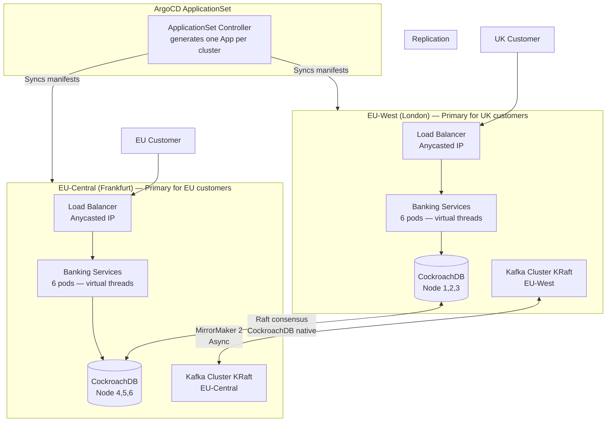
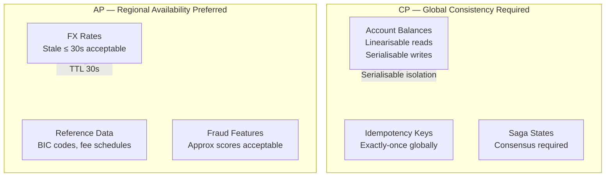
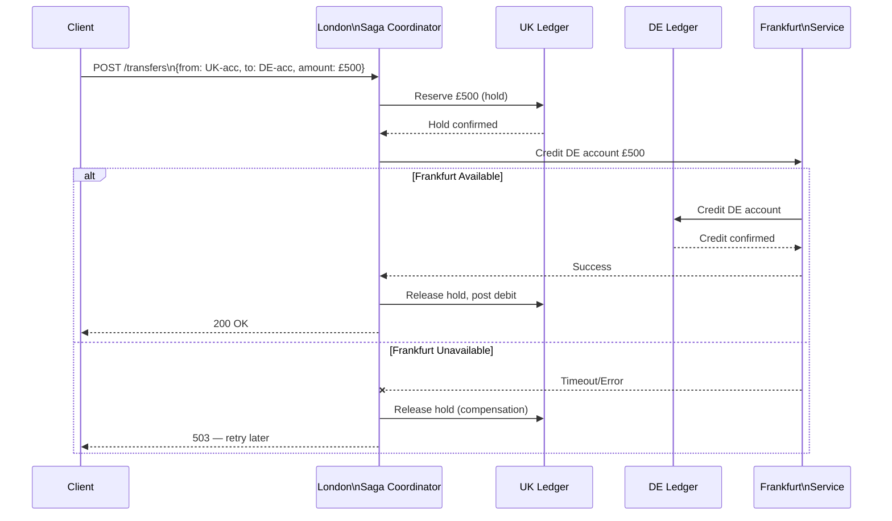

# Multi-Region Banking Platform

## Project Overview

Architect a **multi-region active-active banking platform** that serves customers from the nearest region with low latency, maintains strong consistency for critical financial operations across regions, and achieves sub-50ms RTO for region failover.

This is the most architecturally complex capstone. It requires deep understanding of the CAP theorem trade-offs, distributed consensus, and the patterns that make global-scale financial systems work.

**What you will build:**
- Active-active topology across EU-West (London) and EU-Central (Frankfurt)
- Region-local reads with globally consistent writes for account balances
- Cross-region Saga for international money transfers
- Conflict detection and resolution for concurrent cross-region operations
- Automatic region failover with sub-50ms RTO
- ArgoCD ApplicationSet for GitOps-driven multi-cluster deployment

---

## System Requirements

### Functional Requirements

| Requirement | Specification |
|---|---|
| Region topology | EU-West (London primary), EU-Central (Frankfurt) |
| Account operations | Balance read, debit, credit — served from nearest region |
| Consistency tier | Account balances: global CP; FX rates: regional AP |
| Cross-region transfer | London→Frankfurt: multi-step Saga with compensation |
| Failover | Automatic, sub-50ms RTO, zero manual intervention |
| Data residency | EU customer data must not leave EU regions |

### Non-Functional Requirements

| SLO | Target |
|---|---|
| Read P99 latency | < 10ms (region-local) |
| Write P99 latency | < 50ms (global consensus) |
| RTO (single region failure) | < 50ms |
| RPO (single region failure) | 0 (synchronous replication) |
| Throughput | 20,000 TPS per region |
| Availability | 99.999% (5-nines; 2.63 min/month error budget) |

---

## Architecture



---

## CAP Design Decisions by Data Type



**The critical insight:** Not all data has the same consistency requirement. Using global consensus (CockroachDB Raft) for FX rate lookups would add 50ms of cross-region latency to every payment for no business benefit. Use CP where money is at risk; use AP where staleness is acceptable.

---

## Implementation — CockroachDB Multi-Region

### Database Configuration

```sql
-- CockroachDB multi-region setup
-- Accounts table: data homed to region based on customer's primary region
ALTER TABLE accounts ADD COLUMN region crdb_internal_region NOT NULL DEFAULT 'eu-west-1';

ALTER TABLE accounts SET (
    locality = REGIONAL BY ROW
);
-- This pins each account row to its home region for fast local reads
-- Writes to a row require cross-region consensus when primary region is down

-- Transactions table: global — not region-pinned
-- (transfers cross regions — no single home region)
ALTER TABLE payment_transactions SET (
    locality = GLOBAL
);
-- GLOBAL tables: optimistic consistency, slightly slower reads, globally consistent
```

### Region-Aware Spring Boot 4 Configuration

Constructor injection replaces field injection throughout. Redis properties use the Spring Boot 4 `spring.data.redis.*` namespace.

```java
@Configuration
public class MultiRegionDataSourceConfig {

    private final String currentRegion;
    private final String cockroachdbEndpoint;

    // Constructor injection — no @Autowired field injection
    public MultiRegionDataSourceConfig(
            @Value("${app.region}") String currentRegion,
            @Value("${app.cockroachdb.endpoint}") String cockroachdbEndpoint) {
        this.currentRegion = currentRegion;
        this.cockroachdbEndpoint = cockroachdbEndpoint;
    }

    @Bean
    @Primary
    public DataSource primaryDataSource() {
        // CockroachDB connection — read preference routes to local replicas
        var ds = new HikariDataSource();
        ds.setJdbcUrl("jdbc:postgresql://" + cockroachdbEndpoint +
                       "/banking?sslmode=verify-full" +
                       "&options=-c%20default_transaction_use_follower_reads%3Doff");
        // For strong reads: follower_reads=off (hits the leaseholder, potentially remote)
        ds.setMaximumPoolSize(50);
        return ds;
    }

    @Bean
    public DataSource staleReadDataSource() {
        // For FX rates, reference data — stale reads from local replica
        var ds = new HikariDataSource();
        ds.setJdbcUrl("jdbc:postgresql://" + cockroachdbEndpoint +
                       "/banking?sslmode=verify-full" +
                       "&options=-c%20default_transaction_use_follower_reads%3Don");
        // Follower reads: served by local replica, 4.8s behind leaseholder
        ds.setMaximumPoolSize(20);
        return ds;
    }
}
```

```yaml
# application.yml — Spring Boot 4 Redis namespace
spring:
  data:
    redis:
      host: redis.eu-west.internal
      port: 6379
      timeout: 200ms
      lettuce:
        pool:
          max-active: 16
          max-idle: 8
```

### Java 21 Virtual Threads

Enable virtual threads for the entire web layer so blocking JDBC calls under high concurrency do not exhaust a fixed platform-thread pool.

```java
// Spring Boot 4: enable virtual threads via property
// spring.threads.virtual.enabled=true in application.yml
// — no code change needed for @RestController / @Service beans

// For explicit executor use in async Saga steps:
@Bean
public Executor sagaExecutor() {
    return Executors.newVirtualThreadPerTaskExecutor();
}
```

```yaml
# application.yml
spring:
  threads:
    virtual:
      enabled: true
```

### RestClient for Cross-Region Calls (Spring Boot 4)

`RestClient` replaces the deprecated `RestTemplate` and the more verbose `WebClient` for synchronous inter-region HTTP calls.

```java
@Configuration
public class RestClientConfig {

    @Bean
    public RestClient frankfurtRestClient(
            @Value("${app.frankfurt.base-url}") String baseUrl) {
        return RestClient.builder()
                .baseUrl(baseUrl)
                .defaultHeader(HttpHeaders.CONTENT_TYPE,
                               MediaType.APPLICATION_JSON_VALUE)
                .build();
    }
}

@Component
public class RemoteFrankfurtClient {

    private final RestClient frankfurtRestClient;

    public RemoteFrankfurtClient(RestClient frankfurtRestClient) {
        this.frankfurtRestClient = frankfurtRestClient;
    }

    public CreditResult creditAccount(String accountId, BigDecimal amount,
                                      String currency, String sagaId) {
        return frankfurtRestClient.post()
                .uri("/internal/accounts/{id}/credit", accountId)
                .header("X-Saga-Id", sagaId)
                .body(new CreditRequest(amount, currency))
                .retrieve()
                .onStatus(HttpStatusCode::is5xxServerError, (req, res) -> {
                    throw new RemoteCallException(
                        "Frankfurt credit failed: " + res.getStatusCode());
                })
                .body(CreditResult.class);
    }
}
```

---

## Cross-Region Saga — International Money Transfer

A transfer from a UK account (homed in London) to a German account (homed in Frankfurt) requires a distributed Saga with compensation.



```java
// Java 21 record for immutable transfer request
public record TransferRequest(
    String fromAccountId,
    String toAccountId,
    BigDecimal amount,
    String currency
) {}

@Service
public class CrossRegionTransferSaga {

    private final SagaEventStore eventStore;
    private final UkLedgerService ukLedger;
    private final RemoteFrankfurtClient frankfurtClient;

    // Constructor injection
    public CrossRegionTransferSaga(SagaEventStore eventStore,
                                   UkLedgerService ukLedger,
                                   RemoteFrankfurtClient frankfurtClient) {
        this.eventStore = eventStore;
        this.ukLedger = ukLedger;
        this.frankfurtClient = frankfurtClient;
    }

    @Transactional
    public SagaState execute(TransferRequest request) {
        var sagaId = UUID.randomUUID();
        eventStore.record(sagaId, SagaEvent.STARTED, request);

        try {
            // Step 1: Reserve funds in source account (London-local)
            var holdRef = ukLedger.placeHold(
                request.fromAccountId(), request.amount());
            eventStore.record(sagaId, SagaEvent.HOLD_PLACED, holdRef);

            // Step 2: Credit destination account (Frankfurt — remote call)
            try {
                var creditResult = frankfurtClient.creditAccount(
                    request.toAccountId(), request.amount(),
                    request.currency(), sagaId.toString());
                eventStore.record(sagaId, SagaEvent.DESTINATION_CREDITED, creditResult);

            } catch (RemoteCallException e) {
                // Compensation: release hold
                ukLedger.releaseHold(holdRef);
                eventStore.record(sagaId, SagaEvent.COMPENSATED_HOLD_RELEASED, holdRef);
                throw new TransferFailedException("Destination region unavailable", e);
            }

            // Step 3: Post the debit (convert hold to permanent debit)
            ukLedger.postDebitFromHold(holdRef);
            eventStore.record(sagaId, SagaEvent.SOURCE_DEBITED, holdRef);
            eventStore.record(sagaId, SagaEvent.COMPLETED, request);

            return SagaState.COMPLETED;

        } catch (Exception e) {
            eventStore.record(sagaId, SagaEvent.FAILED, e.getMessage());
            return SagaState.FAILED;
        }
    }
}
```

---

## Region Failover

### Kubernetes Multi-Cluster Routing (Istio)

```yaml
# Istio DestinationRule: route payments to nearest healthy region
apiVersion: networking.istio.io/v1beta1
kind: DestinationRule
metadata:
  name: payment-api-multi-region
spec:
  host: payment-api.payments.svc.cluster.local
  trafficPolicy:
    outlierDetection:
      consecutiveGatewayErrors: 3
      interval: 10s
      baseEjectionTime: 30s
      maxEjectionPercent: 100  # Eject the entire region on failure
    connectionPool:
      http:
        http2MaxRequests: 1000
        maxRequestsPerConnection: 100
  subsets:
  - name: eu-west-1
    labels:
      region: eu-west-1
  - name: eu-central-1
    labels:
      region: eu-central-1
```

### Kubernetes Topology Spread — Pod Distribution Across AZs

```yaml
# Deployment: spread pods across availability zones within each region
apiVersion: apps/v1
kind: Deployment
metadata:
  name: payment-api
  namespace: payments-prod
spec:
  replicas: 6
  template:
    spec:
      topologySpreadConstraints:
      - maxSkew: 1
        topologyKey: topology.kubernetes.io/zone
        whenUnsatisfiable: DoNotSchedule
        labelSelector:
          matchLabels:
            app: payment-api
      - maxSkew: 1
        topologyKey: kubernetes.io/hostname
        whenUnsatisfiable: DoNotSchedule
        labelSelector:
          matchLabels:
            app: payment-api
      affinity:
        podAntiAffinity:
          requiredDuringSchedulingIgnoredDuringExecution:
          - labelSelector:
              matchLabels:
                app: payment-api
            topologyKey: topology.kubernetes.io/zone
```

### ArgoCD ApplicationSet — Multi-Cluster GitOps Deployment

```yaml
# ArgoCD ApplicationSet: generate one Application per cluster from a cluster list
apiVersion: argoproj.io/v1alpha1
kind: ApplicationSet
metadata:
  name: payment-api-multi-region
  namespace: argocd
spec:
  generators:
  - list:
      elements:
      - cluster: eu-west-1
        url: https://k8s.eu-west-1.internal
        region: eu-west-1
        replicaCount: "6"
      - cluster: eu-central-1
        url: https://k8s.eu-central-1.internal
        region: eu-central-1
        replicaCount: "6"

  template:
    metadata:
      name: "payment-api-{{cluster}}"
    spec:
      project: banking
      source:
        repoURL: https://git.internal/bank/k8s-manifests
        targetRevision: main
        path: payment-api/overlays/{{cluster}}
        helm:
          parameters:
          - name: app.region
            value: "{{region}}"
          - name: replicaCount
            value: "{{replicaCount}}"
      destination:
        server: "{{url}}"
        namespace: payments-prod
      syncPolicy:
        automated:
          prune: true
          selfHeal: true
        syncOptions:
        - CreateNamespace=true
```

### Health Checks — Spring Boot 4 Grouped Probes

Spring Boot 4 exposes grouped liveness and readiness probes at distinct actuator endpoints, eliminating the need for custom `@ReadinessProbe`/`@LivenessProbe` annotations.

```java
@Component
public class RegionHealthIndicator implements HealthIndicator {

    private final CockroachDbHealthCheck dbHealth;
    private final KafkaHealthCheck kafkaHealth;
    private final String currentRegion;

    public RegionHealthIndicator(CockroachDbHealthCheck dbHealth,
                                 KafkaHealthCheck kafkaHealth,
                                 @Value("${app.region}") String currentRegion) {
        this.dbHealth = dbHealth;
        this.kafkaHealth = kafkaHealth;
        this.currentRegion = currentRegion;
    }

    @Override
    public Health health() {
        var dbOk    = dbHealth.isLocalReplicaHealthy();
        var kafkaOk = kafkaHealth.isLocalBrokerHealthy();

        if (dbOk && kafkaOk) {
            return Health.up()
                .withDetail("region", currentRegion)
                .withDetail("db", "healthy")
                .withDetail("kafka", "healthy")
                .build();
        }

        // Degraded → readiness probe fails → pod removed from load balancer
        // Istio routes traffic to the other region automatically
        return Health.down()
            .withDetail("region", currentRegion)
            .withDetail("db", dbOk ? "healthy" : "degraded")
            .withDetail("kafka", kafkaOk ? "healthy" : "degraded")
            .build();
    }
}
```

```yaml
# application.yml — Spring Boot 4 grouped probes
management:
  health:
    livenessstate:
      enabled: true
    readinessstate:
      enabled: true
  endpoint:
    health:
      probes:
        enabled: true
      group:
        liveness:
          include: livenessState
        readiness:
          include: readinessState, db, kafka, region
  endpoints:
    web:
      exposure:
        include: health, info, prometheus, metrics

# Kubernetes probe config references:
#   livenessProbe.httpGet.path:  /actuator/health/liveness
#   readinessProbe.httpGet.path: /actuator/health/readiness
```

```yaml
# Kubernetes Deployment — probe paths
livenessProbe:
  httpGet:
    path: /actuator/health/liveness
    port: 8080
  initialDelaySeconds: 20
  periodSeconds: 10
readinessProbe:
  httpGet:
    path: /actuator/health/readiness
    port: 8080
  initialDelaySeconds: 10
  periodSeconds: 5
  failureThreshold: 3
```

---

## Kafka KRaft — Cross-Region Event Replication

Kafka 4.0 runs in KRaft mode (no ZooKeeper). The MirrorMaker 2 configuration is unchanged at the application level; the broker bootstrap addresses point to KRaft clusters.

```yaml
# MirrorMaker 2 configuration: replicate payment events EU-West ↔ EU-Central
# Both clusters run Kafka 4.0 in KRaft mode
apiVersion: kafka.strimzi.io/v1beta2
kind: KafkaMirrorMaker2
metadata:
  name: payment-events-replicator
spec:
  clusters:
  - alias: eu-west
    bootstrapServers: kafka.eu-west.internal:9092
    # KRaft: no zookeeper stanza needed
  - alias: eu-central
    bootstrapServers: kafka.eu-central.internal:9092

  mirrors:
  - sourceCluster: eu-west
    targetCluster: eu-central
    sourceConnector:
      config:
        replication.factor: "3"
        sync.topic.acls.enabled: "false"
        offset-syncs.topic.replication.factor: "3"
    topicsPattern: "payments.authorised|settlements.completed|audit.events"

  - sourceCluster: eu-central
    targetCluster: eu-west
    topicsPattern: "payments.authorised|settlements.completed|audit.events"
```

```yaml
# Spring Kafka 4 / Spring Boot 4 producer config
spring:
  kafka:
    bootstrap-servers: kafka.eu-west.internal:9092
    producer:
      key-serializer: org.apache.kafka.common.serialization.StringSerializer
      value-serializer: org.springframework.kafka.support.serializer.JsonSerializer
      acks: all
      retries: 3
      properties:
        enable.idempotence: true
        max.in.flight.requests.per.connection: 5
    consumer:
      group-id: payment-api-prod
      auto-offset-reset: earliest
      key-deserializer: org.apache.kafka.common.serialization.StringDeserializer
      value-deserializer: org.springframework.kafka.support.serializer.JsonDeserializer
```

---

## Architecture Decision Records

### ADR-001: CockroachDB for Multi-Region (Not PostgreSQL + Replication)

**Status:** Accepted

**Context:** Standard PostgreSQL with streaming replication requires a primary region for all writes. During failover, 10-30 seconds of write unavailability while a new primary is elected. CockroachDB uses Raft consensus — any node can serve writes; regional failures don't require manual promotion.

**Decision:** CockroachDB with 6 nodes (3 per region). Regional tables use `REGIONAL BY ROW` for account data. Payment transactions use `GLOBAL` locality. This provides sub-50ms RTO without manual intervention.

**Consequences:** CockroachDB licensing cost (~3x PostgreSQL infrastructure). Team must learn CockroachDB-specific SQL dialect differences. Serialisable isolation has higher cross-region latency (50ms round trip) than local PostgreSQL.

### ADR-002: Saga Pattern for Cross-Region Transfers (Not 2PC)

**Status:** Accepted

**Context:** Two-Phase Commit (2PC) across regions is a blocking protocol. If the Frankfurt coordinator is unreachable during the PREPARE phase, the London transaction holds its locks indefinitely.

**Decision:** Saga pattern with explicit compensation. Each step is a local ACID transaction. Compensation transactions are designed to be idempotent and always succeed. The saga state is persisted in the event store after each step.

**Consequences:** Cross-region transfers are eventually consistent (not immediately consistent). The intermediate "hold" state is visible to the account holder for up to 2 seconds during normal operation. Compensation scenarios require thorough testing.

### ADR-003: Synchronous Kafka MirrorMaker for Audit Events, Async for Others

**Status:** Accepted

**Context:** Regulatory audit events must be durable across both regions. Payment events can tolerate async replication lag (affects analytics, not correctness). Using synchronous replication for all events increases cross-region latency.

**Decision:** Audit events: synchronous MirrorMaker write (producer.send waits for cross-region acknowledgement). Payment events: async MirrorMaker with at-most-once lag acceptable.

### ADR-004: ArgoCD ApplicationSet Over Manual kubectl for Multi-Cluster Delivery

**Status:** Accepted

**Context:** Maintaining separate Helm release commands per cluster leads to configuration drift. A single ApplicationSet generator enforces that both clusters stay in sync with the same Git revision, with per-cluster parameter overrides for region name and replica count.

**Decision:** ArgoCD ApplicationSet with a List generator. Each cluster entry carries its own `app.region` parameter. SelfHeal and prune ensure drift is corrected automatically within 3 minutes.

**Consequences:** ArgoCD must have kubeconfig credentials for both clusters. Rollouts require a Git commit, not a direct kubectl command — desired property for an audited financial system.

---

## Principal Engineer Review Criteria

- [ ] **Region failover is automatic and sub-50ms** — kill London pods, Frankfurt serves within 50ms
- [ ] **Saga compensation works** — simulate Frankfurt failure mid-transfer, verify London hold is released
- [ ] **CockroachDB REGIONAL BY ROW** — verify UK accounts served from London replicas (trace with EXPLAIN)
- [ ] **No data loss on region failure** — RPO = 0 verified by committing a transaction and immediately killing the region
- [ ] **CAP design documented** — which data types use CP vs AP, with justification
- [ ] **MirrorMaker lag monitored** — alert configured if replication lag exceeds 10 seconds
- [ ] **Load test both regions** — 20k TPS each; verify cross-region transfer latency < 100ms P99
- [ ] **Spring Boot 4 health grouped probes** — `/actuator/health/liveness` and `/actuator/health/readiness` both return correct status; readiness fails when CockroachDB replica is degraded
- [ ] **Virtual threads enabled** — confirm `spring.threads.virtual.enabled=true`; verify no platform-thread pool exhaustion under 20k TPS with blocking JDBC
- [ ] **ArgoCD ApplicationSet syncs both clusters** — merge a config change to Git, observe both Applications reaching Synced/Healthy within 3 minutes
- [ ] **Topology spread constraints respected** — `kubectl get pods -o wide` shows pods spread evenly across AZs; simulate AZ failure and confirm remaining pods accept traffic
- [ ] **RestClient used for inter-region calls** — no `RestTemplate` or `WebClient` in cross-region HTTP paths; `frankfurtRestClient` bean wired via constructor injection

---

## Interview Debrief

### The 60-Second Pitch
> "I built a multi-region active-active banking platform across London and Frankfurt: the hardest problem was split-brain — two regions simultaneously believing they are primary — which I solved by using CockroachDB's Raft-based consensus so there is no concept of a single elected primary, combined with a Saga pattern that makes every compensation step idempotent and always-succeeding, so money is never lost regardless of which region is authoritative at any moment."

### Questions Your Interviewer Will Ask

**Q1: How do you handle a split-brain scenario when two regions both believe they are primary?**

Model answer: CockroachDB eliminates the classic split-brain because leadership is per-range, not per-cluster — each Raft group elects a leaseholder independently, so there is no single "primary region" that could be claimed by both sides simultaneously. If a network partition isolates the two regions, the minority partition loses quorum and its ranges become read-only, while the majority partition continues serving writes. For the application layer, Istio's outlier detection removes pods from the load balancer within 10 seconds of consecutive gateway errors, so clients are automatically rerouted to the healthy side. Saga state is stored in a GLOBAL CockroachDB table, so whichever region picks up a pending saga after the partition heals has the full event history to resume or compensate. The key insight is that "split-brain" is a symptom of leader-election architectures; moving to per-range consensus removes the condition entirely.

**Q2: What consistency guarantees are you willing to sacrifice for 99.999% availability?**

Model answer: For account balances and saga states, I sacrifice nothing — these are CP: linearisable reads from the leaseholder, serialisable writes. The 50ms cross-region round-trip is the price, and it is acceptable for a write that moves money. For FX rates and BIC code lookups I sacrifice consistency: regional Redis caches with a 30-second TTL serve stale data, and that is fine because a 30-second-old EUR/GBP rate affects a fee by fractions of a penny. Fraud feature vectors are AP — an approximate score from the local replica is better than a 50ms stall waiting for global consensus on every payment. The architectural principle is: draw a consistency boundary at the entity level, not the service level. The same payment service uses CP for balance writes and AP for FX lookups within a single request.

**Q3: How does your Saga compensate when the destination region is unreachable?**

Model answer: The Saga coordinator in London places a hold on the source account as the first local ACID transaction and records the HOLD_PLACED event. If the Frankfurt `creditAccount` call times out or returns a 5xx, the coordinator immediately calls `releaseHold` on the UK ledger — this is a local transaction that cannot fail because it only touches London-local data. The COMPENSATED_HOLD_RELEASED event is then written to the global event store. The end state from the customer's perspective is that the payment is declined with a retriable 503, and no funds were moved. Idempotency is enforced by the sagaId: if Frankfurt eventually processes the credit after a network hiccup, the duplicate credit is rejected using the sagaId as an idempotency key. The event store provides a full audit trail for reconciliation.

**Q4: How would you do a rolling upgrade across regions with zero downtime?**

Model answer: ArgoCD ApplicationSet controls both clusters from a single Git commit. A rolling upgrade proceeds in two phases: first update the Frankfurt ApplicationSet override to the new image tag and wait for all Frankfurt pods to reach Running with healthy probes — Istio continues routing UK traffic to London during this window. Once Frankfurt is stable, update the London override and perform the same rolling replacement. If the new version has a schema migration, it must be backward-compatible with the previous version for the duration of the upgrade window; we use Flyway with additive-only migrations and never drop columns in the same release that stops reading them. The readiness probe at `/actuator/health/readiness` gates each pod: a pod only enters the load balancer once its CockroachDB and Kafka health indicators return UP. Canary validation — 5% traffic split via Istio VirtualService weight — runs for 15 minutes before the full rollout proceeds.

**Q5: What does your runbook say for a full region failure at 2am?**

Model answer: The runbook assumes no manual intervention is needed for the first 10 minutes because Istio outlier detection and CockroachDB quorum loss handle traffic rerouting automatically. The on-call engineer's first action is to confirm the failover happened — check Grafana: London TPS should drop to zero and Frankfurt TPS should double within 90 seconds of the failure. Second, verify CockroachDB quorum: the surviving Frankfurt nodes (4, 5, 6) have three nodes which is enough for a 6-node cluster's majority. Third, check MirrorMaker replication lag — the London→Frankfurt mirror is now one-directional; verify lag does not exceed 10 seconds for audit events (the async payment events can lag). The runbook explicitly states: do not manually promote a new London primary, do not restart CockroachDB nodes, do not touch Istio weights — the automation handles it. The engineer's job is monitoring and communicating status to the incident channel. Recovery of the London region is a next-business-day operation unless data integrity issues are detected.

### What to Have Ready on the Whiteboard
- **Active-active topology diagram** showing London and Frankfurt with Raft consensus arrows between CockroachDB nodes and MirrorMaker 2 replication arrows between Kafka clusters, plus the ArgoCD ApplicationSet syncing both clusters from a single Git repo
- **CockroachDB range leaseholder schema** showing `REGIONAL BY ROW` account rows pinned to their home region's leaseholder, `GLOBAL` payment transaction rows with optimistic consistency, and the cross-region Raft quorum path for a balance write
- **CP vs AP trade-off table** listing each data type (balances, saga state, idempotency keys, FX rates, BIC codes, fraud scores) against its consistency tier, the storage technology, the acceptable staleness, and the business justification for the choice
