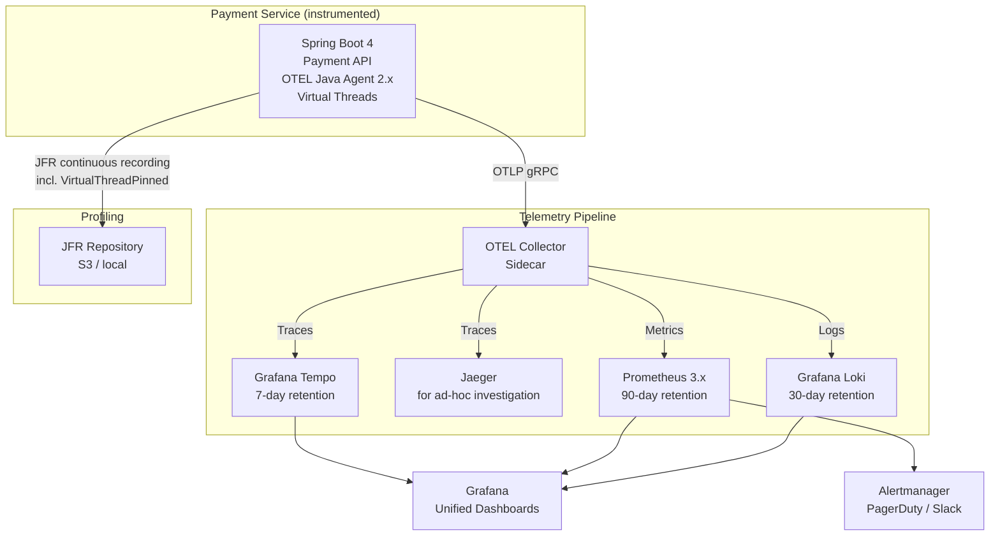

# Production Observability & Incident Investigation Platform

## Project Overview

Build a production-grade observability platform for a payment processing system. This is not just instrumentation — it is the complete operational intelligence layer that answers: "Is our system healthy right now?", "What happened during that incident?", and "Will we breach our SLO this month?"

**What you will build:**
- Full OpenTelemetry Java agent 2.x instrumentation (traces, metrics, logs) with OTLP export to Tempo and Jaeger
- Micrometer 1.14 `Observation` API with `@Observed` for custom business spans
- SLO definitions with multi-window burn-rate alerting using Prometheus 3.x
- Correlated trace-to-log dashboards in Grafana
- JVM Flight Recorder profiling including virtual thread monitoring (`jdk.VirtualThreadStart`, `jdk.VirtualThreadPinned`)
- On-call runbook for a P1 payment processing incident
- SLO-based incident severity classification

---

## System Requirements

### Observability Requirements

| Requirement | Specification |
|---|---|
| Traces | End-to-end for every payment via OTLP → Tempo/Jaeger; tail-sampled |
| Metrics | P50/P95/P99 latency, error rate, throughput, saturation via Micrometer 1.14 |
| Logs | Structured JSON, correlated via trace ID → Loki |
| SLOs | 99.95% availability, P99 < 100ms, over 28-day rolling window |
| Alerting | Multi-window burn rate (1h critical, 6h warning, 3d trend) |
| Dashboards | Payment health, SLO status, JVM internals, virtual thread pinning, Kafka consumer lag |
| Profiling | Continuous profiling via JFR; virtual thread pinning captured via `jdk.VirtualThreadPinned` |
| Retention | Traces: 7 days; Metrics: 90 days; Logs: 30 days; Compliance: 5 years |

---

## Architecture



---

## SLO Definition

### Payment API SLOs

```yaml
# SLO specification — formal definition
slos:
  - id: payment-api-availability
    description: "Payment authorisation API availability"
    service: payment-api

    sli:
      query: |
        sum(rate(http_server_requests_seconds_count{
          app="payment-api",
          status!~"5.."
        }[5m]))
        /
        sum(rate(http_server_requests_seconds_count{
          app="payment-api"
        }[5m]))

    target: 0.9995  # 99.95%
    window: 28d     # 28-day rolling window

    # Error budget: 28d × 24h × 60m × (1 - 0.9995) = 20.16 minutes

  - id: payment-api-latency-p99
    description: "Payment authorisation P99 latency"
    service: payment-api

    sli:
      query: |
        histogram_quantile(0.99,
          sum(rate(http_server_requests_seconds_bucket{
            app="payment-api",
            uri="/v1/payments"
          }[5m])) by (le)
        )

    target: 0.1     # P99 < 100ms
    window: 28d
```

### Multi-Window Burn Rate Alerts (Prometheus 3.x PromQL)

```yaml
# Prometheus 3.x alerting rules
groups:
  - name: payment-slo-alerts
    rules:

    # CRITICAL: fast burn — page on-call immediately
    # 1h + 5m: consuming budget at 14.4x rate → exhausted in ~2 days
    - alert: PaymentAPIAvailabilityCriticalBurnRate
      expr: |
        (
          1 - (
            sum(rate(http_server_requests_seconds_count{app="payment-api",status!~"5.."}[1h]))
            /
            sum(rate(http_server_requests_seconds_count{app="payment-api"}[1h]))
          )
        ) / (1 - 0.9995) > 14.4
        AND
        (
          1 - (
            sum(rate(http_server_requests_seconds_count{app="payment-api",status!~"5.."}[5m]))
            /
            sum(rate(http_server_requests_seconds_count{app="payment-api"}[5m]))
          )
        ) / (1 - 0.9995) > 14.4
      for: 2m
      labels:
        severity: critical
        team: payments-oncall
      annotations:
        summary: "Payment API: critical SLO burn rate — P1 incident"
        description: "Burning budget at {{ $value }}x rate. Will exhaust 28d budget in {{ printf \"%.1f\" (20.16 / $value) }} minutes."
        runbook: "https://runbooks.internal/payments/p1-availability"

    # WARNING: slow burn — page within 1 hour
    # 6h + 30m: consuming at 6x rate → exhausted in ~3 days
    - alert: PaymentAPIAvailabilityWarningBurnRate
      expr: |
        (
          1 - (
            sum(rate(http_server_requests_seconds_count{app="payment-api",status!~"5.."}[6h]))
            /
            sum(rate(http_server_requests_seconds_count{app="payment-api"}[6h]))
          )
        ) / (1 - 0.9995) > 6
      for: 15m
      labels:
        severity: warning
      annotations:
        summary: "Payment API: slow SLO burn rate — investigate"

    # Latency SLO: P99 approaching 100ms threshold
    - alert: PaymentAPILatencySLOBreach
      expr: |
        histogram_quantile(0.99,
          sum(rate(http_server_requests_seconds_bucket{app="payment-api",uri="/v1/payments"}[5m])) by (le)
        ) > 0.09  # Alert at 90ms (before breaching 100ms SLO)
      for: 5m
      labels:
        severity: warning
      annotations:
        summary: "Payment API P99 approaching 100ms SLO"

    # Virtual thread pinning rate — signals blocking code on carrier thread
    - alert: VirtualThreadPinningRateHigh
      expr: |
        rate(jvm_virtual_thread_pinned_seconds_count{app="payment-api"}[5m]) > 10
      for: 5m
      labels:
        severity: warning
      annotations:
        summary: "Virtual thread pinning rate elevated — check for synchronized blocks in hot path"
```

---

## OpenTelemetry Instrumentation

### JVM Agent Configuration (Kubernetes) — OTel Java Agent 2.x

```yaml
# payment-api deployment with OTEL Java Agent 2.x
spec:
  containers:
  - name: payment-api
    image: bank-registry.internal/payment-api:3.0.0
    volumeMounts:
    - name: otel-agent
      mountPath: /opt/otel

    env:
    - name: JAVA_TOOL_OPTIONS
      value: >-
        -javaagent:/opt/otel/opentelemetry-javaagent.jar
        -XX:StartFlightRecording=filename=/var/log/jfr/payment-api.jfr,
          dumponexit=true,settings=profile,maxsize=250m,maxage=1h
        -XX:FlightRecorderOptions=stackdepth=128
        -Djdk.virtualThreadScheduler.parallelism=16

    - name: OTEL_SERVICE_NAME
      value: "payment-api"
    - name: OTEL_EXPORTER_OTLP_ENDPOINT
      value: "http://otel-collector.monitoring.svc.cluster.local:4317"
    - name: OTEL_TRACES_EXPORTER
      value: "otlp"
    - name: OTEL_METRICS_EXPORTER
      value: "otlp"
    - name: OTEL_LOGS_EXPORTER
      value: "otlp"
    - name: OTEL_RESOURCE_ATTRIBUTES
      value: "deployment.environment=production,k8s.namespace.name=payments-prod"
    - name: OTEL_TRACES_SAMPLER
      value: "parentbased_always_on"  # Let Collector handle tail sampling

  initContainers:
  - name: otel-agent-init
    image: ghcr.io/open-telemetry/opentelemetry-operator/autoinstrumentation-java:2.6.0
    command: ["cp", "/javaagent.jar", "/opt/otel/opentelemetry-javaagent.jar"]
    volumeMounts:
    - name: otel-agent
      mountPath: /opt/otel
```

### Spring Boot 4 Auto-Configuration for OTel and Metrics

Spring Boot 4 ships `spring-boot-starter-actuator` with first-class `spring.otel.*` and `management.otlp.*` auto-configuration.

```yaml
# application.yml — Spring Boot 4 observability properties
management:
  otlp:
    tracing:
      endpoint: http://otel-collector.monitoring.svc.cluster.local:4318/v1/traces
    metrics:
      export:
        url: http://otel-collector.monitoring.svc.cluster.local:4318/v1/metrics
  tracing:
    sampling:
      probability: 1.0   # 100% head sample; Collector does tail filtering
  prometheus:
    metrics:
      export:
        enabled: true
  endpoints:
    web:
      exposure:
        include: health, info, prometheus, metrics, httptrace

spring:
  otel:
    resource:
      attributes:
        service.name: payment-api
        deployment.environment: production
  threads:
    virtual:
      enabled: true
```

```xml
<!-- pom.xml — key Spring Boot 4 / Micrometer 1.14 dependencies -->
<dependency>
    <groupId>org.springframework.boot</groupId>
    <artifactId>spring-boot-starter-actuator</artifactId>
</dependency>
<dependency>
    <groupId>io.micrometer</groupId>
    <artifactId>micrometer-registry-prometheus</artifactId>
</dependency>
<dependency>
    <groupId>io.micrometer</groupId>
    <artifactId>micrometer-tracing-bridge-otel</artifactId>
</dependency>
<dependency>
    <groupId>io.opentelemetry</groupId>
    <artifactId>opentelemetry-exporter-otlp</artifactId>
</dependency>
```

### Micrometer 1.14 Observation API with @Observed

```java
// Java 21 record for payment request
public record PaymentRequest(
    String paymentId,
    BigDecimal amount,
    String currency,
    String channel
) {}

// @Observed on service method: creates a Micrometer Observation (span + timer)
@Service
@Observed(name = "payment.authorise")
public class PaymentAuthorisationService {

    private final FraudScoringClient fraudClient;
    private final AccountRepository accountRepository;
    private final ObservationRegistry observationRegistry;

    public PaymentAuthorisationService(FraudScoringClient fraudClient,
                                       AccountRepository accountRepository,
                                       ObservationRegistry observationRegistry) {
        this.fraudClient = fraudClient;
        this.accountRepository = accountRepository;
        this.observationRegistry = observationRegistry;
    }

    public PaymentDecision authorise(PaymentRequest request) {
        // Nested observation for the fraud-scoring sub-span
        return Observation.createNotStarted("payment.fraud.score", observationRegistry)
                .lowCardinalityKeyValue("channel", request.channel())
                .observe(() -> {
                    var score = fraudClient.score(request.paymentId(), request.amount());
                    return score.isHighRisk()
                        ? PaymentDecision.DECLINED
                        : PaymentDecision.AUTHORISED;
                });
    }
}
```

### Custom Business Metrics

```java
@Component
public class PaymentObservability {

    private final MeterRegistry meterRegistry;
    private final ObservationRegistry observationRegistry;

    // Payment outcome counters — dimension by channel, decision, currency
    private final Counter.Builder paymentDecisionsBuilder;

    // Fraud service performance — are we within the 200ms timeout?
    private final Timer fraudLatencyTimer;

    // Error budget burn indicator — custom metric for SLO dashboard
    private volatile double errorBudgetPct = 0.0;

    public PaymentObservability(MeterRegistry meterRegistry,
                                ObservationRegistry observationRegistry) {
        this.meterRegistry = meterRegistry;
        this.observationRegistry = observationRegistry;

        this.paymentDecisionsBuilder = Counter.builder("payment.decisions.total")
            .description("Payment authorisation decisions by outcome");

        this.fraudLatencyTimer = Timer.builder("payment.fraud.score.duration")
            .description("Fraud scoring latency including timeouts")
            .publishPercentiles(0.5, 0.95, 0.99)
            .serviceLevelObjectives(
                Duration.ofMillis(50), Duration.ofMillis(100),
                Duration.ofMillis(150), Duration.ofMillis(200))
            .register(meterRegistry);

        // Observable gauge — polled by Prometheus scrape
        Gauge.builder("payment.slo.error_budget.consumed_pct", this, o -> o.errorBudgetPct)
            .description("Percentage of 28-day error budget consumed")
            .register(meterRegistry);
    }

    public void recordDecision(PaymentRequest request, PaymentDecision decision) {
        paymentDecisionsBuilder
            .tag("channel", request.channel())
            .tag("decision", decision.name())
            .tag("currency", request.currency())
            .register(meterRegistry)
            .increment();
    }

    public void recordFraudLatency(Duration latency) {
        fraudLatencyTimer.record(latency);
    }
}
```

---

## Prometheus 3.x Scrape Configuration

```yaml
# prometheus.yml — Prometheus 3.x scrape config
global:
  scrape_interval: 15s
  evaluation_interval: 15s

scrape_configs:
  - job_name: payment-api
    kubernetes_sd_configs:
    - role: pod
      namespaces:
        names: [payments-prod]
    relabel_configs:
    - source_labels: [__meta_kubernetes_pod_annotation_prometheus_io_scrape]
      action: keep
      regex: "true"
    - source_labels: [__meta_kubernetes_pod_annotation_prometheus_io_path]
      action: replace
      target_label: __metrics_path__
      regex: (.+)
    metrics_path: /actuator/prometheus   # Spring Boot 4 Prometheus endpoint
    # Prometheus 3.x: management.prometheus.metrics.export.enabled=true in SB4
```

---

## Grafana Dashboard Design

### Payment Health Dashboard — Key Panels

```
Row 1: Health Summary
  ┌─────────────────┬─────────────────┬──────────────────┬──────────────────┐
  │ Current TPS     │ P99 Latency     │ Error Rate       │ Error Budget Used│
  │ 32,450 req/s    │ 72ms            │ 0.003%           │ 23% (15.4 min)   │
  └─────────────────┴─────────────────┴──────────────────┴──────────────────┘

Row 2: SLO Burn Rate
  ┌──────────────────────────────────────────────────────────────────────────┐
  │ Availability Burn Rate (1h / 6h / 3d windows)                           │
  │ 1h: 0.8x ✓  6h: 0.6x ✓  3d: 0.5x ✓                                   │
  └──────────────────────────────────────────────────────────────────────────┘

Row 3: Latency Heatmap
  ┌──────────────────────────────────────────────────────────────────────────┐
  │ Request Duration Heatmap — POST /v1/payments                            │
  │ Shows P50/P95/P99 bands over time, easy visual of latency spikes        │
  └──────────────────────────────────────────────────────────────────────────┘

Row 4: Downstream Dependencies
  ┌─────────────────┬─────────────────┬──────────────────┐
  │ Fraud Service   │ FX Service      │ Account Service  │
  │ P99: 145ms      │ P99: 89ms       │ P99: 52ms        │
  │ Timeout rate: 2%│ Timeout rate: 0%│ Timeout rate: 0% │
  └─────────────────┴─────────────────┴──────────────────┘

Row 5: Virtual Thread Health
  ┌─────────────────────────────────────┬────────────────────────────────────┐
  │ VirtualThread Starts / sec          │ VirtualThread Pinned Events / sec  │
  │ (jdk.VirtualThreadStart JFR event)  │ (jdk.VirtualThreadPinned JFR)      │
  │ baseline: ~32,000/s                 │ target: < 1/s                      │
  └─────────────────────────────────────┴────────────────────────────────────┘
```

### Trace-to-Log Correlation

```
Grafana Explore — correlated query:
  1. Search logs for paymentId
  2. Click trace ID in log line → opens Tempo trace
  3. Trace shows: 72ms total, fraud-service took 65ms (slow)
  4. Click span → opens logs for that specific service call

Configuration (Grafana datasource link):
  Loki → Tempo: { traceId: "{{log.traceId}}" }
  Tempo → Loki: { query: "{job=\"payment-api\"} | traceId=\"{{span.traceId}}\"" }
```

---

## JVM Virtual Thread Monitoring

### JFR Events for Virtual Threads

Java 21 virtual threads emit two key JFR events that are essential for diagnosing performance issues in a virtual-thread-based payment service:

| JFR Event | When Emitted | What It Tells You |
|---|---|---|
| `jdk.VirtualThreadStart` | Virtual thread is mounted on a carrier thread | Throughput — how many VTs are created per second |
| `jdk.VirtualThreadPinned` | VT cannot unmount due to `synchronized` or native frame | Root cause of carrier thread exhaustion |

**Virtual thread pinning** occurs when a virtual thread holds a `synchronized` monitor or is inside a native frame. When pinned, the carrier thread is blocked — negating the scalability benefit. For a payment service using JDBC drivers that use `synchronized` internally (pre-virtual-thread drivers), pinning can silently saturate the carrier thread pool.

### Capturing Pinning Events in a Production JFR Recording

```bash
# Option 1: start a targeted JFR recording on a live JVM (no restart required)
# jcmd <pid> can be run from a kubectl exec session
kubectl exec -n payments-prod \
    $(kubectl get pod -n payments-prod -l app=payment-api -o name | head -1) \
    -- jcmd 1 JFR.start \
         name=vthread-pinning \
         settings=profile \
         +jdk.VirtualThreadPinned#enabled=true \
         +jdk.VirtualThreadStart#enabled=true \
         +jdk.VirtualThreadSubmitFailed#enabled=true \
         duration=120s \
         filename=/var/log/jfr/vthread-$(date +%s).jfr

# Option 2: add to the JVM startup flags for continuous recording
# -XX:StartFlightRecording=
#   filename=/var/log/jfr/payment-api.jfr,
#   dumponexit=true,
#   settings=profile,
#   maxsize=250m,
#   maxage=1h,
#   +jdk.VirtualThreadPinned#enabled=true,
#   +jdk.VirtualThreadStart#enabled=true
```

```java
// Programmatic JFR recording — triggered on latency anomaly
// Includes virtual thread pinning events
@Component
public class JfrProfilingService {

    private static final Logger log = LoggerFactory.getLogger(JfrProfilingService.class);

    private final S3Uploader s3Uploader;

    public JfrProfilingService(S3Uploader s3Uploader) {
        this.s3Uploader = s3Uploader;
    }

    @EventListener
    public void onLatencyAnomaly(LatencyAnomalyEvent event) {
        if (event.getP99Ms() < 150) return;

        log.warn("P99 latency anomaly: {}ms — starting JFR recording with VThread events",
            event.getP99Ms());

        // Run the recording on a virtual thread so the event handler returns immediately
        Thread.ofVirtual().name("jfr-recorder").start(() -> captureJfrRecording());
    }

    private void captureJfrRecording() {
        try {
            var recording = new Recording();
            recording.setSettings(Map.of(
                "jdk.ObjectAllocationInNewTLAB#enabled",    "true",
                "jdk.ObjectAllocationOutsideTLAB#enabled",  "true",
                "jdk.ExecutionSample#enabled",              "true",
                "jdk.ExecutionSample#period",               "1ms",
                "jdk.GarbageCollection#enabled",            "true",
                "jdk.GCHeapSummary#enabled",                "true",
                "jdk.ThreadPark#enabled",                   "true",
                // Virtual thread specific:
                "jdk.VirtualThreadStart#enabled",           "true",
                "jdk.VirtualThreadEnd#enabled",             "true",
                "jdk.VirtualThreadPinned#enabled",          "true",
                "jdk.VirtualThreadSubmitFailed#enabled",    "true"
            ));
            recording.start();
            Thread.sleep(60_000);
            recording.stop();

            var output = Path.of("/var/log/jfr/anomaly-" +
                Instant.now().getEpochSecond() + ".jfr");
            recording.dump(output);
            s3Uploader.upload(output, "jfr-recordings/" + output.getFileName());
            log.info("JFR recording saved and uploaded: {}", output);

        } catch (Exception e) {
            log.error("JFR recording failed", e);
        }
    }
}
```

### Analysing Pinning Events

```
In JDK Mission Control (JMC), after loading the .jfr file:

1. Event Browser → jdk.VirtualThreadPinned
   - Columns: startTime, duration, eventThread, stackTrace
   - Sort by duration descending
   - Look for recurring stackTrace entries — these are the pinning hotspots

2. Common pinning sources in a fintech application:
   - JDBC drivers using synchronized connection pools (use HikariCP 6.x which
     is virtual-thread friendly and uses ReentrantLock instead of synchronized)
   - javax.crypto.Cipher is synchronized — use a pool of Cipher instances
   - SLF4J MDC in some appenders uses synchronized blocks

3. Resolution: replace synchronized with ReentrantLock or VarHandle CAS
   HikariCP 6.x already does this for the connection pool.
```

---

## Testing — @MockitoBean and TestObservationRegistry

Spring Boot 4 replaces `@MockBean` with `@MockitoBean` (Mockito 5 integration).

```java
@SpringBootTest
@AutoConfigureMockMvc
class PaymentAuthorisationIntegrationTest {

    @Autowired
    private MockMvc mockMvc;

    // Spring Boot 4: @MockitoBean replaces @MockBean
    @MockitoBean
    private FraudScoringClient fraudScoringClient;

    @MockitoBean
    private AccountRepository accountRepository;

    // Micrometer 1.14 test support: TestObservationRegistry
    @Autowired
    private TestObservationRegistry observationRegistry;

    @Test
    void authorise_lowRiskPayment_returnsAuthorised() throws Exception {
        given(fraudScoringClient.score(anyString(), any()))
            .willReturn(FraudScore.LOW_RISK);
        given(accountRepository.findById(anyString()))
            .willReturn(Optional.of(new Account("acc-001", new BigDecimal("1000.00"))));

        mockMvc.perform(post("/v1/payments")
                .contentType(MediaType.APPLICATION_JSON)
                .content("""
                    {
                      "paymentId": "pay-001",
                      "amount": 100.00,
                      "currency": "GBP",
                      "channel": "API"
                    }
                    """))
                .andExpect(status().isOk())
                .andExpect(jsonPath("$.decision").value("AUTHORISED"));

        // Verify Micrometer Observation was created for this call
        TestObservationRegistry.assertThat(observationRegistry)
            .hasObservationWithNameEqualTo("payment.authorise")
            .that()
            .hasLowCardinalityKeyValue("channel", "API");
    }

    @Test
    void authorise_highRiskPayment_returnsDeclined() throws Exception {
        given(fraudScoringClient.score(anyString(), any()))
            .willReturn(FraudScore.HIGH_RISK);

        mockMvc.perform(post("/v1/payments")
                .contentType(MediaType.APPLICATION_JSON)
                .content("""
                    {
                      "paymentId": "pay-002",
                      "amount": 9500.00,
                      "currency": "GBP",
                      "channel": "API"
                    }
                    """))
                .andExpect(status().isOk())
                .andExpect(jsonPath("$.decision").value("DECLINED"));
    }
}
```

---

## Incident Runbook — P1 Payment Processing Outage

```markdown
# RUNBOOK: Payment API P1 — Availability SLO Breach

## Severity Classification
P1: Error rate > 1% for > 2 minutes, OR complete unavailability

## Immediate Response (first 5 minutes)

### Step 1: Acknowledge the alert
1. Acknowledge in PagerDuty
2. Post to #payments-incidents: "@here P1 declared — payment API error rate {X}% — investigating"
3. Open incident in Jira Service Management

### Step 2: Establish current state
kubectl get pods -n payments-prod
kubectl get hpa -n payments-prod
kubectl top pods -n payments-prod

# Check error rate in Grafana:
# Dashboard: Payment Health → Panel: Error Rate (last 15 minutes)

### Step 3: Identify error type
kubectl logs -n payments-prod -l app=payment-api --since=5m | grep '"level":"ERROR"'

# Common patterns:
# "Connection refused" → database issue (see DB runbook)
# "TimeoutException" → downstream service slow (check fraud/FX/account services)
# "OutOfMemoryError" → JVM heap exhaustion (see JVM runbook)
# "HTTP 503" from upstream → rate limiting or circuit breaker open
# VirtualThreadPinned events high → check for synchronized blocks; see JFR runbook

### Step 4: Check database
kubectl exec -n database -it cockroachdb-0 -- \
  cockroach sql --insecure -e \
  "SELECT count(*) FROM crdb_internal.cluster_queries WHERE application_name='payment-api';"
# > 100 active queries from payment-api: pool exhaustion → restart pods

### Step 5: Check Kafka consumer lag
kubectl exec -n kafka kafka-0 -- \
  kafka-consumer-groups.sh --bootstrap-server localhost:9092 \
  --describe --group payment-api-prod
# Consumer lag > 10,000: settlement workers behind → scale up

### Step 6: Check virtual thread pinning
# If P99 latency is high but error rate is low, check JFR for VirtualThreadPinned
kubectl exec -n payments-prod \
    $(kubectl get pod -n payments-prod -l app=payment-api -o name | head -1) \
    -- jcmd 1 JFR.dump name=vthread-pinning filename=/tmp/live.jfr
kubectl cp payments-prod/<pod>:/tmp/live.jfr ./live.jfr
# Open in JDK Mission Control → Event Browser → jdk.VirtualThreadPinned

## If not resolved in 15 minutes: escalate to Principal Engineer on call

## Post-Incident (within 24 hours)
1. Write postmortem in Confluence
2. File action items in Jira
3. Update this runbook with new patterns found
```

---

## Architecture Decision Records

### ADR-001: Tail Sampling Over Head Sampling

**Status:** Accepted

**Context:** Head sampling (decided at first span) would discard 90% of error traces if sampling rate is 10%. For a financial service, every error trace must be retained.

**Decision:** Tail sampling in OTEL Collector: 100% of error traces, 100% of large-amount payments (>£10k), 10% of healthy sub-100ms requests. Tail sampling sees the complete trace outcome before deciding.

**Consequences:** Requires buffering up to 10 seconds of trace data in the Collector (memory overhead ~200MB). Sampling decisions delayed by up to 10 seconds.

### ADR-002: JFR for Production Profiling (Not Sampling Profiler)

**Status:** Accepted

**Context:** External profilers (async-profiler with JVMTI) have ~5% CPU overhead. JFR uses low-overhead kernel-level hooks and is designed for always-on production profiling (< 1% overhead at default settings).

**Decision:** Continuous JFR recording at profile settings with 1-hour circular buffer. On latency anomaly, dump the last 60 seconds of profiling data to S3 for investigation. `jdk.VirtualThreadPinned` is always enabled to catch blocking code on carrier threads.

**Consequences:** JFR files consume disk space (capped at 250MB via `maxsize`). Analysis requires JDK Mission Control, which is a desktop tool — the dump-to-S3 step ensures the file is accessible from any engineer's workstation.

### ADR-003: Micrometer Observation API Over Direct OTel SDK

**Status:** Accepted

**Context:** Calling the OpenTelemetry SDK directly couples business code to a specific telemetry backend. Micrometer's `Observation` API is a vendor-neutral facade: the same `@Observed` annotation emits both a Micrometer timer (for Prometheus) and an OTel span (for Tempo/Jaeger) depending on which bridges are on the classpath.

**Decision:** Use `@Observed` on service methods and `Observation.createNotStarted` for sub-spans. Never import `io.opentelemetry.*` directly in business code.

**Consequences:** Switching from Tempo to Zipkin requires only a dependency change, not a code change. `TestObservationRegistry` provides clean assertions in unit tests without a live OTel backend.

---

## Principal Engineer Review Criteria

- [ ] **SLO burn rate alert fires correctly** — simulate 2% error rate, verify critical alert within 2 minutes
- [ ] **Trace-to-log correlation works** — search logs by paymentId, click to trace in Tempo, click span to Loki logs
- [ ] **Error budget calculation is accurate** — verify against manual calculation of error rate × window
- [ ] **JFR recording captures GC events** — trigger a Full GC in test, verify in JFR recording
- [ ] **Runbook is actionable** — walk through the runbook with a simulated incident scenario
- [ ] **Dashboard covers the four golden signals** — latency, errors, traffic, saturation all visible
- [ ] **Alert suppression during maintenance** — Alertmanager silencing configured and tested
- [ ] **`@MockitoBean` replaces `@MockBean`** — no `@MockBean` in any test class; all Mockito stubs use the Spring Boot 4 annotation
- [ ] **`spring.otel.*` auto-configuration active** — traces appear in Tempo without manual `OpenTelemetry` bean wiring
- [ ] **`management.otlp.tracing.endpoint` and `management.otlp.metrics.export.url` configured** — both visible in `/actuator/configprops`
- [ ] **Virtual thread pinning monitored** — `jdk.VirtualThreadPinned` events captured in JFR recording; Prometheus metric `jvm_virtual_thread_pinned_seconds_count` present in `/actuator/prometheus`
- [ ] **`@Observed` on payment service** — Grafana shows `payment.authorise` span in Tempo and `payment.authorise.seconds` histogram in Prometheus from the same annotation
- [ ] **Prometheus 3.x scrape succeeds** — `management.prometheus.metrics.export.enabled=true` confirmed; Prometheus scrape target is UP; `payment.decisions.total` counter visible

---

## Interview Debrief

### The 60-Second Pitch
> "I built a production observability platform for a payment processing service: the hardest problem was connecting a user-reported transaction failure to a specific log line across a distributed system, which I solved by propagating OpenTelemetry trace IDs through every service boundary and structuring every log entry with the trace ID as a first-class field, so a single Grafana query on a paymentId takes you from the user complaint to the exact log line and stack trace in under 30 seconds."

### Questions Your Interviewer Will Ask

**Q1: How do you correlate a trace ID from a user-reported transaction failure to the specific pod and log line?**

Model answer: Every HTTP response from the payment API includes a `X-Trace-Id` header containing the OTel trace ID. When a customer reports a failed payment, support provides the transaction ID and timestamp. The engineer runs a Loki query filtering on `paymentId="<id>"` which returns the structured log entry including `traceId`. Clicking the trace ID in Grafana Explore opens the Tempo trace showing every span in the distributed call graph — the failed span is highlighted in red. Clicking the failed span links back to Loki for the logs of that specific service call during that specific 50ms window. The key enabler is that every log statement uses MDC to propagate `traceId`, `spanId`, and `paymentId` as structured fields — not concatenated into the message string — so Loki's label-indexed queries are fast even at 90-day retention.

**Q2: What's your alerting strategy to avoid alert fatigue while ensuring P1s page immediately?**

Model answer: The strategy is multi-window burn-rate alerting on SLO consumption rather than raw error rate thresholds. A 1-hour window at 14.4x burn rate pages immediately — this only fires when you are genuinely in crisis. A 6-hour window at 6x burn rate creates a warning that can wait for the next business hour. Static threshold alerts like "error rate > 0.1%" fire constantly during deployments, maintenance windows, and load test spikes — none of which are P1s. We suppress the static alerts in favour of burn-rate alerts because burn-rate accounts for traffic volume: a 1% error rate at 100 TPS consumes budget at the same rate as 0.1% at 1,000 TPS. Alert fatigue is also reduced by routing: critical burn-rate alerts go to PagerDuty; warning burn-rate alerts go to Slack; info-level capacity alerts go to a weekly digest. We review the alert-to-incident ratio monthly — if more than 20% of pages do not result in a declared incident, we raise the threshold.

**Q3: How do you measure the business impact of a performance regression — not just latency but payment failure rate?**

Model answer: Latency is a leading indicator; payment failure rate is the lagging business metric we actually care about. We track `payment.decisions.total` counter with a `decision` dimension — AUTHORISED, DECLINED, TIMEOUT, ERROR — so we can compute authorisation rate separate from availability rate. A latency regression that pushes P99 above our 200ms fraud-service timeout will appear as a rising TIMEOUT decision rate before it shows up as an HTTP 5xx. We also track `payment.slo.error_budget.consumed_pct` as an observable gauge updated from a background Prometheus query — this gives an immediate "are we burning error budget right now" signal on the dashboard. For revenue impact, we multiply the TIMEOUT/ERROR decision rate by average transaction value to produce an estimated revenue-at-risk per minute, which appears on the incident bridge so stakeholders understand business severity alongside technical severity.

**Q4: How would you debug a memory leak in production without restarting the service?**

Model answer: First, confirm the heap growth pattern in Grafana: `jvm_memory_used_bytes{area="heap"}` growing monotonically across GC cycles confirms a leak rather than a load spike. Then capture a heap histogram without a full heap dump (which pauses the JVM): `jcmd 1 GC.heap_info` and `jcmd 1 VM.native_memory` are low-impact. If the histogram shows a specific class growing (e.g., `PaymentAuditEvent` count increasing), that narrows the search to code that holds references to that class. Next, trigger a JFR recording with `jdk.OldObjectSample` enabled — this event records objects that have survived multiple GC cycles along with their allocation stack traces. The JFR file uploaded to S3 is then opened in JDK Mission Control where the Memory tab shows the top object types and their allocation call stacks. This entire process is live, requires no restart, and typically identifies the leaking code path within 10 minutes. As a last resort, `jcmd 1 GC.heap_dump /tmp/heap.hprof` takes a full heap dump (pauses briefly) which can be analysed offline with Eclipse MAT.

**Q5: What does your SLO review process look like — who attends, what decisions get made?**

Model answer: We hold a monthly SLO review with the payment engineering lead, product manager, and an SRE. The agenda has three parts. First, error budget status: how much of the 28-day rolling budget remains across availability and latency SLOs — if below 50% at the mid-month mark, the second half of the sprint is locked for reliability work and no new features ship. Second, alert quality review: we look at the alert-to-incident ratio for the month; any alert that fired more than three times without resulting in a declared incident is either raised in threshold or deleted. Third, SLO target review: once a year we ask whether the targets are still correct — a target we consistently exceed by a large margin may be set too low, consuming engineering focus unnecessarily; a target we miss may need investment or a renegotiation with the business. Decisions made in the review are binding: if error budget is below 25%, the engineering lead has authority to defer any feature work without escalation. This turns SLOs from a monitoring artefact into a business governance mechanism.

### What to Have Ready on the Whiteboard
- **Telemetry pipeline diagram** showing the payment API emitting OTLP traces, metrics, and logs via the OTel Java agent 2.x sidecar collector to Tempo, Prometheus 3.x, and Loki, with Grafana as the unified query layer and the trace-ID link between Loki and Tempo drawn explicitly
- **Multi-window burn-rate alert formula** on the whiteboard: write out the PromQL for the 1h/5m critical window, label the 14.4x multiplier, show how it relates to the 20.16-minute error budget and explain why two windows (not one) are required to avoid false positives during brief spikes
- **Virtual thread pinning root-cause diagram** showing a carrier thread pool, a pinned virtual thread holding a `synchronized` lock, the remaining carrier threads serving other virtual threads, and the annotation showing that pinning rate > 1/s is the threshold for investigating synchronized blocks in JDBC drivers or crypto code
