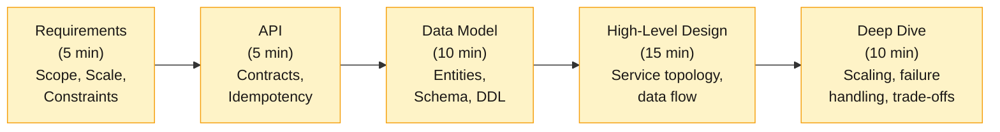
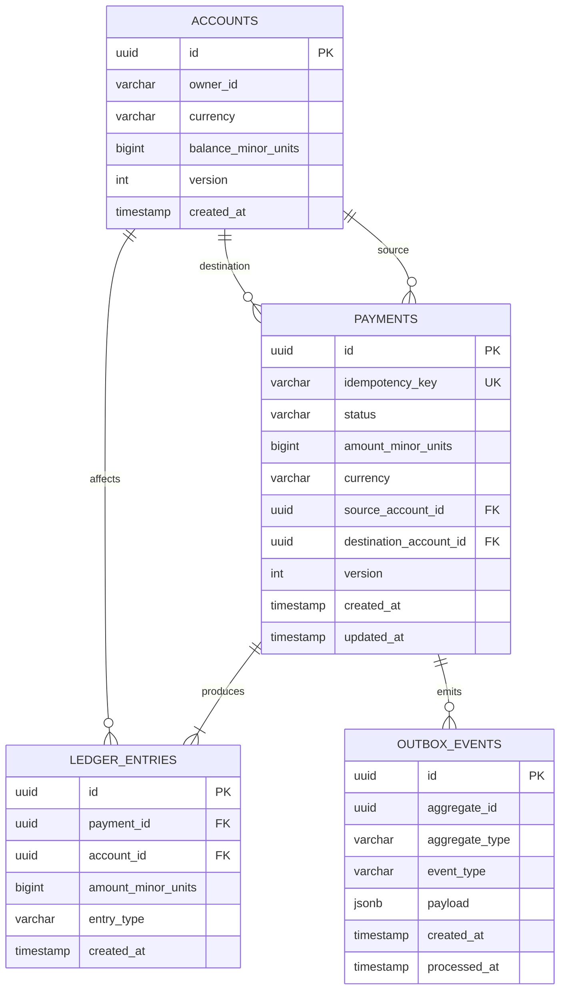

# System Design Framework for Fintech Interviews

You have 45 minutes. The question is: "Design a payment processing service." You know distributed systems cold. The engineer across the table has shipped Revolut's core payments infrastructure. This lesson is about how not to waste those 45 minutes.

Senior engineers fail fintech system design interviews for a predictable set of reasons — none of which are ignorance of distributed systems concepts. This lesson fixes the structural and communication failures before you encounter them in an interview.

---

## What Interviewers Actually Evaluate

Staff-level interviewers at Revolut, Wise, Monzo, and Stripe are evaluating four dimensions simultaneously. Understanding these changes where you allocate your interview time.

### Dimension 1: Correctness of Core Design

Does the design actually solve the stated problem? This is table stakes but it is surprisingly easy to fail on. Common failure mode: a candidate designs a system that is eventually consistent when the question explicitly requires strong consistency for balance updates. The interviewer sees this as a fundamental misunderstanding, not a trade-off decision.

For fintech specifically, correctness means: (1) money does not appear or disappear — double-entry accounting is enforced, (2) the same payment cannot be processed twice — idempotency is structural, not an afterthought, (3) the system can recover from partial failures without manual intervention.

### Dimension 2: Awareness of Failure Modes

A working design for the happy path gets you to mid-level. Staff-level candidates are expected to proactively identify where the system breaks. Interviewers test this by asking "what happens when X fails?" — but the best candidates bring it up themselves.

Failure modes that must surface in every fintech design: network partition between service and database during a write, Kafka producer failure after DB commit but before publish, partial saga completion, thundering herd on retry, duplicate webhook delivery.

### Dimension 3: Articulation of Trade-offs

Interviewers at this level are not looking for the "right answer." They are looking for evidence of engineering judgment. Every significant architectural decision has a trade-off — the candidate who says "I'll use Postgres for strong consistency" without acknowledging the scaling ceiling is showing half their thinking. The candidate who says "Postgres gives us ACID guarantees for balance updates at the cost of horizontal write scalability; I'd shard by account ID before I'd consider a NoSQL alternative here" is showing the full picture.

### Dimension 4: Production Readiness Thinking

Does the candidate think in terms of real systems? This includes: observability (how will on-call know something is wrong before the customer complains?), operability (how do you roll back a bad deployment?), and reliability (SLAs, circuit breakers, graceful degradation). Candidates who design a system without mentioning metrics, alerting, or deployment strategy have not shipped production software at scale.

### Common Mistakes Senior Engineers Make

**Going deep too fast.** A common failure pattern: the candidate jumps to sharding strategy in the first 10 minutes before establishing what the consistency requirement is. The interviewer has to interrupt. This signals poor communication, not poor knowledge.

**Treating the problem as an engineering puzzle.** Fintech system design questions have regulatory, compliance, and financial correctness constraints that pure engineering optimization ignores. If you design a fraud detection system that maximises throughput at the expense of auditability, you have failed the interview.

**Not asking clarifying questions.** A senior engineer who starts drawing boxes immediately looks like a junior engineer who has memorised a template. The right opening is two to three minutes of requirements clarification — it signals that you understand real systems have constraints.

**Describing components without connecting them.** "I'll use Kafka for async messaging and Redis for caching" is a list of tools. The design is in how they interact and why each boundary is drawn where it is.

---

## The RADE Framework

RADE is a time-boxed structure for a 45-minute system design interview. The acronym is less important than the time allocations — interviewers notice when a candidate spends 30 minutes on requirements and runs out of time for the actual design.

```
Requirements    →  5 minutes
API             →  5 minutes
Data model      → 10 minutes
Execution       → 25 minutes
  (High-level design: 15 min)
  (Deep dive on 1-2 components: 10 min)
```



**R — Requirements (5 minutes).** Ask five questions (detailed in the next section). Write the constraints on the whiteboard. Do not proceed until you have established scale, consistency requirement, and failure tolerance. The whiteboard constraints become your design guardrails — you refer back to them when making trade-offs.

**A — API (5 minutes).** Define the external contract: endpoints, request/response shapes, idempotency strategy, error codes. This is fast because you do not implement it — you describe the shape. The API section surfaces assumptions about caller behaviour early.

**D — Data Model (10 minutes).** This is where fintech interviews are won or lost at the data layer. Define the core entities and their relationships. Write actual DDL if the interviewer expects it (they usually do at Stripe/Revolut). Call out the key schema decisions: why this index, why this column type, why NOT NULL here.

**E — Execution (25 minutes).** Two phases. First, high-level design: draw the service topology, data flows, and integration points. This is the architecture diagram. Second, deep dive: the interviewer will direct you toward the most interesting/risky component. Common targets: the idempotency implementation, the saga pattern, the scaling strategy. Have a prepared answer for each.

---

## Requirements: The Five Questions

These five questions extract the constraints that determine every significant architectural decision. Ask all five. Write the answers on the whiteboard.

### Question 1: Scale

"What is the expected transaction volume, and what does peak load look like?"

This establishes: TPS for sizing, read/write ratio for replica strategy, burst multiplier for autoscaling configuration. A system that handles 100 TPS has very different constraints from one that handles 100,000 TPS.

Model answer to expect: "We're targeting 10,000 TPS at peak, with 3x burst headroom. 80% read traffic from status queries."

This immediately tells you: single Postgres primary will not handle 10K write TPS without horizontal partitioning; read replicas for status queries; autoscaling needs burst capacity.

### Question 2: Consistency Requirement

"What is the consistency model for balance updates? Can we tolerate eventual consistency, or is strong consistency required?"

This is the most consequential architectural question in fintech. It determines: whether you can use a distributed cache for balance reads, whether saga compensation is acceptable or whether you need 2PC, whether Kafka consumers can process events out of order.

The answer is almost always "strong consistency for balance, eventual is acceptable for notifications and analytics." If the interviewer says "eventual is fine for balance," push back: "I want to flag that eventual consistency for balance creates a window where a customer could overdraw — is that acceptable, or should I design for strong consistency with a slight latency trade-off?"

### Question 3: Failure Tolerance

"What is the availability SLA, and what is the acceptable failure mode? Can payments fail, or must they queue and eventually complete?"

This separates synchronous rejection (99.95% uptime, synchronous error returned to caller) from durable queuing (messages stored until processed). Both are valid; they have completely different implementations.

For card payments at Revolut scale: synchronous rejection with retry guidance to the caller. For account-to-account transfers where the sender has accepted latency: durable queue acceptable.

### Question 4: Regulatory Constraints

"Are there data residency requirements? Is card data in scope (PCI DSS)? Do we need an immutable audit trail?"

This question demonstrates production experience. The answers change the design significantly:

- PCI scope means card numbers never touch your service. You receive a token from a PCI-compliant vault (Stripe, Braintree). Your service never stores PANs.
- Data residency means EU customer data cannot be processed on US infrastructure. This constrains Kafka topic placement, database region, and potentially requires separate deployments per region.
- Immutable audit trail means append-only ledger, no UPDATE on financial records, potentially event sourcing.

### Question 5: Existing Infrastructure

"Is this greenfield, or are we integrating with an existing stack? Do we have Kafka, what's the database, is there a service mesh?"

A greenfield design that proposes migrating from MySQL to Postgres will not fly if the team has 500 existing services on MySQL. Know the constraints before you optimise.

---

## API Design

### REST vs gRPC vs Async

For payment initiation at a Revolut-class company, the decision is:

| Concern | REST | gRPC | Async (Kafka) |
|---|---|---|---|
| Idempotency | Header-based (`X-Idempotency-Key`) | Per-call, requires application-level key | Native via consumer group offset |
| Caller complexity | Low — any HTTP client | Medium — requires proto, generated client | High — event-driven caller model |
| Latency | Good (HTTP/1.1 or HTTP/2) | Best (HTTP/2, binary) | High — fire-and-forget |
| Synchronous response | Yes | Yes | No |
| Versioning | URL path (`/v1/`) | Proto versioning | Schema Registry |

**Use REST for public-facing payment initiation.** Clients (mobile apps, merchant integrations) are HTTP-native. The idempotency pattern is well-understood via the `X-Idempotency-Key` header pattern (standardised by Stripe).

**Use gRPC for internal service-to-service calls.** The binary protocol and generated clients reduce serialisation overhead significantly at high throughput.

**Use Kafka for event-driven downstream processing.** After a payment is committed to the database, downstream services (notification, ledger, risk) consume from Kafka. They do not call the Payment Service synchronously.

### The Canonical Payment Initiation API

```
POST /v1/payments
X-Idempotency-Key: 7f9e8d2a-1b3c-4e5f-a6b7-c8d9e0f1a2b3
Content-Type: application/json
Authorization: Bearer <token>

{
  "amount": 10000,
  "currency": "GBP",
  "source_account_id": "acc_01HXYZ",
  "destination_account_id": "acc_01HABC",
  "reference": "Invoice #1042",
  "metadata": {
    "merchant_category": "5411"
  }
}
```

```
HTTP/1.1 201 Created
Content-Type: application/json

{
  "payment_id": "pay_01HXYZ",
  "status": "PENDING",
  "amount": 10000,
  "currency": "GBP",
  "created_at": "2026-11-12T10:00:00Z",
  "idempotency_key": "7f9e8d2a-1b3c-4e5f-a6b7-c8d9e0f1a2b3"
}
```

**On duplicate submission with the same idempotency key:** Return `HTTP 200` (not 201) with the original response body. The client cannot distinguish a retry from an original submission — this is the correct behaviour.

**On validation error:**
```
HTTP/1.1 422 Unprocessable Entity
{
  "error": "INSUFFICIENT_FUNDS",
  "message": "Source account balance insufficient for this payment.",
  "payment_id": null
}
```

**Key decisions in the API design:**

The idempotency key goes in the **header**, not the body. It is a transport concern, not a business entity concern. It should not appear in audit logs of business events. It should not be stored alongside payment business data in the same column without clear separation.

The amount is in **minor units** (pence, cents). Never floats. This is non-negotiable. `10000` = £100.00. Interviewers will notice if your API uses floats for money.

Versioning is in the **URL path** (`/v1/`), not in a header or query parameter. URL path versioning is unambiguous for load balancers, API gateways, and log analysis.

---

## Data Model

The core fintech entities and their relationships are consistent across payment types. Know these cold — interviewers expect you to draw this in under 10 minutes.



### Entity Decisions Worth Articulating

**PAYMENTS.idempotency_key: UNIQUE constraint, not just an index.** A unique constraint is enforced by the database at the storage layer — it is a correctness guarantee, not a performance hint. An application-level check (`SELECT` before `INSERT`) has a TOCTOU race condition. The database constraint eliminates the race.

**PAYMENTS.version: optimistic locking.** The `version` column is incremented on every UPDATE. The UPDATE WHERE clause includes `version = :current_version`. If the WHERE clause matches 0 rows, another transaction won the race — throw `OptimisticLockException`, retry. This avoids `SELECT FOR UPDATE` lock contention under most workloads.

**LEDGER_ENTRIES: append-only.** Ledger entries are never updated or deleted. This is both a financial correctness requirement (audit trail) and a database performance property (no UPDATE hotspots). Corrections are made via compensating entries (new CREDIT to offset an erroneous DEBIT), never via modification.

**LEDGER_ENTRIES.entry_type: DEBIT/CREDIT pair.** Every payment produces exactly two ledger entries: a DEBIT from the source account and a CREDIT to the destination account. The sum of all ledger entries for any account must equal the account's current balance. This is double-entry bookkeeping enforced structurally.

**OUTBOX_EVENTS.processed_at: nullable.** NULL means unprocessed. The outbox polling publisher SELECTs WHERE processed_at IS NULL, publishes to Kafka, then UPDATEs processed_at. This is idempotent — if the publisher crashes between publish and update, it republishes (Kafka consumers must be idempotent, but that is a weaker requirement than at-most-once).

---

## Fintech-Specific Red Flags

Interviewers at Revolut and Stripe run mental checklists. If your design triggers any of these, it actively signals inexperience with production fintech systems.

**Red flag 1: No idempotency.** Any payment API without an idempotency key mechanism will process duplicate requests as new payments. Network retries, client timeouts, and load balancer failures all generate duplicate requests. If your design does not address this, the interviewer will ask about it, and "we'll handle retries at the application layer" is not an acceptable answer.

**Red flag 2: Synchronous cross-service calls without circuit breaker.** If your Payment Service synchronously calls a Risk Service and the Risk Service degrades, your Payment Service degrades. At 10,000 TPS, a 500ms latency increase in a synchronous dependency can exhaust your connection pool in seconds. Circuit breakers (Resilience4j) with fallback strategies are mandatory.

**Red flag 3: No transactional outbox for Kafka.** Calling `kafkaTemplate.send()` after a database commit is not atomic. The database commits, the application crashes before Kafka publish, the event is lost. The outbox pattern ensures the event is durable before it is published — it is written to the database in the same transaction as the business data.

**Red flag 4: No audit trail.** Financial regulations in every major market (PSD2, FCA, FINRA) require an immutable audit trail. If your design includes `UPDATE payments SET status = 'FAILED'` without preserving the previous state in an audit table or via event sourcing, you have a compliance gap.

**Red flag 5: Balance stored as a running total without a ledger.** An `accounts.balance` column updated via `UPDATE accounts SET balance = balance - :amount` is both a correctness risk (concurrent updates, no recalculation path) and a compliance risk (how do you prove the balance is correct?). The ledger is the source of truth; the balance column is a denormalised cache.

---

## Trade-off Articulation Template

Interviewers remember candidates who articulate trade-offs precisely. Memorise this template and apply it to every significant decision:

> "I'm choosing **X** over **Y** because **[technical reason]**. The downside is **[concrete downside]**. I'd mitigate that by **[specific mitigation]**. At Revolut scale, I'd revisit this decision if **[scaling condition or metric threshold]**."

### Applied Examples

**On consistency model:**
"I'm choosing synchronous PostgreSQL writes over Kafka-first event sourcing because we need strong consistency for balance updates — if we process a DEBIT event after the customer has already initiated a second transfer, we can't prevent overdraft. The downside is that PostgreSQL becomes a write bottleneck above ~5,000 TPS on a single primary. I'd mitigate that with account-based horizontal sharding. At Revolut scale, I'd revisit this if we see sustained write latency above 50ms p99 on the primary, which would indicate we've hit the shard boundary."

**On idempotency storage:**
"I'm storing idempotency keys in PostgreSQL alongside the payment record rather than in Redis because I want the idempotency guarantee to be transactional — the key is inserted atomically with the payment, so there is no window where a payment exists but its idempotency key is not registered. The downside is PostgreSQL lookup on every request, even reads. I'd mitigate that by adding a Redis L1 cache with a 24h TTL for recently-submitted keys. At scale, I'd revisit if the idempotency key table grows large enough to impact query performance — at which point I'd partition by key hash."

---

## Summary Checklist

Before you move from Requirements to API in an interview, verify:

- [ ] Scale established (TPS, read/write ratio, burst multiplier)
- [ ] Consistency model confirmed and written on whiteboard
- [ ] Failure SLA agreed (synchronous rejection vs durable queue)
- [ ] PCI / data residency scope confirmed (do I store card numbers? No.)
- [ ] Infrastructure constraints noted (greenfield or existing stack?)

Before you move from Data Model to Execution:

- [ ] Idempotency key on payments table with UNIQUE constraint
- [ ] Ledger entries table (append-only, double-entry)
- [ ] Outbox events table (processed_at nullable)
- [ ] Version column for optimistic locking
- [ ] No floats for monetary amounts

The next two lessons apply this framework to the full "Design a payment processing service" question — the most common fintech system design prompt at Staff level.

---

<!-- KNOWLEDGE-CHECK
[
  {
    "id": "kc-01-01",
    "question": "During a Revolut-level system design interview for a payment service, the interviewer asks: 'What consistency model would you use for account balance updates?' You respond that eventual consistency is acceptable because it simplifies the architecture. The interviewer pauses. What is the most likely issue with your answer?",
    "options": [
      "Eventual consistency is too complex to implement in Postgres.",
      "Eventual consistency for balances creates a window where concurrent debits can cause overdraft, violating financial correctness — this requires strong consistency unless a compensating design is explicitly justified.",
      "The interviewer expected you to mention Kafka before discussing consistency models.",
      "Eventual consistency requires a different API versioning strategy."
    ],
    "correct": 1,
    "explanation": "Eventual consistency for balance updates allows multiple concurrent transactions to read a stale balance, potentially approving multiple payments that together exceed the account balance. This is a financial correctness failure. At companies like Revolut, strong consistency for the debit step is a non-negotiable constraint. Mentioning it without justification signals inexperience with fintech production systems."
  },
  {
    "id": "kc-01-02",
    "question": "You are designing a payment API and need to handle duplicate requests due to network retries. You propose: 'On duplicate submission, the client should check if the payment already exists using GET /v1/payments before retrying POST /v1/payments.' What is the fundamental flaw in this approach?",
    "options": [
      "GET requests are not idempotent and cannot be used for this purpose.",
      "This introduces a TOCTOU race condition: between the GET returning 'not found' and the POST executing, a concurrent request can create the payment, resulting in duplicate processing.",
      "HTTP GET responses are not cached at the API gateway layer, making this inefficient.",
      "This approach is correct and is the industry standard used by Stripe."
    ],
    "correct": 1,
    "explanation": "The check-then-act pattern has an inherent race condition. Two concurrent retries can both GET 'not found' and both POST, creating a duplicate. The correct approach is a server-side idempotency key with a database UNIQUE constraint — the INSERT itself enforces uniqueness atomically, eliminating the race condition entirely. This is why Stripe's idempotency key pattern exists."
  },
  {
    "id": "kc-01-03",
    "question": "You propose publishing a Kafka event immediately after committing a payment to Postgres: `db.commit(); kafkaProducer.send(event);`. The interviewer asks what happens if the application crashes between line 1 and line 2. Which of the following correctly describes the problem and the standard solution?",
    "options": [
      "The Kafka message would be delivered twice due to at-least-once semantics; the solution is to use Kafka transactions.",
      "The database commit is rolled back when the application crashes; no message is lost and no special pattern is needed.",
      "The database commit succeeds but the Kafka event is never published, breaking downstream consumers. The solution is the transactional outbox pattern: write the event to an outbox table in the same database transaction, then have a separate publisher read and forward it to Kafka.",
      "This only occurs under exactly-once Kafka semantics; switching to at-least-once delivery resolves the issue."
    ],
    "correct": 2,
    "explanation": "Database commit and Kafka publish are two separate, non-atomic operations. A crash between them leaves the database updated with no corresponding Kafka event — downstream services never see the payment. The transactional outbox pattern solves this: the event is written to an outbox table in the same ACID transaction as the payment record. A separate publisher (polling or CDC-based) then reads and publishes the event, with at-least-once delivery to Kafka. Kafka consumers must be idempotent, but that is a weaker and achievable requirement."
  },
  {
    "id": "kc-01-04",
    "question": "An interviewer asks you to compare storing account balances as a running total column (`accounts.balance`) versus computing them from ledger entries (`SUM(ledger_entries.amount) WHERE account_id = ?`). Which trade-off articulation best demonstrates Staff-level judgment?",
    "options": [
      "The running total is always correct; ledger computation is too slow at scale.",
      "Ledger computation is always correct; running totals should never be used in fintech.",
      "The running total is a denormalised read cache for performance; the ledger is the source of truth for correctness and auditability. The correct design maintains both: the ledger is append-only and authoritative; the balance column is updated transactionally with ledger writes and can be recomputed from the ledger if discrepancies are detected.",
      "Using both a running total and ledger entries violates database normalisation principles and should be avoided."
    ],
    "correct": 2,
    "explanation": "In production fintech systems, both are used together. The ledger provides auditability, recalculability, and regulatory compliance — you can always prove a balance is correct by summing the ledger. The running total column provides O(1) balance reads without aggregating potentially millions of ledger entries. The key insight is that the balance column is a cache, not the source of truth. It is updated atomically in the same transaction as the ledger entries, and it can be reconciled against the ledger at any time. This is the pattern used at Monzo, Revolut, and similar systems."
  }
]
-->

<!-- PRACTICAL-CHALLENGE
{
  "id": "pc-01",
  "title": "RADE Framework Applied: Mock Interview Setup",
  "description": "Apply the RADE framework to structure a complete response to a fintech system design question before diving into implementation.",
  "tasks": [
    {
      "id": "pc-01-01",
      "description": "Given the prompt 'Design a money transfer service for a neobank handling 5,000 TPS,' write out the exact five clarifying questions you would ask, the answers you would expect, and how each answer changes a specific architectural decision. Format as a Q&A dialogue."
    },
    {
      "id": "pc-01-02",
      "description": "Draw (on paper or in a diagramming tool) the RADE timeline for a 45-minute interview on this question: label each phase with its time allocation and list the specific artifacts you would produce in each phase (e.g., 'API section produces: endpoint list, request/response shapes, idempotency strategy')."
    },
    {
      "id": "pc-01-03",
      "description": "Design the core entity-relationship diagram for the money transfer service: include the Payment, Account, LedgerEntry, and OutboxEvent entities with all columns, data types, primary keys, foreign keys, and unique constraints. Justify in one sentence the reason for each UNIQUE constraint and each nullable column."
    },
    {
      "id": "pc-01-04",
      "description": "Using the trade-off articulation template from this lesson, write three distinct trade-off statements for: (1) the choice of PostgreSQL over Cassandra for payment storage, (2) the choice of polling outbox publisher over CDC (Debezium), and (3) the choice of optimistic locking over SELECT FOR UPDATE for concurrent payment updates."
    }
  ]
}
-->
