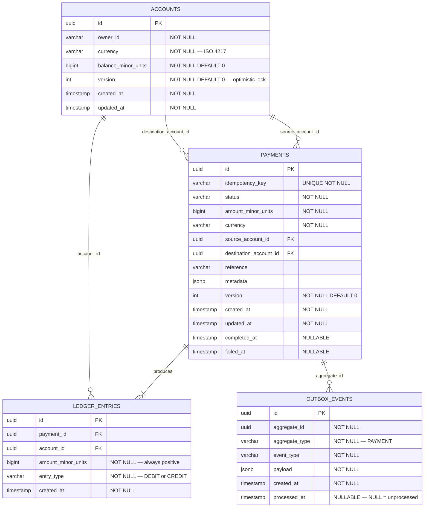
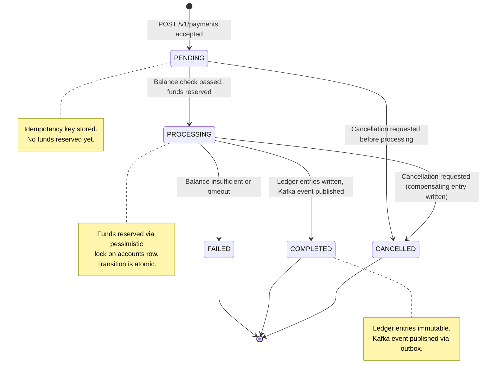

# Design a Payment Processing Service — Part 1

**The interview question:** "Design a payment processing service that handles 10,000 TPS with exactly-once guarantees."

This is the most common Staff-level system design question at Revolut, Wise, and Monzo. It tests requirements clarification, data modelling under financial correctness constraints, concurrency design, and your understanding of the exactly-once problem in distributed systems. This lesson walks through the first half of the interview: requirements, scale estimation, API design, and the data model.

Part 2 covers the distributed system design: idempotency implementation, outbox pattern, saga, and scaling.

---

## Requirements Clarification (5 Minutes)

The first five minutes are a structured Q&A. Do not start drawing boxes until you have written the answers on the whiteboard. Here is the full dialogue — your questions and the expected answers.

---

**You:** "Before I start designing, I want to establish a few constraints. What is the expected TPS, and what does the peak load profile look like?"

**Interviewer:** "We're targeting 10,000 TPS at steady state, with the ability to handle 3x spikes. Payment volume is higher during business hours in Europe — roughly 8am to 8pm UTC."

**What this tells you:** Steady-state 10K TPS, burst to 30K TPS. Autoscaling must handle intra-day patterns. This rules out a single unpartitioned PostgreSQL table for writes — you will need horizontal partitioning.

---

**You:** "What is the consistency requirement for balance updates? Can a customer see a stale balance momentarily, or do we require that every debit is immediately visible?"

**Interviewer:** "Strong consistency for balance updates. We cannot allow a customer to initiate two transfers simultaneously and have both succeed if the account has insufficient funds for both."

**What this tells you:** You cannot use optimistic reads from a replica for the debit step. The balance check and debit must happen in the same serialisable or repeatable-read transaction on the primary. This is the most consequential design constraint — it rules out eventual-consistency architectures for the core payment flow.

---

**You:** "What is the availability SLA, and what is the acceptable behaviour when the service is unavailable — do payments fail synchronously, or queue and retry?"

**Interviewer:** "We're targeting 99.95% uptime. For user-initiated transfers, synchronous failure is acceptable — the user sees an error and can retry. For scheduled payments and direct debits, we need durable queuing."

**What this tells you:** The API needs two modes. For interactive payments: synchronous, low-latency, fail-fast. For batch/scheduled: async with durable queue (Kafka). Design the synchronous path first; the async path is an extension.

---

**You:** "Is card data in scope? Are we tokenising externally, or do we store PANs?"

**Interviewer:** "Card data is out of scope for this service. Card numbers are tokenised by our vault provider before they reach this service. We receive a token, never a PAN."

**What this tells you:** This service is not in PCI cardholder data environment (CDE) scope. No special PCI controls required at the data model layer — no encryption-at-rest mandates beyond standard Postgres encryption. The service does remain in PCI scope for transaction data, but the highest-risk data (PANs) is handled externally.

---

**You:** "Do we have an existing infrastructure stack, or is this greenfield? Specifically: is Kafka available, what is the primary datastore, is there a service mesh?"

**Interviewer:** "We have Kafka (3 brokers in each region), PostgreSQL 16 as the primary store, Redis for caching, and Kubernetes for orchestration. Istio service mesh."

**What this tells you:** You do not need to propose a new messaging system or database. Design within the existing stack. The Kafka availability means the outbox pattern is viable. Redis availability means idempotency key caching is straightforward.

---

### Established Constraints (Write on Whiteboard)

```
Scale:         10,000 TPS steady, 30,000 TPS burst
Consistency:   STRONG — balance check + debit must be atomic
Availability:  99.95% SLA; synchronous rejection for interactive payments
PCI scope:     Tokenised externally — no PAN storage
Infrastructure: Kafka, PostgreSQL 16, Redis 7, Kubernetes + Istio
Audit trail:   Immutable ledger required (regulatory)
```

Every subsequent architectural decision should reference one of these constraints.

---

## Scale Estimation (5 Minutes)

Scale estimation in a fintech interview is not about getting the exact number — it is about demonstrating that your design choices are grounded in real capacity constraints.

### Write Throughput

```
Payment writes:
  10,000 TPS × 1 KB per payment record = 10 MB/s write throughput

Ledger entry writes (double-entry — 2 entries per payment):
  10,000 TPS × 2 entries × 500 bytes = 10 MB/s additional

Outbox event writes:
  10,000 TPS × 1 KB = 10 MB/s additional

Total write throughput: ~30 MB/s to PostgreSQL primary
```

This immediately signals that a single PostgreSQL primary will approach its write ceiling. Modern NVMe-backed Postgres instances can handle roughly 50,000–100,000 simple row insertions per second, but 10K TPS with multi-row transactions (payment + ledger entries + outbox) reduces effective throughput. **Horizontal sharding is not optional at this scale.**

### Storage

```
Daily storage:
  10,000 TPS × 86,400 seconds × ~2.5 KB (payment + ledger + outbox) = ~2 TB/day

Annual storage:
  ~700 TB/year (before compression and cold tiering)
```

**Conclusion:** Partitioning by `created_at` (monthly partitions) with cold storage migration after 90 days is mandatory. Hot storage (last 90 days) is roughly 60 TB. This is manageable on 10 shards of 6 TB each — feasible with modern cloud storage.

### IOPS Requirement

```
PostgreSQL write IOPS estimate:
  Each payment transaction touches ~5 pages (payment row, 2 ledger rows, outbox row, index updates)
  10,000 TPS × 5 pages = 50,000 IOPS on write path

With shared_buffers caching 90% of hot pages:
  ~5,000 IOPS actually hitting disk
```

This is well within AWS io2/gp3 volume capabilities (up to 64,000 IOPS on io2). Mention this to demonstrate you understand the gap between logical operations and physical I/O.

### Read Throughput

```
80% of traffic is GET /v1/payments/{id} status queries:
  10,000 TPS × 0.8 = 8,000 read TPS

These are point lookups by payment_id (UUID primary key):
  → Read replicas handle this comfortably
  → Redis cache for recently-submitted payments reduces replica load further
```

---

## API Design (5 Minutes)

### Payment Initiation

```
POST /v1/payments
X-Idempotency-Key: 7f9e8d2a-1b3c-4e5f-a6b7-c8d9e0f1a2b3
Content-Type: application/json
Authorization: Bearer <service-token>

{
  "amount": 50000,
  "currency": "GBP",
  "source_account_id": "acc_01JABCDEFGH",
  "destination_account_id": "acc_01JXYZ12345",
  "reference": "Rent payment October 2026",
  "payment_type": "TRANSFER",
  "metadata": {
    "initiated_by": "user_01JCUSTOMER",
    "channel": "mobile_app"
  }
}
```

**Success (first submission):**
```
HTTP/1.1 201 Created
Content-Type: application/json
X-Request-Id: req_01JABCDE

{
  "payment_id": "pay_01JABCDE",
  "status": "PENDING",
  "amount": 50000,
  "currency": "GBP",
  "source_account_id": "acc_01JABCDEFGH",
  "destination_account_id": "acc_01JXYZ12345",
  "reference": "Rent payment October 2026",
  "created_at": "2026-11-12T10:00:00.000Z"
}
```

**Duplicate submission (same `X-Idempotency-Key`):**
```
HTTP/1.1 200 OK
Content-Type: application/json
X-Idempotent-Replayed: true

{
  "payment_id": "pay_01JABCDE",
  "status": "PENDING",
  ...same body as original response...
}
```

The `HTTP 200` (not `201`) signals to the caller that this is a replayed response. The `X-Idempotent-Replayed: true` header allows monitoring tools to distinguish replays from originals without parsing the body. The `payment_id` is identical — the caller can use it to poll for status.

**Validation failure:**
```
HTTP/1.1 422 Unprocessable Entity
{
  "error": {
    "code": "INSUFFICIENT_FUNDS",
    "message": "Source account balance is insufficient for this transfer.",
    "payment_id": null,
    "details": {
      "available_balance": 10000,
      "required_amount": 50000,
      "currency": "GBP"
    }
  }
}
```

**Decision: idempotency key in header, not body.** The idempotency key is a protocol concern (retry safety), not a business entity attribute. It should not appear in event payloads, audit logs, or downstream systems. HTTP headers are the appropriate layer. This matches the Stripe convention — interviewers from Stripe backgrounds will notice.

**Decision: amounts in minor units (integer).** `50000` = £500.00. This is not negotiable in a fintech API. Floating-point representation of monetary values introduces rounding errors that accumulate across millions of transactions. Java's `BigDecimal` is used internally; minor-unit integers are used in the API and database.

### Payment Status Query

```
GET /v1/payments/{payment_id}
Authorization: Bearer <service-token>

HTTP/1.1 200 OK
{
  "payment_id": "pay_01JABCDE",
  "status": "COMPLETED",
  "amount": 50000,
  "currency": "GBP",
  "source_account_id": "acc_01JABCDEFGH",
  "destination_account_id": "acc_01JXYZ12345",
  "reference": "Rent payment October 2026",
  "created_at": "2026-11-12T10:00:00.000Z",
  "completed_at": "2026-11-12T10:00:00.482Z"
}
```

This endpoint reads from a **read replica** — it does not require strong consistency. Status is eventually consistent: a just-initiated payment may show `PENDING` on the replica for up to a few hundred milliseconds after creation. This is acceptable for status polling.

### Payment Cancellation

```
POST /v1/payments/{payment_id}/cancel
Authorization: Bearer <service-token>

HTTP/1.1 200 OK
{
  "payment_id": "pay_01JABCDE",
  "status": "CANCELLED",
  "cancelled_at": "2026-11-12T10:00:05.000Z"
}
```

Cancellation inserts a **compensating ledger entry** — it does not delete or update existing records. If the payment was already `COMPLETED`, cancellation returns `409 Conflict` with `PAYMENT_ALREADY_COMPLETED`. Interviewers ask about this: the correct answer is that you cannot cancel a completed payment — you initiate a refund, which is a new payment in the reverse direction.

---

## Data Model (10 Minutes)

### Entity Relationship Diagram



### PostgreSQL DDL

```sql
CREATE TABLE accounts (
    id              UUID        PRIMARY KEY DEFAULT gen_random_uuid(),
    owner_id        VARCHAR(64) NOT NULL,
    currency        CHAR(3)     NOT NULL,
    balance_minor_units BIGINT  NOT NULL DEFAULT 0,
    version         INTEGER     NOT NULL DEFAULT 0,
    created_at      TIMESTAMPTZ NOT NULL DEFAULT NOW(),
    updated_at      TIMESTAMPTZ NOT NULL DEFAULT NOW()
);

-- Index for account lookups by owner
CREATE INDEX idx_accounts_owner_id ON accounts(owner_id);


CREATE TABLE payments (
    id                   UUID        PRIMARY KEY DEFAULT gen_random_uuid(),
    idempotency_key      VARCHAR(64) NOT NULL,
    status               VARCHAR(20) NOT NULL DEFAULT 'PENDING',
    amount_minor_units   BIGINT      NOT NULL CHECK (amount_minor_units > 0),
    currency             CHAR(3)     NOT NULL,
    source_account_id    UUID        NOT NULL REFERENCES accounts(id),
    destination_account_id UUID      NOT NULL REFERENCES accounts(id),
    reference            VARCHAR(140),
    metadata             JSONB,
    version              INTEGER     NOT NULL DEFAULT 0,
    created_at           TIMESTAMPTZ NOT NULL DEFAULT NOW(),
    updated_at           TIMESTAMPTZ NOT NULL DEFAULT NOW(),
    completed_at         TIMESTAMPTZ,
    failed_at            TIMESTAMPTZ,

    CONSTRAINT uq_payments_idempotency_key UNIQUE (idempotency_key),
    CONSTRAINT chk_payments_status CHECK (
        status IN ('PENDING','PROCESSING','COMPLETED','FAILED','CANCELLED')
    ),
    CONSTRAINT chk_different_accounts CHECK (
        source_account_id <> destination_account_id
    )
);

-- Partial index for processing active payments only
CREATE INDEX idx_payments_status_created
    ON payments(status, created_at)
    WHERE status IN ('PENDING', 'PROCESSING');

-- Index for account history queries
CREATE INDEX idx_payments_source_account ON payments(source_account_id, created_at DESC);
CREATE INDEX idx_payments_dest_account   ON payments(destination_account_id, created_at DESC);


CREATE TABLE ledger_entries (
    id                   UUID        PRIMARY KEY DEFAULT gen_random_uuid(),
    payment_id           UUID        NOT NULL REFERENCES payments(id),
    account_id           UUID        NOT NULL REFERENCES accounts(id),
    amount_minor_units   BIGINT      NOT NULL CHECK (amount_minor_units > 0),
    entry_type           VARCHAR(10) NOT NULL,
    created_at           TIMESTAMPTZ NOT NULL DEFAULT NOW(),

    CONSTRAINT chk_entry_type CHECK (entry_type IN ('DEBIT', 'CREDIT'))
);

-- Ledger entries are append-only; no UPDATE or DELETE permissions granted

CREATE INDEX idx_ledger_entries_payment_id ON ledger_entries(payment_id);
CREATE INDEX idx_ledger_entries_account_id ON ledger_entries(account_id, created_at DESC);


CREATE TABLE outbox_events (
    id              UUID        PRIMARY KEY DEFAULT gen_random_uuid(),
    aggregate_id    UUID        NOT NULL,
    aggregate_type  VARCHAR(50) NOT NULL,
    event_type      VARCHAR(100) NOT NULL,
    payload         JSONB       NOT NULL,
    created_at      TIMESTAMPTZ NOT NULL DEFAULT NOW(),
    processed_at    TIMESTAMPTZ
);

-- Polling publisher queries this index constantly
CREATE INDEX idx_outbox_unprocessed
    ON outbox_events(created_at ASC)
    WHERE processed_at IS NULL;
```

### Key Schema Decisions

**`UNIQUE` constraint on `idempotency_key` (not an application-level check).** This is enforced by the database engine at the B-tree index level. When two concurrent requests with the same idempotency key race to INSERT, PostgreSQL serialises them — one succeeds, one gets a constraint violation. This eliminates the TOCTOU race that would exist with an application-level `SELECT` before `INSERT`.

**`version` column for optimistic locking.** When updating a payment's status, the application issues:
```sql
UPDATE payments
SET status = 'PROCESSING', version = version + 1, updated_at = NOW()
WHERE id = :id AND version = :expected_version;
```
If `UPDATE` returns 0 rows, another concurrent transaction updated the record first — throw `OptimisticLockingException` and retry. This avoids row-level locks for the common case where contention is low.

**`processed_at` nullable on `outbox_events`.** NULL means the event has not been published to Kafka. The partial index `WHERE processed_at IS NULL` ensures the polling publisher's SELECT scans only unprocessed events, not the entire table. This index shrinks as events are processed — it stays small and fast indefinitely.

**`amount_minor_units` always positive with CHECK constraint.** Direction (debit vs credit) is encoded in `entry_type`. Storing a negative amount for a debit is a common mistake that makes ledger reconciliation error-prone. With all amounts positive and direction explicit, the invariant `SUM(CREDIT) - SUM(DEBIT) = current_balance` is easy to verify and unit test.

**`TIMESTAMPTZ` for all timestamps.** Never `TIMESTAMP WITHOUT TIME ZONE` in a financial system. Payments cross time zones; daylight saving transitions create ambiguity without timezone information. All times stored and returned in UTC.

---

## Payment State Machine



### State Transition Rules

**PENDING → PROCESSING** is the critical transition. It is performed within a single database transaction that also:
1. Locks the source account row (`SELECT FOR UPDATE`)
2. Verifies `balance_minor_units >= amount_minor_units`
3. Debits the balance: `UPDATE accounts SET balance_minor_units = balance_minor_units - :amount, version = version + 1`
4. Credits the destination: `UPDATE accounts SET balance_minor_units = balance_minor_units + :amount, version = version + 1`
5. Inserts two ledger entries (DEBIT from source, CREDIT to destination)
6. Inserts the outbox event
7. Updates payment status to `PROCESSING`

All seven operations commit atomically, or none do. This is the exactly-once guarantee at the database layer.

**PROCESSING → COMPLETED** is performed by an async worker that confirms downstream processing and publishes the final event. For synchronous transfers within the same ledger, this can happen in the same transaction as the PENDING→PROCESSING transition.

**Terminal states are final.** A `COMPLETED` payment cannot be retransitioned. `FAILED` and `CANCELLED` are also final. Reversals are new payments, not state mutations of existing records.

---

## Concurrency Control Decision

This is the most technically nuanced part of the interview — interviewers at Stripe and Revolut probe this directly.

### Optimistic Locking

**Mechanism:** Read the record, hold the `version` number, write with `WHERE version = :read_version`, retry on conflict.

**Use when:** Contention is rare (most updates succeed on first try). The cost of retries is low relative to the cost of holding locks.

**Applied to:** Payment status transitions (PENDING → PROCESSING). Multiple workers may try to process the same payment, but it is rare in practice — the queue dispatcher routes each payment to one worker.

```java
// Spring Data JPA optimistic locking
@Version
private Integer version;

// Repository update with version check
@Modifying
@Query("""
    UPDATE Payment p SET p.status = :status, p.version = p.version + 1
    WHERE p.id = :id AND p.version = :version
    """)
int updateStatusWithVersion(UUID id, String status, int version);
// Returns 0 if version mismatch → throw OptimisticLockException
```

### Pessimistic Locking (`SELECT FOR UPDATE`)

**Mechanism:** Lock the row on read; no other transaction can read-for-update or write until the lock is released.

**Use when:** Contention is high, or the read-and-write-must-be-atomic property is required (e.g., balance check + debit: you must lock the account row before reading the balance, or another transaction can debit the same balance concurrently).

**Applied to:** The balance check + debit step. After transitioning to PROCESSING, the worker locks both account rows:

```sql
SELECT id, balance_minor_units, version
FROM accounts
WHERE id IN (:source_id, :dest_id)
ORDER BY id  -- consistent ordering prevents deadlock
FOR UPDATE;
```

**Why consistent ordering (`ORDER BY id`):** If Worker A locks account X then tries to lock account Y, while Worker B holds a lock on account Y and tries to lock account X, you have a deadlock. By always locking in the same deterministic order (ascending UUID), both workers will queue to acquire the first lock and the deadlock cannot form.

### Decision for This Service

```
Balance check + debit:         PESSIMISTIC (SELECT FOR UPDATE)
Payment status transitions:    OPTIMISTIC (version column)
Account balance updates:       PESSIMISTIC (inherent in FOR UPDATE step)
Outbox event insertions:       No contention — INSERT only
```

The interview answer is not "use one or the other" — it is "use pessimistic locking where you need atomicity between a read and a write, and optimistic locking elsewhere to maximise concurrency." Articulate this distinction explicitly.

---

## Summary: What You Have Built

At the end of the first half of this interview, you have established:

- **10,000 TPS** with strong consistency, requiring horizontal partitioning
- **REST API** with idempotency key in header, minor-unit amounts, structured error responses
- **Four-table PostgreSQL schema** with UNIQUE constraint on idempotency key, optimistic locking version column, append-only ledger, and partial index on unprocessed outbox events
- **State machine** with seven atomic operations in the PENDING → PROCESSING transition
- **Concurrency control split**: pessimistic for balance reads (correctness), optimistic for status transitions (throughput)

Part 2 covers the distributed design: how idempotency is implemented end-to-end, the outbox publisher, the cross-currency saga, and the scaling architecture.

---

<!-- KNOWLEDGE-CHECK
[
  {
    "id": "kc-02-01",
    "question": "Your payment service processes 10,000 TPS. Each payment transaction writes to the payments table, inserts 2 ledger entries, and inserts 1 outbox event — 4 rows total. During a system design interview, the interviewer asks why you chose to shard the database. Which calculation best justifies the decision?",
    "options": [
      "10,000 TPS × 4 rows = 40,000 row inserts/second, which exceeds typical PostgreSQL limits of approximately 10,000 simple inserts/second on a single primary, making horizontal partitioning necessary.",
      "The outbox table alone will exceed 1 TB within a week, requiring partitioning for storage reasons.",
      "PostgreSQL cannot handle transactions with more than 3 statements, requiring multiple database instances.",
      "10,000 TPS requires 10,000 database connections, which exceeds PostgreSQL's default max_connections of 100."
    ],
    "correct": 0,
    "explanation": "40,000 row inserts/second from multi-row transactions, combined with index maintenance and WAL writes, pushes a single PostgreSQL primary toward its write ceiling. While a highly optimised instance on NVMe storage can handle more, the safe design for a production system at this scale includes horizontal sharding to distribute write load. This also provides fault isolation — a shard failure affects only a subset of accounts. The other options contain factual errors: PostgreSQL has no 3-statement limit, max_connections defaults to 100 but is configurable and the actual constraint is memory per connection, not the count itself."
  },
  {
    "id": "kc-02-02",
    "question": "An interviewer asks: 'Your payments table has a UNIQUE constraint on idempotency_key. Why is this better than checking for an existing record in application code before inserting?' Which answer demonstrates the deepest understanding?",
    "options": [
      "The UNIQUE constraint is faster because it uses a B-tree index, while application-level checks require a full table scan.",
      "The database constraint enforces uniqueness atomically within the storage engine, eliminating the race condition where two concurrent requests both pass the application-level check and both proceed to INSERT — which would create a duplicate payment.",
      "Application-level checks cannot be performed in Java because the JVM does not support atomic compare-and-swap operations on remote databases.",
      "UNIQUE constraints are required by PCI DSS for payment systems."
    ],
    "correct": 1,
    "explanation": "The critical issue with application-level check-then-act is the race condition: Request A checks (no record found), Request B checks (no record found), Request A inserts, Request B inserts — duplicate payment. The database's UNIQUE constraint serialises concurrent INSERTs at the storage level using its internal locking — one wins, one gets a constraint violation error. This is a correctness guarantee, not a performance optimisation. The application catches the constraint violation and returns the original payment response."
  },
  {
    "id": "kc-02-03",
    "question": "During the design interview, you propose using SELECT FOR UPDATE to lock both source and destination accounts during the balance check. The interviewer asks: 'What deadlock scenario does your ORDER BY id prevent?' Which answer is correct?",
    "options": [
      "Without ORDER BY, PostgreSQL's query planner might choose a different index, causing a table lock instead of a row lock.",
      "Without consistent lock ordering, Transaction A can hold a lock on account X while waiting for account Y, while Transaction B holds a lock on account Y while waiting for account X — a circular wait causing deadlock. Ordering by account ID ensures all transactions acquire locks in the same sequence, breaking the circular dependency.",
      "ORDER BY id prevents duplicate locks being acquired on the same account ID in a single transaction.",
      "SELECT FOR UPDATE without ORDER BY will lock the entire accounts table rather than individual rows."
    ],
    "correct": 1,
    "explanation": "Classic deadlock on two-resource locking: if Thread A locks resource 1 then tries to lock resource 2, while Thread B already holds resource 2 and is trying to lock resource 1, neither can proceed. By establishing a canonical lock ordering (always lock the lower UUID first), all threads queue in the same order, and the circular wait condition cannot form. This is a standard deadlock prevention technique for multi-resource locking and is especially important in payment systems where many concurrent transfers may involve overlapping account pairs."
  },
  {
    "id": "kc-02-04",
    "question": "Your data model stores ledger entry amounts as always-positive BIGINT with an explicit entry_type of DEBIT or CREDIT. An interviewer suggests: 'Why not store debits as negative amounts? It simplifies the SQL — just SUM(amount) to get the balance.' How do you respond?",
    "options": [
      "Agree — negative amounts are simpler and there is no functional difference in a well-tested system.",
      "Storing debits as negative amounts makes the data model ambiguous (is a negative amount a debit or a data error?), complicates audit queries, and requires careful handling of the CHECK constraint. Separating sign from magnitude — using always-positive amounts with explicit DEBIT/CREDIT entry_type — makes each field's invariant clear, simplifies reconciliation queries (SUM WHERE entry_type = CREDIT minus SUM WHERE entry_type = DEBIT), and matches standard double-entry bookkeeping conventions.",
      "PostgreSQL BIGINT cannot represent negative values.",
      "Negative amounts would require storing the currency in a separate table."
    ],
    "correct": 1,
    "explanation": "In double-entry bookkeeping, amounts represent magnitudes and direction is a separate dimension. Mixing them (negative = debit) creates ambiguity: a negative balance adjustment that is itself a credit correction becomes doubly confusing. The standard pattern in production ledger systems is positive-only amounts with explicit entry type. It also makes reconciliation arithmetic explicit: you can verify that for every payment, there is exactly one DEBIT and one CREDIT of equal amounts, without sign-cancellation edge cases. The interviewer's suggestion is a simplification trap."
  }
]
-->

<!-- PRACTICAL-CHALLENGE
{
  "id": "pc-02",
  "title": "Payment Service: Requirements to Data Model",
  "description": "Work through the first half of a full payment service system design interview, from requirements to DDL.",
  "tasks": [
    {
      "id": "pc-02-01",
      "description": "Using the five clarifying questions from Lesson 1, write a complete requirements clarification dialogue for the prompt 'Design a payment service for a B2B invoicing platform processing 500 TPS with same-day settlement.' Include your questions, the interviewer's answers, and what each answer means for your design. Identify two constraints that differ from the Revolut consumer case in this lesson."
    },
    {
      "id": "pc-02-02",
      "description": "Perform a scale estimation for the B2B invoicing payment service: calculate write throughput (MB/s), annual storage requirement, estimated IOPS, and read throughput. Determine whether a single PostgreSQL primary is viable or whether sharding is required. Show your arithmetic."
    },
    {
      "id": "pc-02-03",
      "description": "Write the complete PostgreSQL DDL for the payments, ledger_entries, accounts, and outbox_events tables for the B2B invoicing service. Add at least two constraints or indexes that differ from the consumer payment DDL in this lesson, and justify each difference based on the B2B requirements you established in task 1."
    },
    {
      "id": "pc-02-04",
      "description": "Draw the payment state machine for a B2B invoice payment that includes an additional AWAITING_APPROVAL state (payments above £10,000 require manual approval before processing). Define the trigger, the actor, and the atomic database operations for each state transition. Identify which transitions require pessimistic locking and which are safe with optimistic locking."
    }
  ]
}
-->
