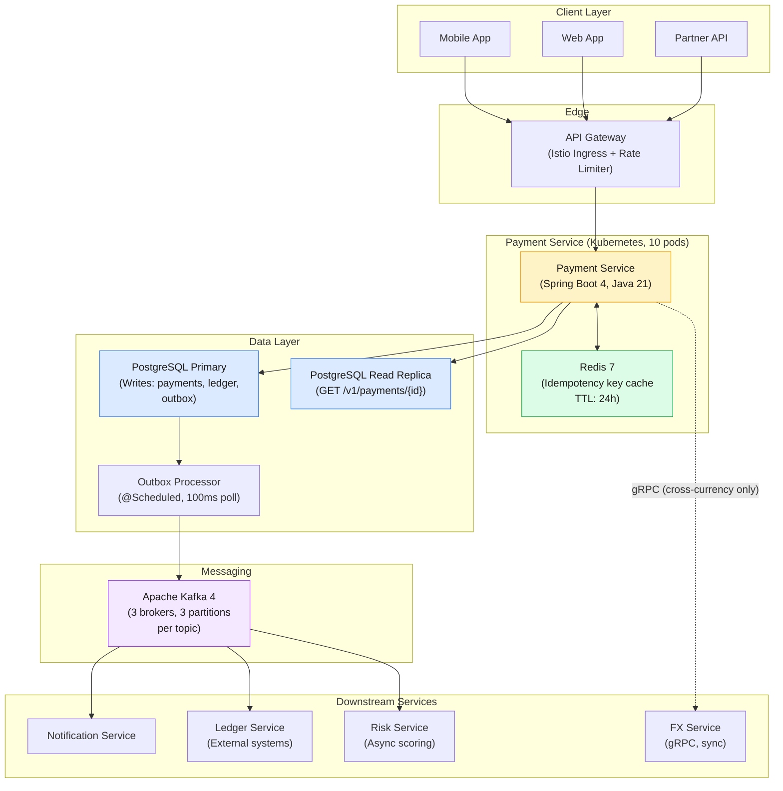
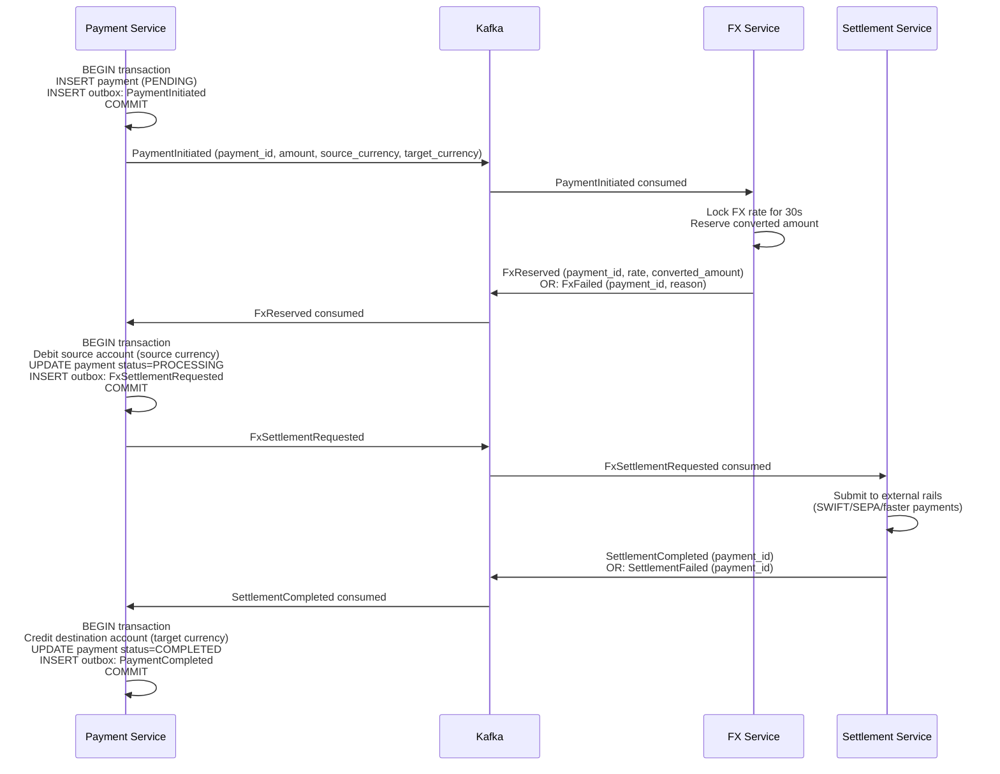
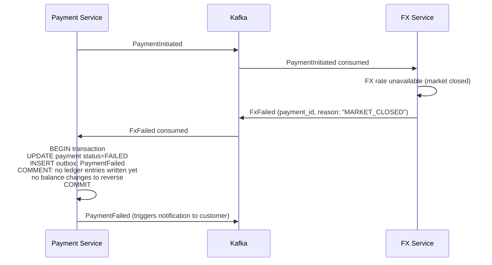

# Design a Payment Processing Service — Part 2

The interviewer has seen your data model. Now they lean in: "Walk me through the full distributed design. How does the idempotency actually work end-to-end? How does Kafka fit in? What happens in a cross-currency payment?"

This is the second half of the interview — the 25 minutes where Staff candidates separate from Senior candidates. This lesson covers the execution phase: system topology, idempotency implementation, outbox pattern, saga choreography, and the scaling decisions behind 10,000 TPS.

---

## High-Level Architecture

Draw this diagram early in the execution phase. It establishes the service boundaries before you go deep.



### Architecture Decisions Worth Articulating

**Stateless Payment Service pods.** No session state, no in-memory payment state. All durable state lives in PostgreSQL. This allows horizontal scaling with zero coordination between pods — the Kubernetes Horizontal Pod Autoscaler can add pods without any rebalancing.

**Read replica for status queries.** `GET /v1/payments/{id}` is 80% of traffic by TPS. These are point lookups that do not require strong consistency — a few hundred milliseconds of replication lag is acceptable for status polling. Routing reads to a replica reduces primary load by ~80%, which is the capacity that handles the write-heavy payment initiation path.

**Outbox Processor as a separate process.** The outbox polling publisher runs in a dedicated pod (not in the Payment Service pod), allowing it to scale independently and be deployed separately. Separating it also isolates failures: if the Kafka cluster is unavailable, only the Outbox Processor is affected — the Payment Service continues accepting and committing payments.

**gRPC only for cross-currency (FX Service).** Most payments are same-currency and require no FX call. The FX Service call is on the critical path for cross-currency payments only — gRPC's binary protocol reduces serialisation overhead for the latency-sensitive path.

---

## Idempotency Implementation (Deep Dive)

This is the question interviewers always ask in detail: "Walk me through exactly what happens when the client retries a payment request."

### Request Flow

```
Step 1: Check Redis cache
  GET idempotency:{key} → HIT: return cached response (HTTP 200)
                        → MISS: proceed to Step 2

Step 2: Attempt database INSERT
  INSERT INTO payments (id, idempotency_key, status, ...)
  ON CONFLICT (idempotency_key) DO NOTHING
  RETURNING id

  → Returns row: new payment created → proceed to Step 3
  → Returns no row: duplicate detected → SELECT existing, return (HTTP 200)

Step 3: Execute payment transaction (atomic)
  BEGIN;
    -- Insert the payment (already done in Step 2 or handle as single step)
    -- Lock source + destination accounts FOR UPDATE (ordered by id)
    -- Verify balance
    -- Update balances (source -amount, destination +amount)
    -- Insert ledger entries (DEBIT + CREDIT)
    -- Insert outbox_event
    -- Update payment status to PROCESSING
  COMMIT;

Step 4: Write to Redis cache
  SET idempotency:{key} = {payment_id, status, ...}  EX 86400
  (best-effort — failure here is acceptable)

Step 5: Return HTTP 201 with payment_id
```

### The Exact Transaction

```sql
-- All within a single database transaction
BEGIN;

-- Step 1: Insert payment (ON CONFLICT handles duplicate idempotency_key)
INSERT INTO payments (
    id, idempotency_key, status, amount_minor_units,
    currency, source_account_id, destination_account_id,
    reference, metadata, version, created_at, updated_at
)
VALUES (
    gen_random_uuid(), :idempotency_key, 'PENDING', :amount,
    :currency, :source_id, :dest_id,
    :reference, :metadata::jsonb, 0, NOW(), NOW()
)
ON CONFLICT (idempotency_key) DO NOTHING
RETURNING id;
-- If 0 rows returned: idempotency_key already exists → SELECT and return

-- Step 2: Lock accounts in ascending id order (deadlock prevention)
SELECT id, balance_minor_units, version
FROM accounts
WHERE id IN (:source_id, :dest_id)
ORDER BY id
FOR UPDATE;

-- Step 3: Verify balance
-- (application layer: if balance < amount → ROLLBACK, return 422)

-- Step 4: Debit source
UPDATE accounts
SET balance_minor_units = balance_minor_units - :amount,
    version = version + 1,
    updated_at = NOW()
WHERE id = :source_id;

-- Step 5: Credit destination
UPDATE accounts
SET balance_minor_units = balance_minor_units + :amount,
    version = version + 1,
    updated_at = NOW()
WHERE id = :dest_id;

-- Step 6: Insert double-entry ledger records
INSERT INTO ledger_entries (id, payment_id, account_id, amount_minor_units, entry_type, created_at)
VALUES
    (gen_random_uuid(), :payment_id, :source_id, :amount, 'DEBIT',  NOW()),
    (gen_random_uuid(), :payment_id, :dest_id,   :amount, 'CREDIT', NOW());

-- Step 7: Insert outbox event
INSERT INTO outbox_events (id, aggregate_id, aggregate_type, event_type, payload, created_at)
VALUES (
    gen_random_uuid(), :payment_id, 'PAYMENT', 'PAYMENT_PROCESSING',
    :payload::jsonb, NOW()
);

-- Step 8: Transition payment to PROCESSING
UPDATE payments
SET status = 'PROCESSING', version = version + 1, updated_at = NOW()
WHERE id = :payment_id;

COMMIT;
```

### What Happens on Retry

**Scenario A: First request succeeded, client retried due to timeout.**

The client sent the request, the server processed it, committed the database transaction, but the HTTP response was lost in transit (network timeout). The client retries with the same `X-Idempotency-Key`.

Flow:
1. Redis cache hit (Step 1) → return cached response immediately with `HTTP 200`
2. If Redis miss (cache evicted or not yet written): the INSERT in Step 2 returns 0 rows due to UNIQUE constraint violation → SELECT the existing payment → return `HTTP 200`

The client receives the same `payment_id` and can poll for status. The payment is not duplicated.

**Scenario B: First request failed mid-transaction (server crashed after BEGIN, before COMMIT).**

PostgreSQL rolls back the incomplete transaction automatically. The idempotency_key was never committed. The retry proceeds as a fresh request.

**Scenario C: Redis write failed after DB commit (Step 4 failed).**

The payment is in the database. The next retry misses Redis, hits the DB UNIQUE constraint, retrieves the existing payment, writes to Redis, and returns `HTTP 200`. Eventual consistency between Redis and DB is acceptable here — the DB is the source of truth.

---

## The Outbox Pattern Implementation

### Why Polling Publisher Over CDC (Debezium)

The outbox polling publisher (`@Scheduled`) queries `SELECT ... WHERE processed_at IS NULL` every 100ms, publishes to Kafka, and updates `processed_at`. This is simpler to operate than Debezium (Change Data Capture via PostgreSQL WAL):

| Concern | Polling Publisher | CDC (Debezium) |
|---|---|---|
| Operational complexity | Low — a Spring `@Scheduled` method | High — separate Kafka Connect cluster, connector management |
| Latency | 100ms max lag | Near-realtime (~10ms) |
| Throughput ceiling | ~10,000 events/sec (per publisher pod) | Scales with WAL throughput |
| Failure recovery | Idempotent replay — just re-query unprocessed | Kafka Connect restart, offset management |
| Infrastructure dependency | None beyond existing Kafka | Kafka Connect, Zookeeper/Schema Registry |

**At 10,000 TPS with an event per payment:** A polling publisher processing 10,000 events every 100ms (100 events/ms) is feasible with batched SELECT and Kafka batch publishing. At 100,000 TPS, you would switch to CDC for throughput.

**Use polling publisher** for this design. Explain that you would evaluate CDC at 5x the current scale.

### Polling Publisher Implementation

```java
@Component
@RequiredArgsConstructor
public class OutboxPublisher {

    private final OutboxEventRepository outboxRepo;
    private final KafkaTemplate<String, String> kafkaTemplate;
    private final ObjectMapper objectMapper;

    @Scheduled(fixedDelay = 100)
    @Transactional
    public void publishPendingEvents() {
        List<OutboxEvent> events = outboxRepo
            .findTop500ByProcessedAtIsNullOrderByCreatedAtAsc();

        if (events.isEmpty()) return;

        List<CompletableFuture<SendResult<String, String>>> futures = events.stream()
            .map(event -> kafkaTemplate.send(
                topicFor(event.getEventType()),
                event.getAggregateId().toString(),
                event.getPayload()
            ))
            .collect(toList());

        // Wait for Kafka acknowledgement before marking processed
        CompletableFuture.allOf(futures.toArray(new CompletableFuture[0])).join();

        Instant now = Instant.now();
        events.forEach(e -> e.setProcessedAt(now));
        outboxRepo.saveAll(events);
    }

    private String topicFor(String eventType) {
        return switch (eventType) {
            case "PAYMENT_PROCESSING"  -> "payments.processing";
            case "PAYMENT_COMPLETED"   -> "payments.completed";
            case "PAYMENT_FAILED"      -> "payments.failed";
            default -> "payments.events";
        };
    }
}
```

**Key implementation details:**

`findTop500` processes in batches. Processing all unprocessed events in one query risks very large result sets under backpressure. 500 events × 100ms poll = 5,000 events/second capacity from a single publisher pod. Run two publisher pods for headroom.

Kafka acknowledgement is awaited before `processed_at` is updated. If Kafka is unavailable, the futures throw, the transaction rolls back, `processed_at` remains NULL, and the publisher retries on the next poll. At-least-once delivery to Kafka — Kafka consumers must be idempotent (deduplicate by `aggregate_id` + `event_type`).

The `@Transactional` annotation ensures the `saveAll` (UPDATE processed_at) is atomic — if it fails, `processed_at` remains NULL and the events are republished on the next cycle.

---

## Saga for Cross-Currency Payments

For same-currency payments within the same ledger, the atomic transaction in the previous section is sufficient. For cross-currency payments, two additional services are involved: the FX Service (which locks an exchange rate) and the Settlement Service (which coordinates with external payment rails). A single database transaction cannot span service boundaries.

### Choreography-Based Saga

The saga is event-driven: each service listens for events on Kafka, performs its step, and emits the next event. No central orchestrator.



### Compensation Flow on FX Failure



**Why compensation is simple in this design:** The source account is not debited until after `FxReserved` is confirmed. If FX fails before the debit, there is nothing to reverse — the PENDING → FAILED transition is a metadata change only. This is the key design insight: defer balance mutations as late as possible in the saga to minimise compensation complexity.

**Settlement failure after debit (the hard case):** If the source is already debited and settlement fails, compensation requires a credit back to the source account (a new ledger entry) and updating the payment to `FAILED`. This is a true compensating transaction — emit a `CompensationRequired` event, which the Payment Service processes atomically.

### Saga Failure Guarantees

**At-least-once event delivery.** Kafka consumers may receive the same event twice (consumer crash between process and commit). Every saga step must be idempotent: processing `FxReserved` twice for the same `payment_id` should produce the same result as processing it once.

**Saga timeout.** Payments stuck in `PENDING` or `PROCESSING` for more than 48 hours (configurable) are automatically failed by a scheduled job. This catches dead sagas where a downstream service emitted no response.

**No two-phase commit.** The saga does not use distributed 2PC. Each step is a local ACID transaction plus a Kafka event. The eventual consistency between services is acceptable — the saga converges to a terminal state (COMPLETED or FAILED) with high probability and guaranteed completion via timeout.

---

## Scaling to 10,000 TPS

### Horizontal Pod Scaling

The Payment Service is stateless — Kubernetes HPA scales pods based on CPU utilisation. Each pod holds a HikariCP connection pool to the PostgreSQL primary.

**HikariCP configuration is a common interview trap.** The correct pool size is not "as large as possible."

```
Optimal pool size per pod = (core count × 2) + effective_spindle_count

For a 4-core pod:
  maximumPoolSize = (4 × 2) + 1 = 9

With 10 pods:
  Total connections to PostgreSQL = 90
  PostgreSQL default max_connections = 100 → need to increase or use PgBouncer
```

HikariCP queues requests when all connections are busy — a small pool with queueing outperforms a large pool with connection overhead. The PostgreSQL connection limit is a hard ceiling; with 10+ pods each with naive pool sizes of 100, you exhaust PostgreSQL's connection capacity. Use **PgBouncer** in transaction pooling mode to multiplex thousands of application-level connections onto a small pool of real PostgreSQL connections.

### Account-Based Sharding

```
10 shards, each handling ~1,000 TPS writes

Shard key: source_account_id
Shard assignment: shard_id = hash(source_account_id) % 10

Routing: Payment Service reads shard_id from account_id,
         routes transaction to correct shard's connection pool
```

**Why account_id as shard key?** Transactions between two accounts must be atomic. If the source and destination accounts are on different shards, you need a distributed transaction — which is what we are trying to avoid. By sharding on source_account_id, the debit always happens on one shard. Cross-shard credits (destination on a different shard) are handled via a compensating event consumed by the destination shard's service.

**Hot shard problem:** A very active account (e.g., Revolut's own treasury account) may become a hot shard. Mitigation: detect hot accounts and route them to a dedicated shard; use virtual shards (256 virtual shards mapped to 10 physical shards) to allow rebalancing without resharding.

### Redis Caching for Idempotency

```
Redis cache: idempotency_key → payment_response (TTL 24h)

Cache hit rate assumption: 80% of retries are within 24h
Benefit: eliminates DB roundtrip for most retries
         reduces lock contention on payments table

Cache miss: query PostgreSQL, populate cache, return response
```

**Cache invalidation is not needed.** Idempotency responses are immutable — once a payment is created, the idempotency key maps to the same `payment_id` forever. The TTL (24h) aligns with Stripe's idempotency key expiry policy — keys older than 24h get a new payment on retry.

### Read Replica Routing

```
Write operations  → PostgreSQL primary
  POST /v1/payments
  POST /v1/payments/{id}/cancel

Read operations   → PostgreSQL read replica
  GET /v1/payments/{id}
  GET /v1/payments?account_id=...

Routing implemented in Spring's AbstractRoutingDataSource:
  TransactionSynchronizationManager.isCurrentTransactionReadOnly()
  → true: use replica DataSource
  → false: use primary DataSource
```

Replication lag (typically <100ms) means a just-created payment may not be visible on the replica immediately. If the client calls `GET /v1/payments/{id}` within 100ms of creation, they may receive a 404. Mitigate with: (1) the POST response body already contains the initial status — polling is for status changes, not for confirming creation; (2) use a `Prefer: respond-async` / callback mechanism for clients that cannot tolerate eventual read consistency.

---

## Failure Handling

### Circuit Breaker on FX Service

The FX Service is on the synchronous critical path for cross-currency payments. A slow or unavailable FX Service must not cascade into the entire Payment Service.

```java
@Bean
public CircuitBreakerConfig fxServiceCircuitBreakerConfig() {
    return CircuitBreakerConfig.custom()
        .failureRateThreshold(50)           // Open after 50% failures
        .waitDurationInOpenState(Duration.ofSeconds(30))
        .slidingWindowSize(10)
        .permittedNumberOfCallsInHalfOpenState(3)
        .build();
}

// In the payment service:
@CircuitBreaker(name = "fxService", fallbackMethod = "rejectCurrencyConversion")
public FxQuote getFxQuote(String sourceCurrency, String targetCurrency) {
    return fxGrpcClient.getQuote(sourceCurrency, targetCurrency);
}

public FxQuote rejectCurrencyConversion(String s, String t, Throwable ex) {
    // Fail the payment with CURRENCY_CONVERSION_UNAVAILABLE
    // Do NOT return a stale cached rate — rate staleness causes financial loss
    throw new FxServiceUnavailableException("FX service unavailable, payment rejected");
}
```

**Critical:** Do not use a stale cached FX rate as the circuit breaker fallback. FX rates change continuously; applying a 10-minute-old rate to a live transaction exposes the company to currency risk. The correct fallback is to reject the cross-currency payment with a clear error — the customer can retry when the FX service recovers.

### Timeout Hierarchy

```
HTTP client timeout (inbound):       30s  — maximum time client waits
  ↓
FX gRPC call timeout:                 1s  — fail fast on FX unavailability
  ↓
PostgreSQL transaction timeout:        5s  — prevents long-running lock holders
  ↓
Saga step timeout (per event):        30s — max time between saga events
  ↓
Payment TTL (stuck in PENDING):       48h — scheduled cleanup job
```

The timeout hierarchy ensures that every resource is released in a bounded time. Without a PostgreSQL transaction timeout, a deadlock or slow query can hold `SELECT FOR UPDATE` locks indefinitely, blocking all concurrent payments touching the same accounts.

### Dead Letter Queue for Outbox Events

If the Outbox Publisher fails to deliver an event to Kafka after 3 retries (Kafka cluster unavailable, schema validation failure, etc.), the event is moved to a dead letter table:

```sql
CREATE TABLE outbox_dead_letter (
    id              UUID PRIMARY KEY,
    outbox_event_id UUID NOT NULL REFERENCES outbox_events(id),
    failure_reason  TEXT NOT NULL,
    retry_count     INTEGER NOT NULL DEFAULT 0,
    last_attempted  TIMESTAMPTZ NOT NULL,
    created_at      TIMESTAMPTZ NOT NULL DEFAULT NOW()
);
```

An operator can inspect and replay dead letter events after resolving the underlying issue. This prevents unprocessed outbox events from accumulating and degrading the partial index performance.

---

## Production Readiness

Interviewers at Revolut and Stripe always close with: "How would you know if something went wrong in production?"

### Metrics (Prometheus + Grafana)

```
payment_service_payment_created_total         [counter, by currency, type]
payment_service_payment_completed_total       [counter]
payment_service_payment_failed_total          [counter, by failure_reason]
payment_service_idempotency_cache_hit_ratio   [gauge]
payment_service_outbox_lag_events             [gauge — events awaiting publish]
payment_service_transaction_duration_seconds  [histogram, p50/p95/p99]
payment_service_db_connection_pool_active     [gauge, by shard]
```

**Alert: `outbox_lag_events > 1000` for 5 minutes.** The outbox publisher is falling behind — Kafka may be unavailable or the publisher is misconfigured.

**Alert: `payment_failed_total{reason="INSUFFICIENT_FUNDS"}` rate doubles in 5 minutes.** May indicate a data issue (balances incorrectly zeroed) or a legitimate spike in failed transfers.

### Distributed Tracing

Every payment initiation emits a trace with `payment_id` and `idempotency_key` as span attributes. The trace spans the full saga: Payment Service → FX Service → Settlement Service. If a cross-currency payment is stuck, the trace immediately shows which saga step is blocked.

---

## Summary: The Complete Picture

You have now designed a payment processing service that:

1. Accepts 10,000 TPS with 3x burst headroom via stateless horizontal scaling
2. Guarantees exactly-once processing via database UNIQUE constraints and atomic transactions
3. Publishes payment events reliably via the transactional outbox pattern
4. Handles cross-currency payments via choreography-based saga with compensation
5. Scales the database via account-based sharding with PgBouncer connection pooling
6. Protects against downstream failures via circuit breakers on the FX Service path
7. Recovers from all partial failures via idempotent retry, saga timeout, and dead letter handling

The key interview insight: **exactly-once is not a Kafka feature you turn on — it is a property you engineer at every layer**: UNIQUE constraints at the database, ON CONFLICT DO NOTHING in SQL, idempotent event consumers, and idempotent saga steps.

---

<!-- KNOWLEDGE-CHECK
[
  {
    "id": "kc-03-01",
    "question": "Your Outbox Publisher calls kafkaTemplate.send() and then outboxRepo.saveAll() to mark events processed. If the application crashes between the Kafka send and the database update, what happens on the next poll cycle, and why is this acceptable?",
    "options": [
      "The events are lost because Kafka has already acknowledged them and the database still shows them as unprocessed — a data inconsistency that requires manual intervention.",
      "The events are republished to Kafka on the next poll (at-least-once delivery). Kafka consumers must be idempotent — they deduplicate by aggregate_id and event_type. This is acceptable because idempotent consumers are a weaker requirement than the alternative (exactly-once end-to-end without an outbox), and duplicate events cause no harm if consumers are correctly written.",
      "PostgreSQL automatically rolls back the Kafka send when the application crashes, ensuring no event is published.",
      "The Kafka transaction manager coordinates with PostgreSQL to ensure the send and the database update are atomic."
    ],
    "correct": 1,
    "explanation": "The outbox pattern guarantees at-least-once delivery to Kafka. A crash between publish and processed_at update causes republication on the next poll. This is intentional: the alternative (at-most-once) would lose events. The design contract is that Kafka consumers must handle duplicate events idempotently — typically by checking if the event's aggregate_id + event_type has already been processed. This is a weaker requirement and much easier to satisfy than trying to make the publisher exactly-once, which would require distributed transactions."
  },
  {
    "id": "kc-03-02",
    "question": "An interviewer asks: 'Why do you shard on source_account_id rather than payment_id?' Which answer demonstrates the correct reasoning?",
    "options": [
      "Payment IDs are UUIDs and cannot be used as shard keys because they are not sequential.",
      "Sharding on source_account_id co-locates all debits for a given account on the same shard, allowing the balance check and debit to execute within a single-shard ACID transaction. Sharding on payment_id would randomly distribute payments, potentially placing a payment's source and destination debit operations on different shards and requiring cross-shard distributed transactions.",
      "Source account IDs have higher cardinality than payment IDs, resulting in better distribution across shards.",
      "Sharding on payment_id would require a global sequence generator, while account IDs are locally assignable."
    ],
    "correct": 1,
    "explanation": "The key insight is that the debit (the write that must be strongly consistent and atomic) is always on the source account. By sharding on source_account_id, the entire debit transaction — balance check, balance update, ledger entry — executes on a single shard with local ACID guarantees. The destination credit can be handled as a cross-shard compensating event without requiring distributed transactions, because the credit (adding money) is naturally idempotent and can be retried safely. Sharding on payment_id provides better distribution but destroys the locality property."
  },
  {
    "id": "kc-03-03",
    "question": "In the cross-currency saga, you defer debiting the source account until after the FX Service confirms rate reservation. The interviewer asks: 'What is the financial correctness benefit of this design choice?' Which answer is most precise?",
    "options": [
      "It reduces database lock contention by deferring the SELECT FOR UPDATE until later in the flow.",
      "It eliminates the need for compensating transactions in the FX failure case: since no funds were moved before FX confirmation, a failed FX reservation requires only a metadata update (PENDING → FAILED) with no ledger reversals. This minimises the complexity and risk of compensation logic.",
      "It allows the FX rate to be locked for a longer period, giving the customer better exchange rates.",
      "It ensures the payment can be processed on any shard, not just the source account's shard."
    ],
    "correct": 1,
    "explanation": "In a saga, compensation (undoing a completed step) is the most complex and error-prone part. By deferring balance mutations until all external dependencies are confirmed, you reduce the number of compensating transactions required. If FX fails before the debit, there is nothing to reverse — a PENDING → FAILED status update is sufficient. This is a deliberate saga design principle: order saga steps so that the steps that are most difficult to reverse (balance mutations) happen last. The fewer compensating transactions you need to implement and test, the more reliable your saga is."
  },
  {
    "id": "kc-03-04",
    "question": "You propose setting HikariCP's maximumPoolSize to 100 connections per pod across 20 pods — 2,000 total connections to PostgreSQL. The interviewer points out PostgreSQL's default max_connections is 100. You correctly note you would increase it. However, the interviewer then asks: 'Beyond the connection count limit, what is the performance problem with 2,000 connections to PostgreSQL?' Which answer is correct?",
    "options": [
      "PostgreSQL uses one thread per connection; 2,000 threads causes excessive context switching and memory consumption (~10MB per connection = 20GB RAM just for connection overhead).",
      "PostgreSQL can only process queries sequentially — more connections reduce throughput.",
      "2,000 connections require 2,000 open file descriptors, which exceeds the Linux default ulimit.",
      "PostgreSQL locks are per-connection and 2,000 locks cannot fit in shared_buffers."
    ],
    "correct": 0,
    "explanation": "PostgreSQL spawns one OS process (or thread in newer configurations) per connection. 2,000 connections means 2,000 processes/threads, each consuming ~10MB of memory for stack and per-connection overhead — roughly 20GB of RAM consumed by connection management alone, before any query processing. Additionally, the OS context-switching overhead for 2,000 threads under high concurrency degrades throughput. The solution is PgBouncer in transaction pooling mode: application pods connect to PgBouncer (which supports many connections cheaply), and PgBouncer maintains a small pool (e.g., 50–100) of real PostgreSQL connections, multiplexing transactions across them."
  }
]
-->

<!-- PRACTICAL-CHALLENGE
{
  "id": "pc-03",
  "title": "Payment Service: Distributed Design and Scaling",
  "description": "Design the distributed components of the payment service, including idempotency implementation, saga flow, and production scaling configuration.",
  "tasks": [
    {
      "id": "pc-03-01",
      "description": "Draw the complete sequence diagram for a payment that is submitted, times out at the client (HTTP 504), retried by the client, and ultimately succeeds. Show: the idempotency key path through Redis and PostgreSQL, the HTTP status codes at each step, and the final state of the outbox_events table. Identify every point where the system must handle a potential duplicate."
    },
    {
      "id": "pc-03-02",
      "description": "Design the compensation flow for a cross-currency saga where the source account has been debited but the Settlement Service returns a SettlementFailed event (external payment rail rejected the transfer). Write the specific Kafka events emitted, the database operations performed in each step, and the final state of the payment and ledger_entries tables. Show why the compensation is idempotent."
    },
    {
      "id": "pc-03-03",
      "description": "Calculate the optimal HikariCP pool size configuration for a Payment Service deployment with: 8-core pods, 15 pods total, PostgreSQL primary with max_connections = 500, PgBouncer with pool_size = 200. Determine: maximumPoolSize per pod, minimumIdle per pod, connectionTimeout, and whether PgBouncer is strictly necessary at this configuration. Show your arithmetic."
    },
    {
      "id": "pc-03-04",
      "description": "Define five Prometheus metrics and three alert rules for the payment service outbox pipeline. For each alert, specify: the PromQL expression, the threshold and duration, the severity (warning/critical), and the runbook action the on-call engineer should take. Ensure one alert detects Kafka consumer lag on the downstream side."
    }
  ]
}
-->
