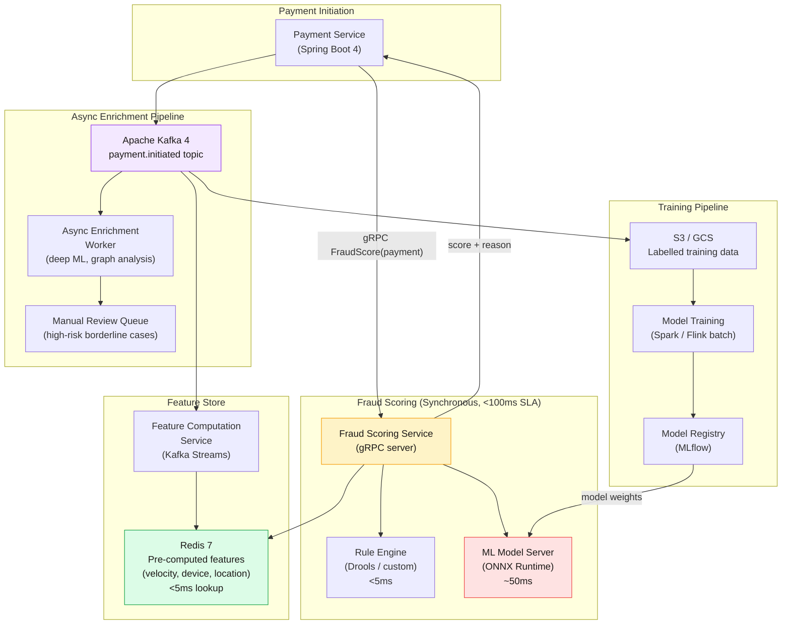
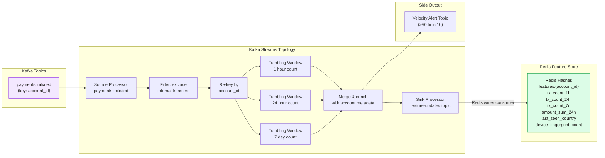
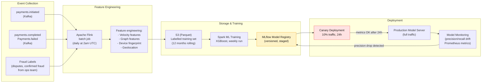

# Design a Fraud Detection Pipeline

**The interview question:** "Design a real-time fraud detection system that must score every payment in under 100ms with 99.9% availability."

This question is asked at Revolut, Monzo, and Stripe for Staff Backend roles and above. It tests your ability to reason about latency budgets, streaming architectures, ML serving trade-offs, and the specific failure modes of a system that is on the critical path for every payment. Getting this wrong operationally means either fraudulent payments go through or legitimate customers are blocked.

---

## Requirements Clarification (5 Minutes)

The fraud detection interview has a subtle trap in the requirements phase: the interviewer is testing whether you recognise the **accuracy vs latency trade-off** as a requirements question, not an implementation detail. Raise it yourself.

---

**You:** "What is the latency budget? You mentioned 100ms — is that p50, p95, or p99?"

**Interviewer:** "P99. The tail latency matters — a slow fraud check on 1% of transactions is still 100 blocked transactions per second at 10,000 TPS."

**What this tells you:** Designing for p99 means your system must handle resource contention, GC pauses, and cold cache paths within 100ms. This constrains your model choices significantly — a complex deep learning model with 300ms inference time cannot be used synchronously.

---

**You:** "What is the accuracy target, and what is the cost of a false positive versus a false negative?"

**Interviewer:** "We want to minimise false negatives (missed fraud) but false positives have a real cost — a blocked legitimate transaction costs us the payment revenue and risks customer churn. We're willing to accept a 0.1% false positive rate."

**What this tells you:** This is an explicit accuracy vs availability trade-off. You must design for a system that errs on the side of allowing borderline transactions rather than blocking them — the cost of a false positive exceeds the cost of a false negative in many retail payment scenarios. Flag this as a business decision that belongs with Product, not just Engineering.

---

**You:** "Must the fraud score block the payment synchronously (pre-authorisation), or can it run asynchronously (post-posting)?"

**Interviewer:** "For card payments and high-value transfers: synchronous, payment must be blocked if fraud score exceeds threshold. For low-value account-to-account transfers under £50: async is acceptable."

**What this tells you:** You need two execution paths in your design — a synchronous scoring path for high-risk payment types and an async enrichment path for low-risk types. Design both; explain the boundary condition.

---

**You:** "What is the model update frequency? Can a data scientist push a new model at any time, and how quickly does it need to take effect?"

**Interviewer:** "Models are retrained weekly. New models go through a canary deployment — 10% traffic for 24 hours, then full rollout. We need to roll back a bad model in under 5 minutes."

**What this tells you:** You need a model registry and traffic-splitting capability on the model serving layer. The 5-minute rollback requirement means model routing must be dynamic — a configuration change, not a deployment.

---

**You:** "Are there regulatory explainability requirements? If we block a customer's payment, can we provide a human-readable reason?"

**Interviewer:** "Yes — under UK FCA regulations and PSD2, if we decline a payment, we must be able to provide a reason on request. Fully opaque ML models are a compliance risk."

**What this tells you:** Pure deep learning models (black-box) require an interpretability layer. SHAP values, LIME, or a parallel rule engine can generate human-readable reasons. This requirement pushes toward hybrid designs (rule engine + ML) rather than pure ML.

---

### Established Constraints

```
Latency:         <100ms p99 for synchronous scoring
Throughput:      10,000 TPS (scoring request volume matches payment volume)
Availability:    99.9% (fraud service outage must NEVER block payments)
False positives: Tolerate 0.1% rate — prefer allowing borderline transactions
Explainability:  Human-readable decline reasons required (regulatory)
Model updates:   Weekly retrain, canary deployment, 5-min rollback
Sync/Async:      Card + high-value: sync. Low-value A2A: async
```

---

## Synchronous vs Asynchronous Fraud Scoring

The architectural choice between synchronous (pre-authorisation) and asynchronous (post-posting) scoring is one of the first decisions the interviewer expects you to address.

| Dimension | Synchronous (Pre-Auth) | Asynchronous (Post-Posting) |
|---|---|---|
| Fraud prevention | High — payment blocked before execution | Partial — fraud detected after payment completes |
| Customer experience | Can block legitimate payments (false positives create friction) | Never blocks legitimate payments |
| Latency requirement | Strict — adds to payment end-to-end latency | None — runs out of band |
| Reversibility | Not needed — payment not yet made | Required — clawback or dispute process needed |
| Implementation complexity | Lower — single synchronous call | Higher — event-driven, reconciliation needed |
| Use case fit | Card payments, high-value transfers | Account-to-account micro-transfers, recurring payments |

**Decision for this design:** Use synchronous scoring as the primary path with an asynchronous fallback. If the fraud service responds within the timeout, use the score. If it times out or is unavailable, fall back to a rule engine. Never block a payment due to fraud service unavailability — this is the **availability-over-accuracy trade-off** that distinguishes production-grade from academic system designs.

---

## High-Level Architecture



### Architecture Decisions

**gRPC between Payment Service and Fraud Scoring Service.** The fraud check is on the synchronous critical path — binary serialisation, HTTP/2 multiplexing, and generated client stubs reduce overhead compared to REST. A 1ms reduction in serialisation adds up at 10,000 TPS.

**Fraud Scoring Service queries Redis directly.** Feature lookup is the innermost operation in the latency budget. At p99 ~5ms for a Redis lookup versus ~50ms for the ML model inference, the feature retrieval is not the bottleneck — but it must be pre-warmed. If a feature is missing from Redis (new account, cold cache), the service falls back to default feature values rather than querying a slow source.

**Rule engine runs in parallel with ML model.** The rule engine provides the explainability layer required by regulation (FCA/PSD2). It also serves as the fallback when the ML model is unavailable. Rules are fast (<5ms) and can produce human-readable decline reasons (`"Unusual transaction velocity: 15 transactions in the last hour"`).

**Async enrichment for all payments (even when sync score passes).** Every payment is published to Kafka after the sync check. The async pipeline runs deeper analysis (graph-based fraud ring detection, more complex ML models, manual review queue for borderline cases). This enrichment does not block the payment — it feeds back into model training and can trigger retrospective action (account freeze, dispute initiation).

---

## Latency Budget Decomposition

The 100ms p99 budget must be allocated across every component in the synchronous path. Interviewers at Revolut and Stripe expect you to work through this explicitly — it drives every component selection decision.

```
Budget: 100ms p99

Network: Payment Service → Fraud Scoring Service (gRPC, same data centre)
  Allocation: 2ms

Feature lookup: Redis GET (pre-warmed, single key lookup)
  Allocation: 5ms (p99 — includes Redis GC pause, network jitter)

ML model inference: ONNX Runtime, XGBoost gradient boosting
  Allocation: 50ms (p99 — includes JVM warm-up, model loading overhead)

Rule engine evaluation: Drools / in-process rules
  Allocation: 5ms

Response serialisation + network return
  Allocation: 2ms

Internal processing overhead (gRPC marshalling, service routing)
  Allocation: 5ms

Total allocated: 69ms
Headroom: 31ms (for unexpected spikes, GC, Kubernetes scheduling jitter)
```

**The 50ms ML inference allocation drives the model selection.** XGBoost with 100 trees on a CPU can score in 10–50ms depending on feature count. A deep learning model (Transformer, LSTM) on CPU requires 200–500ms. The <100ms SLA with safety margin means: **XGBoost or similar gradient boosting is the maximum model complexity for synchronous scoring.** Deep models are reserved for the async enrichment pipeline.

**Rule engine as the safety net.** If the ML model server responds in >80ms, the service falls back to the rule engine result alone. The circuit breaker threshold is 80ms — leaving 20ms headroom for the rule engine path to complete within the 100ms budget.

---

## Kafka Streams Feature Computation

The feature store is only as useful as the features it contains. The Feature Computation Service reads payment events from Kafka and maintains rolling window aggregations in Redis — this is the technical deep dive interviewers probe hardest.

### Topology Design



### Kafka Streams Implementation

```java
@Component
public class VelocityFeatureTopology {

    @Bean
    public Topology buildTopology(StreamsBuilder builder) {

        KStream<String, PaymentEvent> payments = builder
            .stream("payments.initiated",
                Consumed.with(Serdes.String(), paymentEventSerde()));

        // 1-hour rolling transaction count per account
        KTable<Windowed<String>, Long> hourlyCount = payments
            .filter((accountId, event) -> !event.isInternalTransfer())
            .groupByKey(Grouped.with(Serdes.String(), paymentEventSerde()))
            .windowedBy(
                TimeWindows.ofSizeWithNoGrace(Duration.ofHours(1))
            )
            .count(Materialized.<String, Long, WindowStore<Bytes, byte[]>>as(
                "velocity-1h-store"
            ).withRetention(Duration.ofHours(2)));

        // 24-hour rolling amount sum per account
        KTable<Windowed<String>, Long> dailyAmountSum = payments
            .groupByKey(Grouped.with(Serdes.String(), paymentEventSerde()))
            .windowedBy(
                TimeWindows.ofSizeWithNoGrace(Duration.ofHours(24))
            )
            .aggregate(
                () -> 0L,
                (accountId, event, sum) -> sum + event.getAmountMinorUnits(),
                Materialized.<String, Long, WindowStore<Bytes, byte[]>>as(
                    "amount-sum-24h-store"
                ).withValueSerde(Serdes.Long())
            );

        // Write to feature-updates topic; a Redis sink consumer updates Redis
        hourlyCount.toStream()
            .map((windowedKey, count) -> KeyValue.pair(
                windowedKey.key(),
                new FeatureUpdate("tx_count_1h", count,
                    windowedKey.window().endTime())
            ))
            .to("feature-updates",
                Produced.with(Serdes.String(), featureUpdateSerde()));

        // High-velocity alert side output
        hourlyCount.toStream()
            .filter((windowedKey, count) -> count > 50)
            .map((windowedKey, count) -> KeyValue.pair(
                windowedKey.key(),
                new VelocityAlert(windowedKey.key(), count,
                    windowedKey.window().startTime())
            ))
            .to("fraud.velocity-alerts",
                Produced.with(Serdes.String(), velocityAlertSerde()));

        return builder.build();
    }
}
```

### Kafka Streams Configuration for Exactly-Once

```java
@Bean
public Properties kafkaStreamsProperties() {
    Properties props = new Properties();
    props.put(StreamsConfig.PROCESSING_GUARANTEE_CONFIG,
        StreamsConfig.EXACTLY_ONCE_V2);        // Requires Kafka 2.5+
    props.put(StreamsConfig.REPLICATION_FACTOR_CONFIG, 3);
    props.put(StreamsConfig.NUM_STREAM_THREADS_CONFIG, 4);
    props.put(StreamsConfig.STATE_DIR_CONFIG, "/var/kafka-streams/state");
    props.put(ConsumerConfig.AUTO_OFFSET_RESET_CONFIG, "earliest");
    return props;
}
```

**`EXACTLY_ONCE_V2` for feature updates.** Velocity counts must not be double-counted — processing a payment event twice would inflate the velocity count and potentially trigger false fraud flags. `EXACTLY_ONCE_V2` uses epoch fencing to prevent zombie writers from producing duplicate messages after a rebalance.

**RocksDB-backed state stores.** Kafka Streams uses RocksDB (embedded) for windowed state stores. State is local to the pod but replicated to Kafka changelog topics for fault tolerance. On pod restart, state is restored from the changelog — typically a few minutes for large state stores. During restoration, the pod does not serve requests (Kafka Streams standby replicas mitigate this for latency-sensitive applications).

**State store sizing.** At 10,000 TPS with 7-day windows across 1 million accounts, the state store holds approximately:
```
1,000,000 accounts × 3 windows × ~100 bytes per window entry
= ~300 MB per Kafka Streams partition
With 10 partitions: ~3 GB total state
```
This fits comfortably in memory or on fast NVMe storage.

---

## Model Serving at <100ms P99

### The Rule Engine vs ML Model Trade-off

This is the trade-off articulation the interviewer is waiting for. Do not say "ML is better." Say:

> "I'm choosing a hybrid approach — rule engine for immediate explainability and low latency, XGBoost for higher accuracy within the latency budget. The downside of the rule engine is that rules require manual maintenance and miss complex non-linear patterns. The downside of XGBoost is that it requires feature engineering and periodic retraining. I'd use the rule engine as the primary scoring mechanism for the first 90 days (before we have enough labelled data to train a reliable model), then introduce XGBoost as an additional signal once we have confidence in its calibration. The rule engine remains live as the explainability and fallback layer."

| Factor | Rule Engine | XGBoost |
|---|---|---|
| Latency | <5ms | 20–50ms |
| Accuracy | Lower (misses novel patterns) | Higher (learns from labelled data) |
| Explainability | Native (rule names are reasons) | Requires SHAP values post-hoc |
| Maintenance | High (rules become stale) | Moderate (weekly retrain) |
| Cold start | Works immediately | Requires labelled fraud data |
| Regulatory compliance | Easy (rules are auditable) | Requires interpretability layer |

### Synchronous Scoring Flow

```java
@GrpcService
public class FraudScoringServiceImpl extends FraudScoringServiceGrpc.FraudScoringServiceImplBase {

    private final FeatureStoreClient featureStore;
    private final RuleEngine ruleEngine;
    private final ModelServer modelServer;
    private final CircuitBreaker modelServerCircuitBreaker;

    @Override
    public void scorePayment(ScorePaymentRequest request,
                             StreamObserver<ScorePaymentResponse> observer) {
        try {
            // Step 1: Fetch pre-computed features from Redis (~5ms)
            AccountFeatures features = featureStore.getFeatures(
                request.getSourceAccountId()
            );

            // Step 2: Run rule engine (always, for explainability + fallback)
            RuleResult ruleResult = ruleEngine.evaluate(request, features);

            // Step 3: Run ML model (with circuit breaker)
            Optional<ModelScore> mlScore = modelServerCircuitBreaker.executeSupplier(
                () -> modelServer.score(request, features)
            );

            // Step 4: Combine scores
            FraudScore finalScore = combineScores(ruleResult, mlScore);

            observer.onNext(ScorePaymentResponse.newBuilder()
                .setScore(finalScore.getScore())
                .setDecision(finalScore.getDecision())
                .setReason(finalScore.getHumanReadableReason())  // FCA compliance
                .setModelVersion(mlScore.map(ModelScore::getModelVersion)
                    .orElse("rule-engine-only"))
                .build());
            observer.onCompleted();

        } catch (Exception e) {
            // NEVER fail the payment due to fraud service error
            observer.onNext(ScorePaymentResponse.newBuilder()
                .setDecision(Decision.ALLOW)
                .setReason("FRAUD_SERVICE_DEGRADED")
                .build());
            observer.onCompleted();
        }
    }
}
```

**Critical: catch-all returns ALLOW.** If the fraud service itself throws an unexpected exception, the payment is allowed through. This is a deliberate safety decision: a 100% false-block rate due to service error is worse than accepting a small amount of fraud during a service degradation window. The degradation is monitored and alerted on immediately — the on-call engineer investigates, but customers are not blocked in the meantime.

### Circuit Breaker on the ML Model Server

```java
@Bean
public CircuitBreaker modelServerCircuitBreaker() {
    return CircuitBreaker.of("model-server",
        CircuitBreakerConfig.custom()
            .failureRateThreshold(30)
            .slowCallRateThreshold(50)
            .slowCallDurationThreshold(Duration.ofMillis(80))  // 80ms threshold
            .waitDurationInOpenState(Duration.ofSeconds(10))
            .slidingWindowSize(20)
            .build()
    );
}
```

The `slowCallDurationThreshold` of 80ms is key: calls that complete but take >80ms are counted as failures for the circuit breaker. If >50% of calls are slow, the circuit opens and the fraud service falls back to rule-engine-only scoring. This prevents slow ML inference from cascading into payment latency breaches.

---

## Model Training Data Pipeline



### Label Creation (The Hard Part)

Training a fraud model requires labelled data: payments that were confirmed fraudulent (true positives) and confirmed legitimate (true negatives). Label quality is the most common bottleneck in production fraud systems.

**Positive labels (fraud):** Confirmed via (1) customer disputes that were upheld, (2) card network chargebacks, (3) manual review determinations from the fraud operations team.

**Negative labels (legitimate):** All payments that were not disputed within 90 days (assumed legitimate, with some noise from unreported fraud).

**Label lag problem:** A fraudulent payment may not be identified as fraud for weeks (customer notices on their statement, initiates dispute, dispute is investigated). Training data must include this 60-90 day lag window, meaning your training data is always at minimum 2-3 months stale. This is an inherent property of fraud detection — mention it.

**Class imbalance:** Fraud rates are typically 0.01–0.1% of transactions. A naive model that labels everything as legitimate achieves 99.9% accuracy but 0% recall. Use class-weight adjustment or oversampling (SMOTE) in training.

---

## Failure Modes and Mitigations

### Redis Unavailable (Feature Store Down)

```
Detection:  Redis connection timeout >5ms
Response:   Fall back to default feature values (0 velocity, unknown device)
Effect:     ML model runs on incomplete features → lower accuracy
Mitigation: Default features produce a conservative score (less likely to block)
Alert:      PagerDuty: fraud_feature_store_unavailable → P1
Recovery:   Redis reconnects, features repopulate within ~10 minutes via Kafka Streams
```

**Do not block payments when features are unavailable.** Use default values that bias toward ALLOW. The accuracy degradation during feature store outage is monitored and tolerated.

### Model Server Degraded (High Latency)

```
Detection:  Circuit breaker: >50% of calls take >80ms
Response:   Circuit opens; fall back to rule engine only
Effect:     Lower accuracy (rule engine), but all payments have a decision
Alert:      PagerDuty: fraud_model_server_degraded → P2
Recovery:   Circuit moves to half-open after 10 seconds, probes model server
```

### Kafka Streams Lag (Feature Freshness Degradation)

```
Detection:  consumer_lag > 10,000 on feature-computation consumer group
Response:   Features in Redis become stale (last-known values used)
Effect:     Velocity counts may be outdated by minutes
Alert:      PagerDuty: fraud_feature_staleness → P2
Recovery:   Add Kafka Streams partitions; check for slow processing bottleneck
```

**Stale features are better than no features.** A velocity count from 5 minutes ago is more useful than a default of zero. Redis features remain valid until TTL expiry (24h) — during Kafka Streams lag, features degrade gracefully.

---

## Production Readiness

### Metrics

```
fraud_scoring_requests_total              [counter, by decision: ALLOW/BLOCK/REVIEW]
fraud_scoring_latency_seconds             [histogram, p50/p95/p99]
fraud_model_inference_latency_seconds     [histogram, by model_version]
fraud_rule_engine_latency_seconds         [histogram]
fraud_feature_store_hit_ratio             [gauge — % of accounts with warm features]
fraud_model_precision                     [gauge — updated daily from labelled data]
fraud_model_recall                        [gauge]
fraud_circuit_breaker_state               [gauge — 0=CLOSED, 1=OPEN, 2=HALF_OPEN]
```

**Alert: `fraud_scoring_latency_seconds{quantile="0.99"} > 0.090` for 2 minutes** (90ms threshold with 10ms headroom before SLA breach) → P1.

**Alert: `fraud_model_precision` drops >10% week-over-week** → P2 (possible model drift, trigger ad-hoc retraining review).

**Alert: `fraud_scoring_requests_total{decision="BLOCK"}` rate increases >200% in 10 minutes** → P1 (possible rule misconfiguration causing mass false positives).

### Canary Deployment for Models

New model deployment uses traffic splitting, not blue-green. The model server receives a `model_version` parameter from the Fraud Scoring Service, which reads routing configuration from Redis:

```
Redis key: fraud:model:routing
Value:     {"primary": "xgb-v42", "canary": "xgb-v43", "canary_pct": 10}
```

The Fraud Scoring Service reads this configuration once per second (cached). For 10% of requests, it sends `model_version=xgb-v43`; for the remaining 90%, `model_version=xgb-v42`. Precision/recall metrics are computed per model version — if the canary shows worse precision, the routing config is updated to 0% canary, completing the rollback in <5 minutes (the cache refresh window).

---

## Summary: Key Design Decisions

| Decision | Choice | Justification |
|---|---|---|
| Scoring mode | Synchronous for card/high-value | Fraud must be preventable, not just detectable |
| Feature lookup | Redis (pre-computed) | <5ms p99; on-demand computation exceeds latency budget |
| Scoring model | Rule engine + XGBoost hybrid | Explainability (regulatory) + accuracy; pure ML fails <100ms SLA |
| Feature computation | Kafka Streams (exactly-once) | Fault-tolerant, stateful, event-driven; no double-counting |
| Fallback on model failure | Rule engine result | Never block payment due to fraud service failure |
| Circuit breaker threshold | 80ms slow call | Leaves 20ms headroom for rule engine fallback within 100ms budget |
| Model deployment | Canary with dynamic routing | 5-minute rollback without redeploy |

The central insight for this question: **fraud detection is a latency-constrained, accuracy-optimising system where the failure mode must always be ALLOW, never BLOCK.** A fraud detection system that blocks legitimate payments due to a service failure is worse than no fraud detection — it destroys customer trust and payment revenue. Every design decision flows from this operational constraint.

---

<!-- KNOWLEDGE-CHECK
[
  {
    "id": "kc-04-01",
    "question": "Your fraud detection service has a p99 latency target of 100ms. The ML team proposes replacing XGBoost with a Transformer-based model that improves precision from 94% to 97%, but has p99 inference latency of 250ms. How should you respond in the interview?",
    "options": [
      "Accept the new model — the precision improvement outweighs the latency cost.",
      "Reject the model entirely — the latency target is non-negotiable.",
      "The Transformer model cannot be used synchronously within the 100ms SLA. Propose a hybrid approach: keep XGBoost for the synchronous scoring path (maintains <100ms p99), and deploy the Transformer in the async enrichment pipeline where it scores every payment post-posting without latency constraints. High-risk payments flagged by the async pipeline are queued for manual review or trigger account-level risk adjustments.",
      "Request that the ML team optimise the model until it fits within 100ms."
    ],
    "correct": 2,
    "explanation": "This is a classic latency vs accuracy trade-off that requires a design solution, not a rejection. The correct architecture is a two-tier system: a fast model (XGBoost, <50ms) on the synchronous path, and a more accurate but slower model (Transformer) on the asynchronous path. The async path does not block payments — it enriches the risk profile and can trigger retrospective action. This is the architecture used in production fraud systems at large fintech companies. Rejecting the model entirely wastes the accuracy improvement; accepting it without a plan breaks the SLA."
  },
  {
    "id": "kc-04-02",
    "question": "Your Kafka Streams topology uses `EXACTLY_ONCE_V2` processing guarantee for velocity feature computation. The interviewer asks why exactly-once matters for this specific use case. Which answer is most precise?",
    "options": [
      "Exactly-once prevents duplicate messages from reaching Kafka consumers.",
      "Exactly-once ensures that each payment event is counted exactly once in the velocity aggregation. Without it, a consumer crash and rebalance could process the same payment event twice, inflating the velocity count. An inflated count would increase fraud scores for legitimate high-velocity accounts (e.g., merchants) and cause false positives — blocking legitimate payments.",
      "Exactly-once is required by Kafka for windowed aggregations to function correctly.",
      "Exactly-once prevents the state store from becoming corrupted during pod restarts."
    ],
    "correct": 1,
    "explanation": "In a windowed count aggregation, processing a payment event twice means the count is incremented twice for that window. For velocity-based fraud detection, an artificially inflated count directly causes false fraud flags. For example, a merchant processing 20 transactions per hour (legitimate) might appear to process 40 (fraudulent threshold) due to double-counting after a consumer rebalance. EXACTLY_ONCE_V2 uses epoch fencing to prevent zombie writers from producing duplicate state store updates after a rebalance, ensuring counts are accurate."
  },
  {
    "id": "kc-04-03",
    "question": "Your Fraud Scoring Service's ML model server circuit breaker opens (model server is degraded). The fallback is to return ALLOW for all payments. The interviewer challenges: 'This means fraudsters can exploit the outage window — doesn't that make your fallback unacceptable?' How do you respond?",
    "options": [
      "Agree — the fallback should be BLOCK during model server outage to prevent fraud exploitation.",
      "The alternative (blocking all payments during model server outage) fails the 99.9% availability requirement and causes massive customer and business harm. The fraud rate during a model server outage (minutes to hours) represents a small, quantifiable financial loss. The rule engine fallback continues operating, catching high-confidence fraud. The outage is immediately alerted on and resolved. The incremental fraud loss during the window is an accepted, bounded operational risk — it is better to absorb a small fraud increase than to block all legitimate customer payments.",
      "Implement a 50% traffic block during model server outage as a compromise.",
      "Cache the last 10 minutes of model scores and replay them during outage."
    ],
    "correct": 1,
    "explanation": "This is a classic availability vs accuracy trade-off in production systems. Blocking payments during a fraud service outage trades a small fraud risk (most payments are legitimate even without ML scoring) for a large availability failure (all customers are blocked). The correct answer requires quantifying the trade-off: at 10,000 TPS with a 0.1% fraud rate, 10 fraudulent transactions per second pass through during an outage. A 10-minute outage means ~6,000 potentially fraudulent transactions at risk. This is a bounded, acceptable loss compared to blocking 10,000 × 600 = 6 million legitimate transactions. The rule engine fallback continues catching obvious fraud, reducing the actual exposure further."
  },
  {
    "id": "kc-04-04",
    "question": "An interviewer asks why you pre-compute features in Redis rather than computing them on-demand when scoring a payment. Which answer best justifies the design?",
    "options": [
      "On-demand computation would require reading from Kafka, which does not support point lookups by account ID.",
      "Pre-computing in Redis moves feature computation off the synchronous critical path. On-demand velocity calculation (e.g., COUNT transactions in the last hour for account X) would require a PostgreSQL aggregation query, which at p99 might take 50–200ms — consuming most or all of the 100ms fraud scoring budget before the ML model even runs. Redis lookup is O(1) with p99 ~5ms. The trade-off is feature freshness: Redis features are computed asynchronously and may lag real-time by seconds. For velocity features, seconds of lag is acceptable — a fraud pattern that takes only seconds to exceed thresholds is rare.",
      "Pre-computing in Redis is required because Kafka Streams cannot read from PostgreSQL.",
      "On-demand computation would require a database transaction, which conflicts with Kafka Streams' exactly-once guarantee."
    ],
    "correct": 1,
    "explanation": "The core constraint is the 100ms latency budget. An aggregation query like COUNT(*) WHERE account_id = X AND created_at > NOW() - INTERVAL '1 hour' on a PostgreSQL table with millions of rows requires an index scan, and at p99 latency (factoring in lock contention, WAL, replica lag) might take 50–200ms. This would consume the entire latency budget before any fraud scoring happens. Pre-computing features moves this expensive computation out of the critical path. The tradeoff — features may be a few seconds stale — is acceptable for velocity features, whose nature is inherently approximate anyway."
  }
]
-->

<!-- PRACTICAL-CHALLENGE
{
  "id": "pc-04",
  "title": "Fraud Detection Pipeline: Architecture and Trade-offs",
  "description": "Design a production-grade real-time fraud detection system, working through the latency budget, feature design, and operational failure modes.",
  "tasks": [
    {
      "id": "pc-04-01",
      "description": "Decompose the 100ms p99 latency budget for a fraud scoring service that must: (1) look up 5 features from Redis, (2) run a rule engine evaluation, (3) call an ML model server, and (4) return a decision via gRPC. Assign millisecond allocations to each component with justification. Then identify which single component is the bottleneck and propose what you would do if the ML team requires a model with 150ms p99 inference to meet their accuracy target."
    },
    {
      "id": "pc-04-02",
      "description": "Design the Redis schema for a fraud feature store that must support: transaction velocity (count in 1h, 24h, 7d), total amount in 24h, number of distinct destination accounts in 7d, last seen country (ISO code), and device fingerprint hash. For each feature: specify the Redis data structure used (String, Hash, Sorted Set, etc.), the key naming convention, the TTL, and how the value is updated by the Kafka Streams feature computation job."
    },
    {
      "id": "pc-04-03",
      "description": "Draw the complete Kafka Streams topology for computing the following features from a payments.initiated stream (key: account_id): (1) transaction count per account in a tumbling 1-hour window, (2) sum of transaction amounts per account in a sliding 24-hour window, (3) count of distinct destination accounts per account in the last 7 days. For each feature, specify: the KStream/KTable operation, the window type and size, the state store type, and how exactly-once is maintained."
    },
    {
      "id": "pc-04-04",
      "description": "Define the complete failure mode analysis for the synchronous fraud scoring path: for each of the following failure scenarios, specify the detection mechanism, the fallback behaviour, the effect on fraud prevention accuracy, and the alert/runbook. Scenarios: (1) Redis cluster down, (2) ML model server latency spikes to p99 = 300ms, (3) Kafka Streams consumer lag exceeds 50,000 events, (4) a newly deployed model version has 40% false positive rate."
    }
  ]
}
-->
