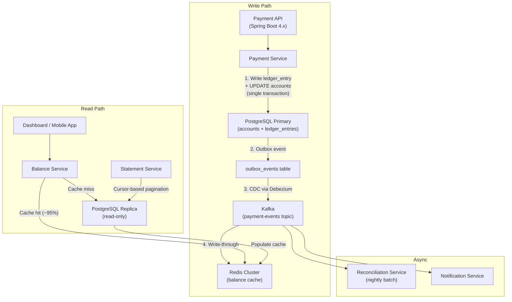

# Design a Financial Ledger at Scale

**Interview question:** "Design the core ledger system for a digital bank that handles 50 million accounts and 1 billion transactions per year with full auditability and regulatory compliance."

This is one of the highest-signal questions in fintech interviews. It tests whether you understand the difference between financial correctness and distributed correctness, and whether you can reason about the trade-off between consistency, performance, and auditability simultaneously.

---

## 1. Requirements Clarification

Do not skip this phase. Interviewers at Revolut and Monzo specifically expect you to surface hidden constraints before drawing a single box.

**Scale:**
- 50 million accounts
- 1 billion transactions/year = ~31 TPS average
- Peak: 10,000 TPS (payday cycles, Black Friday)
- Storage: assuming ~500 bytes per ledger entry, 1B entries/year = ~500 GB/year of raw ledger data

**Consistency:**
- Strong consistency required on balance writes — you cannot have a user's balance go negative or overdraw without authorisation. This rules out eventual consistency for the write path.
- Reads can tolerate up to ~200 ms staleness for display purposes (dashboard balance), but the balance used for a payment authorisation must be the committed balance.

**Immutability:**
- Regulatory requirement: transactions once committed cannot be modified or deleted.
- Corrections are made by posting a reversing entry (a credit to offset a debit), not by updating a row.
- This requirement essentially mandates an append-only ledger.

**Audit trail:**
- 7-year retention (PSD2, FCA, AML requirements)
- Regulator access must be possible without taking the system offline
- Every balance change must be traceable to a specific event and actor

**Additional constraints to surface:**
- Multi-currency: accounts hold a single currency, but cross-currency transfers require FX conversion events
- Reconciliation: nightly process must be able to verify that the sum of all credits equals the sum of all debits (double-entry invariant)
- Schema migration risk: any schema change to core ledger tables is extremely high risk

---

## 2. The Fundamental Design Decision: State vs Event Sourcing

This is the core trade-off the interviewer is testing. State your position, justify it, and acknowledge the downside.

### Option A: Pure State Model

```sql
CREATE TABLE accounts (
    id          UUID PRIMARY KEY,
    owner_id    UUID NOT NULL,
    currency    CHAR(3) NOT NULL,
    balance     NUMERIC(19, 4) NOT NULL DEFAULT 0,
    updated_at  TIMESTAMPTZ NOT NULL DEFAULT now()
);
```

Balance is a mutable column. Each payment `UPDATE`s the balance directly.

**Pros:** Balance read is O(1) — a single row lookup. Simple to implement.

**Cons:**
- Balance history is gone unless you separately log every change — which means you're maintaining two systems anyway.
- Concurrent writes cause lost updates without careful locking. Two concurrent debits can both read `balance = 100`, both subtract 50, both write `balance = 50`, and you've lost 50.
- The balance can silently diverge from the transaction history if the application has a bug.
- Immutability is bolted on rather than intrinsic.

### Option B: Pure Event Sourcing

```sql
CREATE TABLE ledger_entries (
    id              UUID PRIMARY KEY,
    account_id      UUID NOT NULL,
    amount          NUMERIC(19, 4) NOT NULL,  -- always positive
    entry_type      VARCHAR(6) NOT NULL CHECK (entry_type IN ('DEBIT', 'CREDIT')),
    payment_id      UUID NOT NULL,
    created_at      TIMESTAMPTZ NOT NULL DEFAULT now()
);
```

Balance = `SELECT SUM(CASE WHEN entry_type = 'CREDIT' THEN amount ELSE -amount END) FROM ledger_entries WHERE account_id = ?`

**Pros:** Immutable by design, full audit trail, correct by construction.

**Cons:**
- For an account with 10 years of history (and potentially thousands of transactions), every balance read is a full table scan over that account's partition. At 50M accounts × average 200 entries each = 10 billion rows — this is not viable for real-time authorisation.
- The aggregate query must be strongly consistent, which means it must run against the primary. This concentrates read load on the write path.

### Decision: Hybrid Model (Event Sourcing + Materialised Balance)

The correct answer for a production fintech ledger is to use both: an immutable event log (`ledger_entries`) as the source of truth, plus a materialised balance (`accounts.balance`) as a derived read optimisation, protected by an optimistic lock.

**The key insight:** `ledger_entries` is the truth; `accounts.balance` is a cache. If they diverge, `ledger_entries` wins, and reconciliation detects and corrects the discrepancy.

This is what Revolut, Wise, and Monzo have all described in engineering blog posts, in various forms.

---

## 3. Schema Design

### Core Tables

```sql
-- Write-side: materialised balance with optimistic locking
CREATE TABLE accounts (
    id              UUID PRIMARY KEY DEFAULT gen_random_uuid(),
    owner_id        UUID NOT NULL,
    currency        CHAR(3) NOT NULL,
    balance         NUMERIC(19, 4) NOT NULL DEFAULT 0,
    version         BIGINT NOT NULL DEFAULT 0,         -- optimistic lock version
    status          VARCHAR(20) NOT NULL DEFAULT 'ACTIVE',
    created_at      TIMESTAMPTZ NOT NULL DEFAULT now(),
    CONSTRAINT balance_non_negative CHECK (balance >= 0 OR status = 'OVERDRAFT_AUTHORISED')
);

-- Write-side: immutable event log
CREATE TABLE ledger_entries (
    id              UUID PRIMARY KEY DEFAULT gen_random_uuid(),
    account_id      UUID NOT NULL,
    amount          NUMERIC(19, 4) NOT NULL,
    entry_type      VARCHAR(6) NOT NULL CHECK (entry_type IN ('DEBIT', 'CREDIT')),
    running_balance NUMERIC(19, 4) NOT NULL,  -- denormalised for fast history queries
    payment_id      UUID NOT NULL,
    idempotency_key VARCHAR(64) UNIQUE,       -- deduplication
    created_at      TIMESTAMPTZ NOT NULL DEFAULT now(),
    CONSTRAINT amount_positive CHECK (amount > 0)
) PARTITION BY RANGE (created_at);

-- Balance snapshots for fast history reconstruction
CREATE TABLE account_balance_snapshots (
    account_id      UUID NOT NULL,
    balance_at      NUMERIC(19, 4) NOT NULL,
    entry_count     BIGINT NOT NULL,          -- entries included in this snapshot
    snapshot_date   DATE NOT NULL,
    PRIMARY KEY (account_id, snapshot_date)
);

-- Partitions (managed by pg_partman in production)
CREATE TABLE ledger_entries_2026 PARTITION OF ledger_entries
    FOR VALUES FROM ('2026-01-01') TO ('2027-01-01');
CREATE TABLE ledger_entries_2025 PARTITION OF ledger_entries
    FOR VALUES FROM ('2025-01-01') TO ('2026-01-01');
```

**Why `running_balance` is denormalised:** When a user opens their statement, they expect to see "Balance after transaction: £342.50" next to each row. Computing this from scratch requires scanning all prior entries in sequence — an O(n) scan per page load. Storing `running_balance` at write time (when we already know it) reduces statement history reads to a simple indexed range scan.

**Why `idempotency_key` has a UNIQUE constraint:** This is your primary defence against double-posting. The database enforces uniqueness; your application does not need a distributed lock to check for duplicates.

### Partition Strategy for 7-Year Retention

```sql
-- pg_partman configuration (conceptual — actual config is in pg_partman table)
-- Year partitions for ledger_entries
-- Active: current year + 1 prior year on SSD storage
-- Warm: 2-5 years old → compressed tablespace
-- Cold: 5-7 years → archive to S3 via pg_partman + pglogical or pg_dump

-- Create yearly partitions
SELECT partman.create_parent(
    p_parent_table   => 'public.ledger_entries',
    p_control        => 'created_at',
    p_type           => 'range',
    p_interval       => '1 year',
    p_premake        => 2,  -- create 2 future partitions in advance
    p_start_partition => '2020-01-01'
);

-- Retention policy: move partitions older than 2 years to cold tablespace
UPDATE partman.part_config
SET    retention = '2 years',
       retention_keep_table = true,  -- don't drop, just detach
       retention_schema = 'archive'
WHERE  parent_table = 'public.ledger_entries';
```

Detached partitions are moved to a read-only schema (`archive`) backed by a cheaper tablespace. Regulators can still query them via a reporting replica; they're not on the hot write path.

---

## 4. Concurrency Control for Balance Updates

This is the highest-risk part of the design. Getting this wrong means money can be created or destroyed.

### Optimistic Locking (default path)

```java
// In LedgerService.java
@Transactional
public LedgerEntry debitAccount(UUID accountId, BigDecimal amount, String idempotencyKey) {
    int rowsUpdated = accountRepository.decrementBalance(accountId, amount);
    if (rowsUpdated == 0) {
        // Either balance check failed or version mismatch (concurrent write)
        throw new OptimisticLockException("Concurrent modification detected, caller should retry");
    }
    return ledgerEntryRepository.insertEntry(accountId, amount, EntryType.DEBIT, idempotencyKey);
}
```

```sql
-- accountRepository.decrementBalance
UPDATE accounts
SET    balance  = balance - :amount,
       version  = version + 1
WHERE  id       = :accountId
  AND  balance >= :amount   -- insufficient funds check is atomic
  AND  version  = :currentVersion;
-- Returns 0 rows if: account not found, insufficient funds, OR concurrent write (version mismatch)
```

The caller reads the account (getting the current `version`), then calls this UPDATE. If another thread committed a balance change between the read and this UPDATE, the `version` will have changed and 0 rows are updated. The service retries — the retry reads the new balance and version.

**Retry budget:** Maximum 3 retries with 10 ms exponential backoff. If all retries fail, return a retriable error to the caller. This is acceptable for normal user accounts where contention is low.

### Pessimistic Locking (high-contention accounts)

For merchant collection accounts, Revolut Vault accounts, or any account that receives high-frequency concurrent credits (e.g., a business account receiving 500 payments/second from an e-commerce platform), optimistic locking generates too many retries.

```sql
-- Pessimistic path: SELECT FOR UPDATE serialises all writers
BEGIN;
SELECT id, balance, version
FROM   accounts
WHERE  id = :accountId
FOR UPDATE NOWAIT;  -- NOWAIT: fail immediately if locked rather than waiting indefinitely

UPDATE accounts
SET    balance = balance - :amount,
       version = version + 1
WHERE  id      = :accountId
  AND  balance >= :amount;

INSERT INTO ledger_entries (account_id, amount, entry_type, running_balance, payment_id, idempotency_key)
VALUES (:accountId, :amount, 'DEBIT', :newBalance, :paymentId, :idempotencyKey);
COMMIT;
```

**Routing logic:** Account metadata includes a `contention_tier` field (`LOW`, `HIGH`). The LedgerService checks this field before choosing the locking strategy. High-contention accounts are identified during onboarding (business accounts, vault accounts) or promoted dynamically when the retry rate for an account exceeds a threshold over a 5-minute window.

---

## 5. Architecture: Write Path and Read Path



**Why write-through cache on the write path and not the read path?** Because if you populate the cache lazily on cache miss, there is a window where the cache is empty and all requests hit the replica. After a cache flush (e.g., Redis restart), you get a thundering herd on the replica. Write-through ensures the cache is always warm immediately after a write commits.

**Why cursor-based pagination for statement history?** Offset-based pagination (`LIMIT 20 OFFSET 1000`) requires the database to scan and discard the first 1000 rows on every page request. For an account with 10,000 transactions, page 500 requires a scan of 10,000 rows. Cursor-based pagination uses the `id` or `created_at` of the last row seen:

```sql
-- Cursor-based: fast regardless of page depth
SELECT id, amount, entry_type, running_balance, created_at
FROM   ledger_entries
WHERE  account_id = :accountId
  AND  created_at < :cursorTimestamp  -- cursor from previous page
ORDER BY created_at DESC
LIMIT  20;
```

This uses the index on `(account_id, created_at)` and never scans rows it won't return.

---

## 6. Sharding Strategy

At 50 million accounts and 10,000 TPS peak, a single PostgreSQL instance will not be sufficient. You need horizontal sharding.

**Shard key:** `account_id` (UUID). Hash-based sharding: `shard = hash(account_id) % 16`.

**Account ID encoding:** To avoid cross-shard lookups on account ID alone, encode the shard affinity in the UUID itself. Use the first 4 bits of the UUID to store the shard number. This allows the router to determine the shard without a lookup table.

```java
// AccountIdGenerator.java
public UUID generateAccountId(int shardId) {
    UUID base = UUID.randomUUID();
    // Embed shard bits in the top 4 bits of the UUID
    long msb = (base.getMostSignificantBits() & 0x0FFFFFFFFFFFFFFFL)
             | ((long) shardId << 60);
    return new UUID(msb, base.getLeastSignificantBits());
}

public int extractShardId(UUID accountId) {
    return (int) (accountId.getMostSignificantBits() >>> 60) & 0xF;
}
```

**Cross-shard transfers — the hard problem:**

A transfer from Account A (shard 3) to Account B (shard 11) cannot be done in a single ACID transaction across two separate PostgreSQL instances. The correct answer is a **Saga pattern** with compensation.

```mermaid
sequenceDiagram
    participant TS as Transfer Service
    participant S3 as Shard 3 (Account A)
    participant Kafka
    participant S11 as Shard 11 (Account B)

    TS->>S3: BEGIN; Debit A by £100; INSERT outbox event; COMMIT
    S3-->>TS: OK (A debited, transfer_id=X)
    S3->>Kafka: publish TransferDebitedEvent{transferId=X, amount=100}

    Kafka->>S11: consume TransferDebitedEvent
    S11->>S11: BEGIN; Credit B by £100; INSERT outbox event; COMMIT
    S11-->>Kafka: publish TransferCreditedEvent{transferId=X}

    Note over TS,S11: Happy path complete

    alt Credit fails (Shard 11 error)
        S11-->>Kafka: publish TransferCreditFailedEvent{transferId=X}
        Kafka->>S3: consume TransferCreditFailedEvent
        S3->>S3: BEGIN; Reverse debit (credit A £100); COMMIT
        Note over S3: Compensation: money returned to sender
    end
```

**Key properties of this Saga:**
- Each step is a local ACID transaction on a single shard.
- Idempotency keys ensure that if the credit step is retried, the credit is not applied twice.
- The debit step includes a pending state (`TRANSFER_PENDING`) that is updated to `TRANSFER_COMPLETE` after the credit confirms. The user's available balance reflects the debit immediately; they cannot double-spend the in-flight amount.

---

## 7. Regulatory Compliance and Retention

**7-year retention implementation:**

1. `ledger_entries` is range-partitioned by year (shown above).
2. After 2 years, partitions are moved to a compressed tablespace (`pg_lz` compression) on cheaper storage. Write operations against old partitions are blocked (`ALTER TABLE ... ENABLE ROW LEVEL SECURITY` with a policy that rejects INSERTs).
3. After 5 years, partitions are detached and exported to S3 as Parquet files via a scheduled job. A metadata table tracks which date ranges are in cold storage.
4. A reporting replica with foreign data wrappers (FDW) pointing to the Parquet files allows regulators to query across hot + cold data with a single SQL interface.

**Immutability enforcement at the database level:**

```sql
-- Revoke UPDATE and DELETE from the application role
REVOKE UPDATE, DELETE ON TABLE ledger_entries FROM app_role;

-- Only INSERT is permitted
GRANT INSERT, SELECT ON TABLE ledger_entries TO app_role;

-- A separate audit_role for read-only regulator access
GRANT SELECT ON ALL TABLES IN SCHEMA public TO audit_role;
```

The application role can never modify or delete a ledger entry. This is enforced at the database privilege level, not just application logic.

**Hash chain for tamper evidence:**

```sql
ALTER TABLE ledger_entries ADD COLUMN entry_hash VARCHAR(64);

-- entry_hash = SHA256(id || account_id || amount || entry_type || payment_id || previous_entry_hash)
-- Computed at insert time by the application
-- A reconciliation job verifies the chain nightly
```

If any entry is modified (e.g., by a rogue DBA), the hash chain breaks at that point, and the nightly verification job alerts.

---

## 8. Observability Checklist

The interviewer may ask "how would you debug a balance discrepancy in production?" Have these ready:

- **Metric:** `ledger.debit.retry_rate` by account — spike indicates contention
- **Metric:** `ledger.write.latency_p99` — partition bloat or index degradation
- **Alert:** Balance of `accounts.balance` deviates from `SUM(ledger_entries)` for any account → page on-call immediately
- **Trace:** Every `ledger_entries` insert includes the trace ID of the originating HTTP request
- **Audit log query:** "Show me every change to account X in the last 24 hours" — answered by `ledger_entries WHERE account_id = X AND created_at > now() - interval '24h'`

---

<!-- KNOWLEDGE-CHECK
[
  {
    "id": "kc-05-01",
    "question": "An account with 8 years of transaction history (50,000 entries) needs its current balance computed for a payment authorisation. Which approach gives the strongest consistency guarantee with the best performance?",
    "options": [
      "SELECT SUM from ledger_entries against the read replica",
      "Read the materialised balance from accounts table on the primary, protected by SELECT FOR UPDATE",
      "Read balance from Redis cache, falling back to the replica on cache miss",
      "Replay ledger events through an in-memory aggregate on the application tier"
    ],
    "correct": 1,
    "explanation": "Payment authorisation requires the committed balance with strong consistency — it cannot use a replica (replication lag) or cache (stale). SELECT FOR UPDATE on the primary gives you the latest committed value and prevents concurrent modification during the authorisation check."
  },
  {
    "id": "kc-05-02",
    "question": "You are designing a cross-shard money transfer. Account A is on shard 3, Account B on shard 11. A developer proposes using XA (two-phase commit) across the two PostgreSQL instances. What is the primary reason to reject this approach for a high-throughput payment system?",
    "options": [
      "XA transactions cannot span different database vendors",
      "2PC holds locks on both shards for the duration of the prepare+commit round-trip, creating a latency and throughput bottleneck that does not scale",
      "PostgreSQL does not support XA transactions",
      "XA requires a separate transaction coordinator service which adds complexity"
    ],
    "correct": 1,
    "explanation": "2PC is correct for correctness but fatal for throughput. During the prepare phase, locks are held on both shards. If the coordinator crashes between prepare and commit, both shards are blocked until recovery. At 10,000 TPS, this blocking behaviour creates cascading failures. Saga with compensation is the production answer: each step is a short local transaction, and failure triggers a compensating transaction rather than holding distributed locks."
  },
  {
    "id": "kc-05-03",
    "question": "Your `ledger_entries` table has 10 billion rows partitioned by year. A reconciliation job needs to verify that for every account, SUM(credits) - SUM(debits) equals the materialised balance. The job runs nightly. What is the correct execution strategy?",
    "options": [
      "Run SELECT SUM(...) GROUP BY account_id across all partitions on the primary",
      "Stream all ledger events from Kafka and recompute balances in-memory",
      "Run the aggregation on a dedicated replica using partition pruning to limit the scan to recent partitions, comparing against a snapshot taken at the same LSN",
      "Export ledger_entries to S3 as CSV and run Spark aggregation"
    ],
    "correct": 2,
    "explanation": "Full reconciliation against all 10B rows nightly on the primary would devastate write performance. The correct approach uses a read replica (zero impact on writes), partition pruning to focus on the current period (since prior periods were reconciled and are immutable), and a consistent snapshot at a known LSN to avoid phantom reads during the aggregation."
  },
  {
    "id": "kc-05-04",
    "question": "You choose optimistic locking for balance updates on normal user accounts. Under what specific condition does this approach degrade to worse performance than pessimistic locking?",
    "options": [
      "When the account balance is exactly zero",
      "When more than one concurrent writer attempts to debit the same account within the same millisecond window, causing repeated retry loops that consume more total CPU than a serialised queue",
      "When the account has more than 10,000 ledger entries",
      "When the database primary is under high CPU load"
    ],
    "correct": 1,
    "explanation": "Optimistic locking assumes low contention. Under high contention (many concurrent writers to the same account), every writer except one will fail the version check and retry. With N concurrent writers, you get O(N²) total attempts in the worst case. This is the exact scenario where pessimistic locking (serialised queue via SELECT FOR UPDATE) outperforms optimistic: wasted retries exceed the cost of the lock wait."
  }
]
-->

---

<!-- PRACTICAL-CHALLENGE
{
  "id": "pc-05",
  "title": "Financial Ledger Design Sprint",
  "description": "Design and validate the core components of a production-grade financial ledger.",
  "tasks": [
    {
      "id": "pc-05-01",
      "description": "Draw the complete data model (ER diagram) for the hybrid ledger system: include accounts, ledger_entries, account_balance_snapshots, and the outbox_events table. Annotate each column with its purpose and mark which columns carry indexes and why."
    },
    {
      "id": "pc-05-02",
      "description": "Write the SQL for a cross-shard transfer Saga: (1) the debit transaction on shard A including outbox insert, (2) the credit transaction on shard B, and (3) the compensation transaction that reverses the debit if the credit fails. Ensure all three are idempotent using the idempotency_key column."
    },
    {
      "id": "pc-05-03",
      "description": "Capacity estimate: given 1 billion transactions per year, each ledger_entry row is 200 bytes, and you retain data for 7 years — calculate total raw storage, estimate compression savings at 4:1 for cold partitions, and determine how many 4 TB NVMe drives you need for the hot tier (current year + 1 prior year)."
    },
    {
      "id": "pc-05-04",
      "description": "Design the reconciliation alerting system: specify (1) the SQL query that detects a discrepancy between accounts.balance and SUM(ledger_entries) for any account, (2) the threshold at which you page vs log-only, and (3) the runbook steps for the on-call engineer who receives the alert."
    }
  ]
}
-->
