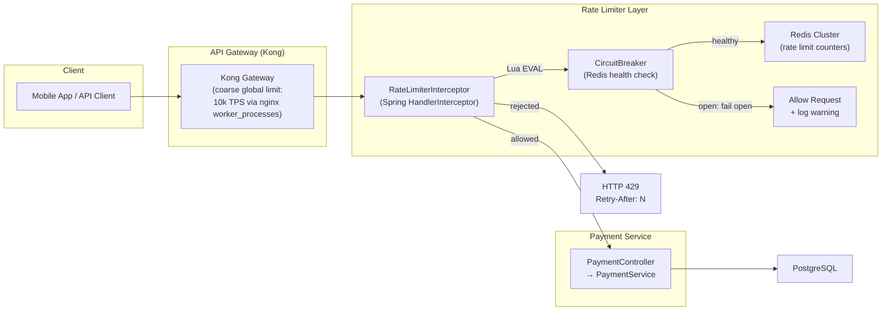
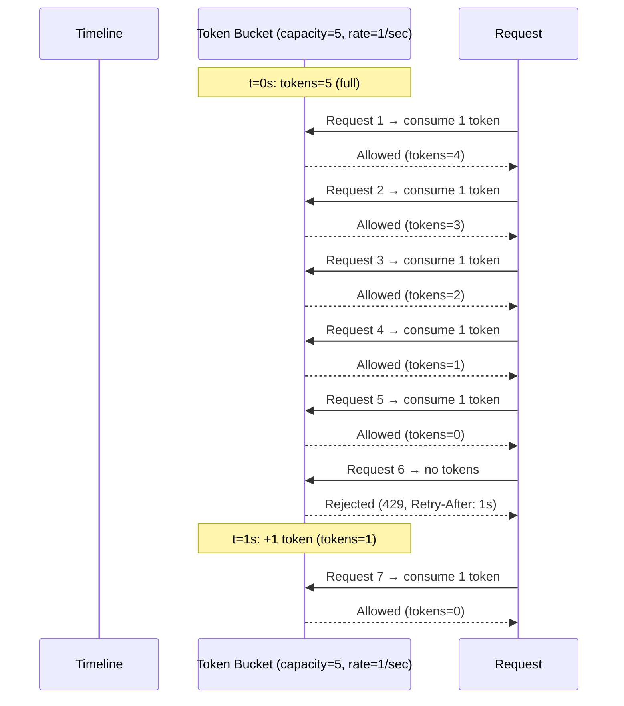

# Design a Rate Limiter for a Payment API

**Interview question:** "Design a rate limiter for a payment API that enforces: 100 requests/minute per user, 10,000 TPS total system throughput, and 1 payment per second per account."

This question is asked at Stripe, Revolut, and Adyen because it combines distributed systems thinking (how do you share state across pods?) with operational precision (what happens when Redis is down?). The answer reveals whether you think about rate limiting as a simple counter or as a nuanced policy enforcement mechanism.

---

## 1. Requirements Clarification

Before designing anything, surface the implicit constraints:

**What to rate limit:**
- All endpoints, or only payment initiation? (Answer: payment initiation specifically — read endpoints like balance queries have different risk profiles and limiting them too aggressively degrades UX)
- Internal service-to-service calls? (Usually excluded from user-facing rate limits but subject to their own circuit breakers)

**Limit granularity:**
- Per user (100 req/min): coarse protection against API abuse
- Per account (1 payment/sec): fine-grained protection against duplicate payment storms
- Global (10,000 TPS): system-level capacity protection

**Enforcement point:**
- API Gateway (Kong, Nginx) vs application-level Spring interceptor. This matters for latency budget.

**Distributed requirement:**
- The payment service runs on 20+ pods. A per-pod counter only enforces 100/20 = 5 req/min per pod effectively, which means a user hitting all pods could send 2,000 req/min. Rate limits must be enforced globally across all pods.

**Behaviour on limit hit:**
- Return HTTP 429 with `Retry-After` header
- Do NOT silently drop — the client must know to back off
- Do NOT block indefinitely — fail fast

**Behaviour on Redis failure:**
- This is the most revealing question. Payment companies typically: fail open (allow requests) with logging, because the cost of blocking legitimate payments exceeds the cost of allowing slightly more than the limit during a Redis outage.

---

## 2. Algorithm Comparison

You need to know all four and explain when each is appropriate. Do not just describe token bucket — interviewers will ask why you didn't use the others.

### Fixed Window Counter

```
Window: 00:00 - 01:00  → counter = 73
Window: 01:00 - 02:00  → counter = 0 (reset)
```

A user sends 100 requests at 00:59 and 100 more at 01:01. Both windows see 100 — the limit — but the user sent 200 requests in a 2-second span. This "burst at boundary" problem is the fundamental flaw.

**Use when:** You need simplicity and the 2× burst at boundaries is acceptable (e.g., non-financial analytics APIs).

### Sliding Window Log

Store the timestamp of every request. Count of requests in the window = `SELECT COUNT(*) WHERE timestamp > now() - window`. Accurate but storage-intensive at high QPS: at 10,000 TPS, storing individual timestamps is impractical.

**Use when:** You need perfect accuracy and volume is low (e.g., per-account limit checking where accounts have low individual frequency).

### Sliding Window Approximation

Combine the simplicity of fixed window with the accuracy of sliding window using the formula:

```
effective_count = current_window_count + previous_window_count × (1 - elapsed_in_current_window / window_size)
```

Example: 60-second window. 40 seconds into the current window. Previous window had 80 requests, current has 30.
Effective count = 30 + 80 × (1 - 40/60) = 30 + 80 × 0.333 = 30 + 26.6 = 56.6

This is accurate to within 0.1% and requires only two counters — no log. This is the technique used for high-volume per-user limits.

### Token Bucket

A bucket with capacity `B` starts full. Tokens refill at rate `R` tokens/second. Each request consumes one token. If the bucket is empty, the request is rejected.

**Properties:**
- Allows controlled bursting up to `B` requests
- After a burst, the account must wait for tokens to refill before sending again
- Handles bursty-but-bounded traffic naturally

**For payment APIs:** Token bucket is appropriate for user-level limits (100 req/min with a small burst allowance). A burst of 5-10 requests when a user first opens the app is legitimate and should not be rejected.

### Leaky Bucket

Requests enter a queue at any rate but exit at a fixed rate R. This smooths output — the downstream payment processor sees a steady request rate regardless of upstream burst. The queue acts as a buffer.

**Use when:** Protecting a downstream dependency (e.g., a card network) from burst. The rate limiter absorbs spikes, the downstream sees smooth flow.

**Decision for this system:**
- User-level (100 req/min): **sliding window approximation** — high volume, two-counter storage
- Account-level (1 payment/sec): **token bucket with B=1** — natural fit for "no more than 1 per second" with no burst
- Global throughput: **not a rate limiter** — this is a capacity planning and auto-scaling concern, not per-identity limiting

---

## 3. Redis Implementation

### Key Design

```
# User-level sliding window (two keys per window)
rate_limit:user:{userId}:current_window:{windowStart}   → INTEGER (count)
rate_limit:user:{userId}:previous_window:{windowStart}  → INTEGER (count)

# Account-level token bucket
rate_limit:account:{accountId}:tokens          → FLOAT (current token count)
rate_limit:account:{accountId}:last_refill_ts  → INTEGER (unix timestamp ms)
```

### Atomic Lua Script: Sliding Window Approximation

The critical requirement is **atomicity**: check-and-increment must be atomic. Without atomicity, two concurrent requests can both read count=99, both check `99 < 100`, both increment to 100, and you've allowed 101 requests.

`MULTI/EXEC` (Redis transactions) prevents commands from interleaving but does not allow conditional logic based on read results. Lua scripts execute atomically in Redis's single-threaded runtime — no other command executes while the script runs.

```lua
-- sliding_window_rate_limit.lua
-- KEYS[1] = current window key
-- KEYS[2] = previous window key
-- ARGV[1] = limit
-- ARGV[2] = window size in seconds
-- ARGV[3] = current timestamp (unix seconds)
-- ARGV[4] = current window start timestamp
-- Returns: {allowed: 1|0, remaining: N, reset_at: timestamp}

local limit          = tonumber(ARGV[1])
local window_size    = tonumber(ARGV[2])
local now            = tonumber(ARGV[3])
local window_start   = tonumber(ARGV[4])
local elapsed        = now - window_start

-- Read both window counts
local current_count  = tonumber(redis.call('GET', KEYS[1])) or 0
local previous_count = tonumber(redis.call('GET', KEYS[2])) or 0

-- Sliding window approximation
local weight         = 1 - (elapsed / window_size)
local effective      = current_count + (previous_count * weight)

if effective >= limit then
    -- Rate limited
    local reset_at = window_start + window_size
    return {0, 0, reset_at}
end

-- Increment current window counter
local new_count = redis.call('INCR', KEYS[1])
if new_count == 1 then
    -- First request in this window: set TTL to 2× window (need previous window to remain accessible)
    redis.call('EXPIRE', KEYS[1], window_size * 2)
end

local remaining = math.floor(limit - effective - 1)
local reset_at  = window_start + window_size
return {1, remaining, reset_at}
```

**Why Lua over Redis Functions (introduced in Redis 7)?** For this use case they are equivalent. Redis Functions provide better lifecycle management (they persist across restarts, support libraries). For new deployments on Redis 7+, prefer Functions. For compatibility with Redis 6, use EVAL with Lua.

### Token Bucket Lua Script (Account-Level)

```lua
-- token_bucket.lua
-- KEYS[1] = tokens key
-- KEYS[2] = last_refill_ts key
-- ARGV[1] = bucket_capacity (e.g., 1 for "1 payment/sec, no burst")
-- ARGV[2] = refill_rate (tokens per second)
-- ARGV[3] = current_timestamp_ms

local capacity     = tonumber(ARGV[1])
local refill_rate  = tonumber(ARGV[2])
local now_ms       = tonumber(ARGV[3])

local tokens       = tonumber(redis.call('GET', KEYS[1]))
local last_refill  = tonumber(redis.call('GET', KEYS[2]))

-- First request: initialise bucket
if tokens == nil then
    tokens      = capacity
    last_refill = now_ms
end

-- Compute tokens to add since last refill
local elapsed_seconds = (now_ms - last_refill) / 1000.0
local tokens_to_add   = elapsed_seconds * refill_rate
tokens = math.min(capacity, tokens + tokens_to_add)

if tokens < 1 then
    -- Bucket empty: compute when next token available
    local wait_ms = math.ceil((1 - tokens) / refill_rate * 1000)
    return {0, 0, wait_ms}
end

-- Consume one token
tokens = tokens - 1
redis.call('SET', KEYS[1], tokens, 'EX', 60)        -- TTL: auto-expire inactive buckets
redis.call('SET', KEYS[2], now_ms, 'EX', 60)
return {1, math.floor(tokens), 0}
```

---

## 4. Architecture: Request Flow



**Where to enforce limits — API Gateway vs Spring interceptor:**

| Concern | API Gateway (Kong) | Spring Interceptor |
|---|---|---|
| Global TPS cap | Yes — single point before any service | No — each service instance is independent |
| Per-user limits | Yes, with Kong rate-limit plugin | Yes — has access to auth context |
| Per-account limits | No — Gateway doesn't know account ID | Yes — available after auth parsing |
| Custom logic (e.g., VIP users) | Plugin code, harder to change | Java code, full flexibility |
| Latency overhead | ~0.5 ms (C-level plugin) | ~1-2 ms (JVM, Redis round-trip) |

**Recommendation:** Use the API Gateway for global TPS enforcement and coarse per-IP protection (DDoS). Use the Spring interceptor for per-user and per-account limits where you need auth context and business logic.

---

## 5. Token Bucket Visualisation



---

## 6. Failure Modes

### Redis Unavailable

```java
// RateLimiterService.java
@Component
public class RateLimiterService {

    private final RedisTemplate<String, String> redis;
    private final CircuitBreaker circuitBreaker;
    private final MeterRegistry metrics;

    public RateLimitResult checkLimit(String userId, String accountId) {
        try {
            return circuitBreaker.executeSupplier(() -> {
                return evalLuaScript(userId, accountId);
            });
        } catch (CallNotPermittedException e) {
            // Circuit is open: Redis is down
            metrics.counter("rate_limiter.circuit_open.requests").increment();
            log.warn("Rate limiter Redis unavailable, failing open for user={}", userId);
            // Fail open: allow request but log for audit
            return RateLimitResult.allowedDegraded();
        }
    }
}
```

**Why fail open for payments?** The alternative is fail closed — block all requests when Redis is unavailable. For a payment API:
- Fail closed during a Redis outage = 100% of your payment revenue stops
- Fail open during a Redis outage = some users might exceed their rate limit for a few minutes

The business cost of fail-closed is vastly higher. The risk of fail-open is bounded — a Redis outage is detected quickly, and the brief window of unrestricted requests is logged for review.

**Alert:** When the circuit opens, page the on-call engineer. The rate limiter being bypassed is a known, logged, time-bounded exception — not a silent failure.

### Redis Latency Spike

Add a timeout to the Redis call. If the Lua script takes more than 10 ms (a p99 outlier), fail open rather than adding 100 ms to every payment request.

```java
redis.execute(connection -> {
    connection.setTimeout(Duration.ofMillis(10));
    return connection.eval(luaScript, ...);
});
```

---

## 7. Response Headers

Every rate-limited response (HTTP 429) and every successful response from a rate-limited endpoint should include these headers:

```java
// RateLimiterInterceptor.java
@Override
public boolean preHandle(HttpServletRequest request, HttpServletResponse response, Object handler) {
    RateLimitResult result = rateLimiterService.checkLimit(userId, accountId);

    response.setHeader("X-RateLimit-Limit",     String.valueOf(result.getLimit()));
    response.setHeader("X-RateLimit-Remaining", String.valueOf(result.getRemaining()));
    response.setHeader("X-RateLimit-Reset",     String.valueOf(result.getResetAtEpochSeconds()));

    if (!result.isAllowed()) {
        long retryAfterSeconds = result.getRetryAfterSeconds();
        response.setHeader("Retry-After", String.valueOf(retryAfterSeconds));
        response.setStatus(HttpStatus.TOO_MANY_REQUESTS.value());
        response.getWriter().write("{\"error\":\"rate_limit_exceeded\",\"retry_after\":" + retryAfterSeconds + "}");
        return false;
    }
    return true;
}
```

**`Retry-After` semantics:** The value should be the number of seconds until the client can retry with confidence of success — not just the window reset time. For token bucket, this is `ceil((1 - current_tokens) / refill_rate)`. Clients that respect `Retry-After` make backing off automatic, reducing the thundering herd when a rate limit expires.

---

## 8. Observability

Key metrics for a production rate limiter:

```
rate_limiter.requests.total{user_id, allowed=true}
rate_limiter.requests.total{user_id, allowed=false}       ← spike = abuse or bug
rate_limiter.redis.latency_ms{percentile=p99}             ← > 5ms = problem
rate_limiter.circuit.state{state=open|closed|half-open}   ← open = page immediately
rate_limiter.lua_eval.duration_ms                         ← script performance
```

**Alert on:** More than 1% of requests being rate-limited from a single user ID (possible runaway client). Rate limit rejects exceeding 0.1% of total traffic (possible DDoS — escalate to network team).

---

<!-- KNOWLEDGE-CHECK
[
  {
    "id": "kc-06-01",
    "question": "Your rate limiter uses a fixed window counter (100 requests/minute). A client sends 100 requests at 12:00:59 and 100 more at 12:01:01. How many total requests pass through, and why is this a problem?",
    "options": [
      "100 requests pass — the first window is already full",
      "200 requests pass — both windows see exactly 100 requests and both are within the limit, but the client sent 200 requests in a 2-second span",
      "100 requests pass in the first window, 0 in the second due to global throttling",
      "150 requests pass due to the sliding window approximation applied automatically"
    ],
    "correct": 1,
    "explanation": "The fixed window counter resets at the minute boundary. The first window (12:00) sees 100 requests and passes them all (exactly at limit). The second window (12:01) sees 100 requests starting fresh from zero and also passes them all. The user effectively sent 200 requests in 2 seconds — twice the intended rate. This boundary burst problem is why production systems prefer token bucket or sliding window approximation."
  },
  {
    "id": "kc-06-02",
    "question": "Why must the check-and-decrement operation in a Redis rate limiter use a Lua script rather than two separate Redis commands (GET then DECR)?",
    "options": [
      "Lua scripts are faster than individual Redis commands due to network batching",
      "Two separate commands allow another client to modify the counter between the GET and DECR, causing a race condition where two requests both pass despite the limit being reached",
      "Redis DECR does not support conditional logic based on current value",
      "MULTI/EXEC transactions cannot be used for read-then-write patterns"
    ],
    "correct": 1,
    "explanation": "Redis is single-threaded but commands from different clients interleave. Client A reads count=99 (below limit 100). Client B also reads count=99 before Client A writes. Both decide to allow the request and both increment to 100. Result: 101 requests were allowed. A Lua script executes atomically — no other command runs while the script is executing — which eliminates this race condition entirely."
  },
  {
    "id": "kc-06-03",
    "question": "Your payment service has 50 pods. You implement a per-pod in-memory rate limiter (no Redis). Each pod allows 100 req/min per user. What is the effective global limit per user, and when would this be acceptable?",
    "options": [
      "100 req/min — the load balancer distributes requests evenly so each pod sees 1/50 of traffic",
      "5,000 req/min — a user hitting all pods equally can reach 100 × 50, so this is only acceptable for internal services where clients connect to a single pod",
      "100 req/min — round-robin load balancing ensures consistent distribution",
      "0 req/min — in-memory rate limiters are never acceptable in distributed systems"
    ],
    "correct": 1,
    "explanation": "With 50 pods each allowing 100 req/min independently, a user can send up to 5,000 req/min by distributing requests across pods. In practice, with round-robin load balancing, each pod sees roughly 1/50 of traffic — meaning the effective per-pod limit is 2 req/min for average traffic. The in-memory approach is only acceptable when: (1) the rate is a soft limit (overages are logged but not blocked), (2) the number of pods is small and stable, or (3) for coarse protection where 2× overage is tolerable."
  },
  {
    "id": "kc-06-04",
    "question": "Redis becomes unavailable during a peak payment period. Your rate limiter is configured to fail closed (block all requests when Redis is unreachable). What is the operational impact, and what would you change?",
    "options": [
      "No impact — the payment service handles the Redis failure gracefully with a local cache",
      "All payment requests return HTTP 503, which is correct behavior since rate limit enforcement cannot be guaranteed",
      "100% of payment traffic is blocked, causing complete revenue loss. Change to fail open with circuit breaker: allow requests during Redis outage, log for audit, and alert immediately",
      "Payments slow down by 10ms but continue processing via the fallback path"
    ],
    "correct": 2,
    "explanation": "Fail closed during a Redis outage means 0% of payments succeed — a complete outage caused by an infrastructure dependency failure, not a business logic problem. For a payment API, fail open is the correct policy: the brief window of unrestricted requests during a Redis outage is a known, monitored, logged exception. The circuit breaker ensures you detect the failure immediately, alert the on-call engineer, and restore enforcement as soon as Redis recovers."
  }
]
-->

---

<!-- PRACTICAL-CHALLENGE
{
  "id": "pc-06",
  "title": "Rate Limiter Implementation Sprint",
  "description": "Design and validate a production-grade distributed rate limiter for a payment API.",
  "tasks": [
    {
      "id": "pc-06-01",
      "description": "Write the complete Lua script for a token bucket rate limiter that supports: configurable capacity B and refill rate R, fractional token accumulation between requests, and returns {allowed, remaining_tokens, retry_after_ms}. Verify correctness by tracing through 3 requests at t=0s, t=0.5s, and t=1.5s with B=2 and R=1/sec."
    },
    {
      "id": "pc-06-02",
      "description": "Design the Spring Boot RateLimiterInterceptor: show the class structure, how it extracts userId and accountId from the request, how it calls the Redis Lua script, and how it sets X-RateLimit-* response headers. Include the Resilience4j CircuitBreaker configuration (failure threshold, wait duration, slow call threshold)."
    },
    {
      "id": "pc-06-03",
      "description": "Calculate the Redis memory footprint for the sliding window approximation rate limiter: 50 million active users, 2 keys per user (current + previous window), each key holding an integer counter with 60-second TTL. Estimate total memory usage and determine if a single Redis instance (128 GB RAM) is sufficient or if Redis Cluster is required."
    },
    {
      "id": "pc-06-04",
      "description": "Design the observability dashboard for the rate limiter: list 6 key metrics with their alert thresholds, describe the runbook for each of these 3 scenarios: (1) rate_limiter.rejects > 1% of traffic, (2) rate_limiter.redis.latency_p99 > 20ms, (3) circuit breaker transitions to OPEN state."
    }
  ]
}
-->
