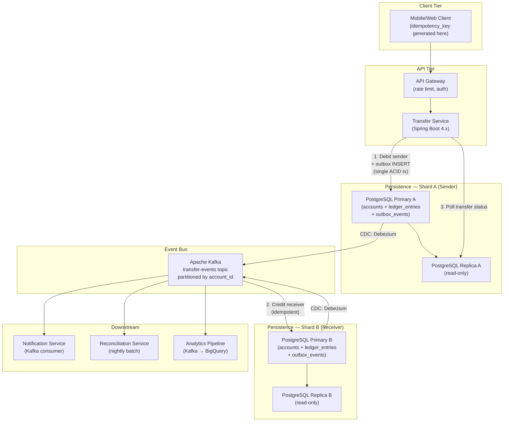

# 10 Common Fintech System Design Problems — Condensed Answers

This lesson is structured differently from lessons 2–6. Each section gives you a **model answer outline** for one frequently asked fintech system design question. These are not full designs — they are what you should cover in the **first 10 minutes** of a 45-minute interview session, before the interviewer steers you toward specific deep dives.

Each entry follows this structure:
1. **Key clarifying questions** — what to ask before drawing anything
2. **Core design decision** — the one architectural choice that defines the design
3. **Critical failure mode** — the one failure scenario you must mention proactively
4. **Likely follow-up** — where the interviewer will push you next

The goal is breadth and speed. When you encounter one of these in an actual interview, you should be able to lay out the skeleton in 8–10 minutes, then spend the remaining time on the follow-ups the interviewer cares about.

---

## Problem 1: "Design a Money Transfer Service"

**Key clarifying questions:**
- Domestic or cross-border? (Different latency and compliance requirements)
- Real-time or batch settlement? (Revolut internal is instant; SEPA Credit Transfer settles in hours)
- What's the failure recovery requirement? (Can we hold funds in a pending state indefinitely, or must we reverse within N seconds?)
- Maximum transfer amount? (Different AML screening thresholds)

**Core design decision: Outbox + Saga, not 2PC**

The transfer involves two accounts that may be on different database shards. Two-phase commit is the naive answer — it's wrong for high throughput because it holds distributed locks. The correct answer:

1. Debit the sender's account in a local transaction; write a `transfer_pending` outbox event in the same transaction
2. Publish the event to Kafka via Debezium (CDC)
3. A consumer credits the receiver's account in a separate local transaction
4. Write a `transfer_completed` event back through Kafka
5. If the credit fails: publish a `transfer_credit_failed` event → compensating transaction debits the sender back

Each step is a local ACID transaction. Idempotency keys prevent double-application. The saga state machine (`PENDING → DEBITED → COMPLETED | REVERSED`) is stored in a `transfers` table.

**Critical failure mode:** The outbox consumer crashes after the debit commits but before Kafka receives the event. Recovery: Debezium retries from the last committed WAL position. The idempotency key ensures the Kafka consumer does not double-process if the event is delivered twice.

**Likely follow-up:** "What happens if the receiver's account doesn't exist?" — the credit step fails, compensation triggers. "How do you handle the case where both debit and reversal fail?" — idempotent retry with exponential backoff and manual intervention queue after 3 failures.

---

## Problem 2: "How Would You Prevent Double Charging?"

**Key clarifying questions:**
- At which layer: client sending duplicate HTTP requests, or internal service retrying a failed RPC?
- Is the client known (authenticated user) or anonymous (webhook from card network)?
- What's the deduplication window? (5 minutes? 24 hours? Forever?)

**Core design decision: Idempotency key with UNIQUE constraint**

The client must supply an idempotency key (UUID, generated client-side) with every payment initiation request. The server enforces uniqueness at the database level:

```sql
CREATE TABLE payments (
    idempotency_key VARCHAR(64) UNIQUE NOT NULL,
    -- ... other columns
);
```

If the client retries with the same key, the INSERT fails with a unique constraint violation. The service catches this, looks up the existing payment by `idempotency_key`, and returns its current status — not an error.

**Two-layer deduplication:**
- Layer 1: Redis cache check (`SETNX idempotency:{key} "processing" EX 300`) — fast path, blocks concurrent in-flight duplicates
- Layer 2: DB UNIQUE constraint — durable deduplication for retries that arrive after the in-flight window

**Critical failure mode:** The payment is processed successfully but the response is lost (network timeout). The client retries. Redis TTL has expired (5 minutes), but the DB row exists. Layer 2 catches it and returns the existing payment. If Layer 2 is also unavailable during the retry: the client sees an error — not a double charge, because the UNIQUE constraint will catch the duplicate when the DB recovers.

**Likely follow-up:** "What if the client generates a new idempotency key on each retry?" — that's a client bug, not a server concern. The API contract must state that retries must use the same key. "How do you handle idempotency for webhook-driven payments?" — same principle: the card network's transaction ID is the idempotency key.

---

## Problem 3: "Design a Notification System for Payment Events"

**Key clarifying questions:**
- Notification channels: push notification, SMS, email? (Different latency requirements — push is real-time, email can be batched)
- Delivery guarantee: at-least-once? Exactly-once? (Can a user receive two push notifications for one payment?)
- Volume: 10 million payment events/day = ~115 events/second average

**Core design decision: Kafka consumer with idempotent handlers and dead-letter topic**

```
Payment Service → Kafka (payment-events) → Notification Consumer → {FCM, Twilio, SendGrid}
```

The notification consumer is an idempotent Kafka consumer. Processing a notification event twice must produce the same visible outcome to the user (deduplicate on payment ID + channel in a sent_notifications table). This is at-least-once delivery made safe by idempotency.

**Consumer configuration:**
- `enable.auto.commit=false` — manually commit offsets only after the notification is dispatched
- `max.poll.records=50` — limit batch size; if FCM is slow, don't hold up the consumer
- Separate consumer groups per notification channel (push, SMS, email) — different SLAs and delivery characteristics

**Dead-letter topic (DLT):** After N failures (default: 3), route the event to `payment-events-dlt`. A separate monitoring job alerts on DLT growth. Failed notifications are replayed during the incident post-mortem.

**Critical failure mode:** The notification is dispatched to FCM successfully, but the offset commit to Kafka fails. On restart, the consumer re-reads the event and tries to dispatch again. FCM returns "already delivered" (deduplicated by FCM's own idempotency). The sent_notifications DB check is the backstop for providers that don't deduplicate natively.

**Likely follow-up:** "How do you handle notification ordering?" (user should see payments in order, not scrambled) — partition by user_id, ensuring all events for a user go to the same partition, preserving order per user.

---

## Problem 4: "How Do You Handle a Database Failure Mid-Transaction?"

**Key clarifying questions:**
- Which type of failure: primary crash, network partition, disk full, slow query timeout?
- Is the transaction partially committed? (Writes before the crash point are durable; writes after are not)
- What's the recovery time objective? (How long can payments be held pending?)

**Core design decision: Outbox pattern + WAL-based recovery, not 2PC**

PostgreSQL's WAL (write-ahead log) ensures that any committed transaction survives a primary crash. When the primary restarts, it replays the WAL to recover committed state. Transactions that were in-flight at the time of the crash are automatically rolled back.

The outbox pattern makes cross-service coordination crash-safe:
- The payment row and the outbox event are written in a single local transaction
- If the crash happens before COMMIT: both are rolled back — no money moved, no event published
- If the crash happens after COMMIT: both are durable — the CDC process (Debezium) will pick up the outbox event when the primary comes back up

**What 2PC adds and why it's wrong here:** 2PC provides atomicity across two separate systems. But it requires both systems to reach a decision (commit or abort). If the coordinator crashes during the "prepared" phase, both participants are blocked until the coordinator recovers. This is a distributed lock that can hold indefinitely. The outbox avoids 2PC entirely by keeping the write to a single system.

**Critical failure mode:** The primary fails mid-replication, before the replica has received the latest WAL segment. When the replica is promoted, it is missing some committed transactions. This is a data loss scenario — it's why `synchronous_commit = remote_write` is used for financial systems (at the cost of write latency).

**Likely follow-up:** "What's your RPO?" — with `synchronous_commit = on`, RPO is 0 (no data loss on failover). With `synchronous_commit = off`, RPO depends on replication lag (typically milliseconds, but non-zero).

---

## Problem 5: "Design a Currency Exchange Service"

**Key clarifying questions:**
- Spot rates or indicative rates? (Spot must be real-time; indicative can be cached longer)
- Which data sources? (Bloomberg, Reuters, ECB reference rates, internal liquidity pools)
- What's the rate validity window? (Wise locks a rate for 30 seconds; Revolut for 10 seconds)
- Regulatory requirement: best execution? (Some jurisdictions require you to show users the rate they were quoted)

**Core design decision: Rate feed ingestion → Redis TTL cache → FX reservation → settlement**

```
Rate Provider (Bloomberg API) → Rate Ingestion Service → Redis (TTL: 1 second)
                                                        ↓
User requests FX quote → Rate Service reads Redis → Returns quote with expiry timestamp
                                                   ↓
User confirms → Payment Service creates FX reservation (locks rate for 30 seconds)
              → If confirmed within 30s: execute at reserved rate
              → If expired: re-quote or cancel
```

**Rate caching:** Redis with a 1-second TTL. The rate ingestion service writes new rates every 500 ms. If Redis fails, fall back to the last known good rate with a staleness flag in the response.

**FX reservation:** An atomic operation that records `{account_id, from_currency, to_currency, rate, reserved_at, expires_at}`. The rate is "locked" — if the market moves against the company during the 30-second window, the company absorbs the loss (factored into the spread).

**Critical failure mode:** High volatility event (flash crash). The ingestion service is receiving conflicting rates from different feeds. Use a median of the last 3 ticks rather than the latest tick to smooth outliers. Add a circuit breaker: if the rate moves more than X% in 1 second, halt new FX reservations and alert the treasury team.

**Likely follow-up:** "How do you handle reconciliation between reserved rates and settlement rates?" — the settlement rate (the actual rate at which you buy/sell currency from your liquidity provider) differs from the customer rate. The difference is the spread revenue. Daily reconciliation: sum of (settlement_rate - customer_rate) × amount = expected spread revenue.

---

## Problem 6: "How Would You Scale a Payment Service to 100,000 TPS?"

**Key clarifying questions:**
- Is this peak TPS or sustained? (100k sustained requires very different hardware planning than 100k peak for 30 seconds)
- Read/write ratio? (Balance reads vastly outnumber payment writes — different scaling strategies)
- What can be async? (Balance updates must be synchronous; notifications, analytics, reconciliation can be async)

**Core design decision: Scale the stateless tier horizontally; scale the stateful tier (DB) vertically + sharding + read replicas**

**Stateless tier (payment service pods):** Kubernetes HPA on CPU + RPS metric. At 100k TPS with ~50ms average processing time, steady-state concurrency = 5,000 in-flight requests. With 2 cores per pod and 50 concurrent threads per core: ~200 pods. These scale in and out in seconds.

**Database tier — the bottleneck:**
- PostgreSQL primary can handle ~10k–20k writes/second on modern NVMe hardware
- For 100k TPS: shard by account_id hash into 16 shards (each handling ~6k TPS write, well within limits)
- Read replicas: 1 primary + 3 replicas per shard for read scaling
- Balance reads: serve from Redis (99% hit rate). Only payment authorisation reads hit the DB primary.

**Async everything except the debit:** The payment write path must synchronously debit and return. Everything downstream (notifications, ledger updates to derived tables, analytics events, reconciliation records) goes through Kafka and is processed asynchronously. This decouples the write path latency from the downstream complexity.

**Critical failure mode:** One shard becomes a hot spot (e.g., a viral merchant collects 50% of all payments). Mitigation: virtual shards (256 virtual → 16 physical) allow rebalancing hot virtual shards to new physical shards without changing the account IDs.

**Likely follow-up:** "How do you handle schema migrations at this scale?" — online schema migrations (pg_repack, pglogical, or Percona Online Schema Change). Never lock a table that's receiving 6k writes/second.

---

## Problem 7: "Design an Audit Log System for PCI Compliance"

**Key clarifying questions:**
- What must be logged? (All cardholder data access, all configuration changes, all authentication events — PCI DSS Requirement 10)
- Who needs access? (Compliance team, internal audit, external QSA)
- Retention: PCI requires 12 months online + 12 months total — most companies keep 7 years for AML
- Must the log be tamper-evident? (Yes — a log that can be modified by the system is not an audit log)

**Core design decision: Append-only table + hash chain + cold storage**

```sql
CREATE TABLE audit_log (
    id              BIGSERIAL PRIMARY KEY,
    event_type      VARCHAR(50) NOT NULL,
    actor_id        UUID NOT NULL,         -- who performed the action
    resource_type   VARCHAR(50) NOT NULL,
    resource_id     UUID NOT NULL,
    event_data      JSONB NOT NULL,        -- what changed (before/after values)
    ip_address      INET,
    created_at      TIMESTAMPTZ NOT NULL DEFAULT now(),
    entry_hash      VARCHAR(64) NOT NULL,  -- SHA-256 of (id, event_data, previous_hash)
    CONSTRAINT audit_log_insert_only CHECK (true)  -- enforced by DB privileges
);

-- Application role: INSERT and SELECT only
REVOKE UPDATE, DELETE ON audit_log FROM app_role;
```

**Tamper evidence via hash chain:** Each row hashes its own content plus the hash of the previous row (`entry_hash = SHA256(id || event_data || previous_entry_hash)`). To modify any entry, every subsequent hash in the chain must be recomputed. A nightly verification job checks the chain: if any `entry_hash` doesn't match the computed value, it pages immediately.

**Encryption at rest:** Audit logs contain cardholder data. Encrypt the `event_data` JSONB column using PostgreSQL's `pgcrypto` extension with a key stored in a separate key management service (AWS KMS, HashiCorp Vault). The encryption key is rotated annually.

**Critical failure mode:** The hash chain verification job finds a broken chain. This could indicate: (a) a rogue modification, (b) a bug in the hash computation, or (c) a migration that re-ordered rows. The incident response procedure treats this as a potential breach until proven otherwise.

**Likely follow-up:** "How do you make audit logs searchable without exposing sensitive data?" — a separate read model (Elasticsearch or BigQuery) stores only the metadata (event_type, actor_id, resource_id, created_at) without cardholder data. Full event_data is fetched from the encrypted source only when needed.

---

## Problem 8: "How Would You Implement a Distributed Lock for Account Balance Updates?"

**Key clarifying questions:**
- What's the lock duration? (Balance update takes ~5ms — the lock should not live longer than 100ms)
- What's the failure mode if the lock holder crashes? (The lock must auto-expire to prevent deadlock)
- How many concurrent writers per account? (1-10: use DB-level locking. 100+: use Redis for the queue)

**Core design decision: SELECT FOR UPDATE for DB-local serialisation; Redis SETNX for cross-service coordination**

**Option A: SELECT FOR UPDATE (PostgreSQL)**
```sql
BEGIN;
SELECT id, balance FROM accounts WHERE id = ? FOR UPDATE NOWAIT;
-- If another transaction holds the lock: NOWAIT causes immediate error (no deadlock wait)
UPDATE accounts SET balance = balance - ? WHERE id = ?;
COMMIT;
-- Lock is released when transaction commits or rolls back
```

Best for: single-service, single-shard, low-to-medium contention. The lock lives exactly as long as the transaction — no separate expiry management needed. Automatic release on crash (transaction rollback).

**Option B: Redis SETNX + TTL**
```
SET lock:account:{accountId} {processId} NX PX 100
-- NX: only set if not exists
-- PX 100: auto-expire after 100ms (prevents deadlock if holder crashes)
```

Best for: cross-service locking where multiple services might update the same account (e.g., Payment Service + Refund Service are separate deployed services that share accounts). The TTL ensures the lock is released even if the holder crashes.

**Why not Redlock?** Redlock (Martin Kleppmann's critique is worth knowing) requires quorum across multiple independent Redis instances. Even then, it has correctness issues under clock skew and GC pauses. For payment systems, the simpler SELECT FOR UPDATE or single-instance Redis SETNX with appropriate TTL is safer and easier to reason about.

**Critical failure mode:** Lock holder crashes after acquiring the lock but before releasing it. SELECT FOR UPDATE: PostgreSQL detects the connection drop and rolls back the transaction, releasing the lock automatically. Redis SETNX: the TTL expires (100ms), releasing the lock. The key risk with Redis is setting the TTL too long — if a request takes longer than the TTL, a second holder acquires the lock while the first is still running (two concurrent writers).

**Likely follow-up:** "What's the minimum safe TTL for the Redis lock?" — TTL must be greater than p99.9 of the operation it protects. If the balance update takes max 50ms, set TTL to 500ms (10× headroom). Monitor `lock_acquisition_latency` and `operation_duration` to validate.

---

## Problem 9: "Design a Reconciliation System"

**Key clarifying questions:**
- What is being reconciled? (Internal ledger vs external card network settlement file? Or internal debit vs internal credit?)
- Frequency: real-time, hourly, nightly? (Most card network reconciliation is nightly — they send a settlement file at 02:00)
- What's the tolerance for discrepancies? (Any amount-level discrepancy above £0.01 must be flagged; count discrepancies above 0 must be flagged)

**Core design decision: Stream-based discrepancy detection + nightly batch for external reconciliation**

**Internal reconciliation (double-entry invariant):**
Sum of all DEBIT entries must equal sum of all CREDIT entries across all accounts. Any deviation is a critical bug.

```sql
-- Run on read replica
SELECT
    SUM(CASE WHEN entry_type = 'DEBIT'  THEN amount ELSE 0 END) AS total_debits,
    SUM(CASE WHEN entry_type = 'CREDIT' THEN amount ELSE 0 END) AS total_credits,
    ABS(SUM(CASE WHEN entry_type = 'CREDIT' THEN amount ELSE -amount END)) AS discrepancy
FROM ledger_entries
WHERE created_at >= CURRENT_DATE AND created_at < CURRENT_DATE + INTERVAL '1 day';
```

**External reconciliation (card network):**
1. Card network sends settlement file (ISO 8583 or CSV) at 02:00 containing all settled transactions from the previous day
2. Import file into `external_settlements` staging table
3. JOIN against `payments` table on card network transaction ID
4. Three categories: matched (expected), missing from internal (card network has it, we don't — potential data loss), missing from external (we have it, card network doesn't — potential fraud or timing issue)
5. Alert on any discrepancies; route to manual review queue for human resolution

**Critical failure mode:** The settlement file arrives late or corrupt. The reconciliation job must detect and alert on missing files, not silently produce "no discrepancies" because there's nothing to reconcile against.

**Likely follow-up:** "How do you handle timing differences?" (payments initiated near midnight may settle the next day) — use a 2-day window for matching: if a transaction is unmatched today, hold it in a pending queue and try again tomorrow before flagging as a discrepancy.

---

## Problem 10: "How Would You Handle a Kafka Rebalance Storm During Peak Traffic?"

**Key clarifying questions:**
- Consumer group size? (100 consumers rebalancing simultaneously is very different from 5)
- What triggers the rebalance? (Consumer crash? Deployment rolling restart? Partition reassignment?)
- What's the acceptable rebalance duration? (During a rebalance, consumers are paused — this directly impacts payment processing latency)

**Core design decision: Cooperative rebalancing + tuned timeouts + deployment coordination**

**Classic (eager) rebalancing:** All consumers in the group stop, revoke all partitions, then the group coordinator reassigns. With 100 consumers and 1,000 partitions, this pause can last 30+ seconds. During peak traffic, this means 30 seconds of no payment event processing.

**Cooperative incremental rebalancing:** Only the partitions that need to move are revoked. A consumer that keeps its partitions never stops consuming. This reduces the blast radius of each rebalance event dramatically.

```java
// application.yml
spring:
  kafka:
    consumer:
      group-id: payment-processor
      properties:
        partition.assignment.strategy: org.apache.kafka.clients.consumer.CooperativeStickyAssignor
        session.timeout.ms: 30000      # 30s: how long before a consumer is considered dead
        heartbeat.interval.ms: 3000    # 3s: heartbeat frequency (must be < session.timeout.ms / 3)
        max.poll.interval.ms: 300000   # 5min: max time between polls before consumer is kicked
        max.poll.records: 50           # limit records per poll to keep processing time predictable
```

**Rolling deployment strategy:** Instead of deploying all pods simultaneously (triggering a full rebalance storm), deploy in waves:
1. Deploy 25% of pods (rebalance #1 — partial, cooperative, fast)
2. Wait for the group to stabilise (all consumers healthy, lag returns to zero)
3. Deploy next 25%
4. Repeat

**Critical failure mode:** A consumer that takes too long to process a batch (longer than `max.poll.interval.ms`) is kicked from the group and triggers a rebalance. During a downstream slowdown (e.g., the notification provider is slow), processing time per batch increases, causing cascading rebalances. Mitigation: `max.poll.records=50` to limit batch size, and a bulkhead pattern (separate consumer group for slow operations).

**Likely follow-up:** "What's the difference between session.timeout.ms and max.poll.interval.ms?" — `session.timeout.ms` is how long the broker waits for a heartbeat before declaring the consumer dead. `max.poll.interval.ms` is how long the broker allows between `poll()` calls. A consumer can be sending heartbeats (healthy network) but not calling `poll()` (stuck in processing). `max.poll.interval.ms` catches this scenario.

---

## Canonical Architecture: Money Transfer Service



---

<!-- KNOWLEDGE-CHECK
[
  {
    "id": "kc-07-01",
    "question": "In a money transfer Saga, the debit of the sender's account succeeds and is committed. The Kafka event is published. The credit consumer receives the event but the receiver's account has been closed. Which action correctly resolves this?",
    "options": [
      "Retry the credit indefinitely until the account is reopened",
      "Silently discard the credit event — the money stays in the sender's account",
      "Publish a TransferFailedEvent that triggers a compensating transaction to credit back the sender's account",
      "Use 2PC to roll back the original debit retroactively"
    ],
    "correct": 2,
    "explanation": "In a Saga, each step either succeeds or triggers a compensating transaction. A closed receiver account is a business error that cannot be retried — the credit will never succeed. The correct action is to publish a failure event that the compensation consumer handles by crediting the sender back, effectively reversing the debit. The sender's balance is restored, and the user is notified that the transfer failed."
  },
  {
    "id": "kc-07-02",
    "question": "Your Kafka payment consumer is processing 1,000 records per batch. A downstream notification provider starts responding slowly (2 seconds per notification instead of 50ms). What is the most likely consequence, and how do you prevent it?",
    "options": [
      "Kafka consumer lag increases gradually but processing continues normally",
      "The consumer exceeds max.poll.interval.ms, is kicked from the group, triggers a rebalance, and the entire consumer group pauses processing while rebalancing — compounding the problem",
      "The consumer automatically reduces its batch size to compensate for the slow provider",
      "Kafka's built-in backpressure mechanism slows down producers to match consumer speed"
    ],
    "correct": 1,
    "explanation": "max.poll.interval.ms defines the maximum time between poll() calls. When processing 1,000 records at 2 seconds each = 2,000 seconds, far exceeding the typical 300-second max.poll.interval.ms. The broker kicks the consumer, triggering a group rebalance — which pauses ALL consumers while partitions are reassigned. Setting max.poll.records=50 limits batch size, ensuring processing completes well within the interval. The notification service should also be on its own consumer group, isolated from the core payment processing path."
  },
  {
    "id": "kc-07-03",
    "question": "An audit log uses a hash chain where each entry's hash is computed as SHA-256(id + event_data + previous_hash). A nightly verification job checks every hash in the chain. What is the fundamental limitation of this approach that a sophisticated attacker could exploit?",
    "options": [
      "SHA-256 is not secure enough for financial audit logs",
      "An attacker with write access to the database can recompute the entire hash chain after modifying any entry, making the modified chain appear valid",
      "Hash chains cannot handle concurrent inserts — entries must be inserted sequentially",
      "The hash chain verification job itself could be compromised"
    ],
    "correct": 1,
    "explanation": "A hash chain alone proves consistency within itself — it does not prove that the chain was not entirely rewritten. If an attacker has write access to the database, they can modify an entry and then recompute every subsequent hash to produce a valid chain. The mitigation is to publish hash checkpoints to an external, independent system (e.g., write the daily chain root hash to a public blockchain, or publish it to a regulator's system). External witnesses prevent silent chain rewriting."
  },
  {
    "id": "kc-07-04",
    "question": "During nightly reconciliation, you find 50 payments present in your internal ledger but absent from the card network's settlement file. What is the most likely explanation, and what is the correct remediation?",
    "options": [
      "These are fraudulent payments — immediately freeze all affected accounts",
      "The card network's file is corrupt — re-request the full file and re-run reconciliation",
      "These payments were initiated near the settlement cut-off time and will appear in the next day's settlement file — hold them in a pending queue and re-match tomorrow before escalating",
      "Your ledger has duplicate entries — run a deduplication job to remove them"
    ],
    "correct": 2,
    "explanation": "Card networks have settlement cut-off times (e.g., 23:00 UTC). Payments initiated between 23:00 and midnight are authorised and reflected in your ledger immediately but not settled until the next business day's file. These are timing differences, not discrepancies. The correct reconciliation design includes a 'pending match' queue that holds unmatched records for 24-48 hours before treating them as genuine discrepancies requiring investigation."
  }
]
-->

---

<!-- PRACTICAL-CHALLENGE
{
  "id": "pc-07",
  "title": "Condensed Design Sprint",
  "description": "Practice delivering structured, time-boxed answers to common fintech system design questions.",
  "tasks": [
    {
      "id": "pc-07-01",
      "description": "Set a 10-minute timer. Without referring to these notes, write the full skeleton answer for 'Design a money transfer service' — covering: 3 key clarifying questions, the core architectural decision (name the pattern), the critical failure mode, and the follow-up question you'd expect. Then compare against the model answer and note what you missed."
    },
    {
      "id": "pc-07-02",
      "description": "Design the idempotency key deduplication flow for a payment API: draw the sequence diagram showing (1) first request, (2) duplicate request arriving while first is in-flight, and (3) duplicate request arriving after first has committed. Show exactly which layer (Redis vs DB) catches each duplicate and what response the client receives in each case."
    },
    {
      "id": "pc-07-03",
      "description": "Write the reconciliation SQL for a nightly job that compares internal ledger against an external settlement file: the query must produce three result sets — matched transactions, internal-only transactions (potential fraud or timing), and external-only transactions (potential data loss). Include the JOIN condition and the timestamp window logic for handling cut-off timing differences."
    },
    {
      "id": "pc-07-04",
      "description": "For 3 of the 10 problems in this lesson (your choice), write a 'Staff-level vs Senior-level' comparison: for each problem, describe what a Senior engineer would say in the first 5 minutes versus what a Staff engineer would add. Focus on failure modes, scale trade-offs, and observability gaps that the Senior answer would miss."
    }
  ]
}
-->
