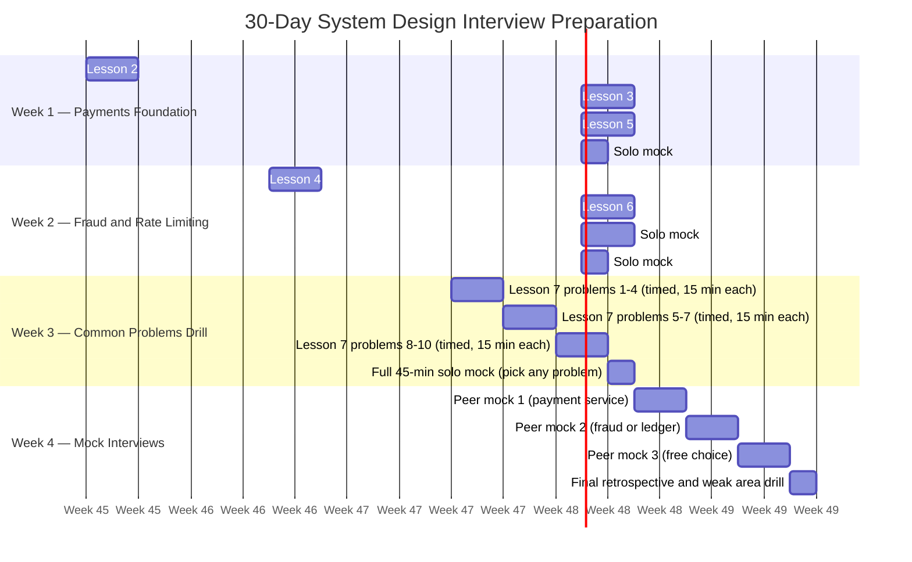

# System Design Mock Interview Guide

This lesson is about the meta-skill: how to practice, how to evaluate yourself, and how to perform under interview conditions. The previous lessons gave you the technical content. This lesson tells you how to convert that knowledge into a consistent interview performance.

The gap between "I know the concepts" and "I perform well in a 45-minute live interview" is larger than most engineers expect. It is a skill that requires deliberate practice, structured retrospectives, and honest self-assessment.

---

## 1. Self-Assessment Rubric

Use this rubric to evaluate every mock interview you do. Score yourself on each dimension before reviewing any notes. Honest self-assessment is the fastest feedback loop.

### The Five Dimensions

| Dimension | Trainee | Mid-Level | Senior | Staff |
|---|---|---|---|---|
| **Requirements Gathering** | Jumps straight to design. Misses key constraints. | Asks 2–3 functional questions. Skips non-functional (latency, consistency, scale). | Asks functional + non-functional + clarifies failure expectations. Establishes scale figures before drawing. | Surfaces hidden constraints the interviewer didn't mention. Explicitly states assumptions when information is unavailable. Names the regulatory dimension unprompted. |
| **API Design Quality** | Proposes endpoints without request/response shapes. No error handling. | Names endpoints and request bodies. Treats all errors as HTTP 500. | Defines idempotency keys, versioning, and meaningful error codes (429, 409, 422). Considers backward compatibility. | Explains the API contract as a promise to clients — discusses what changes are breaking vs non-breaking and how to handle them. Considers internal vs external API surface differences. |
| **Data Model Correctness** | Single table, no indexes, no constraints. | Multi-table relational schema. Some indexes. No concurrency consideration. | Correct schema with optimistic locking or versioning. Appropriate index design. Partitioning considered for large tables. | Explains the schema as a consequence of the access patterns, not the other way around. Discusses migration strategy for schema changes at scale. Names the trade-off between normalisation and query performance explicitly. |
| **Failure Mode Awareness** | Assumes the happy path. No mention of what happens when things fail. | Mentions that retries should happen. Knows idempotency exists. | Specifies retry policy (max attempts, backoff, jitter). Names which operations are idempotent. Discusses compensation for distributed transactions. | Proactively raises failure scenarios the interviewer hasn't mentioned. Distinguishes between fail-safe and fail-secure. Names the specific PostgreSQL, Redis, and Kafka failure modes and their mitigations. |
| **Trade-off Articulation** | Makes decisions without explanation ("I'd use Kafka"). | Names alternatives ("I could use SQS or Kafka"). | Explains why one option was chosen and what is sacrificed ("Kafka over SQS because we need ordered delivery per account, at the cost of operational complexity"). | Frames every decision as a trade-off with explicit cost: "If we're wrong about this assumption, we'd want to revisit this choice because..." Shows awareness that the right answer depends on context, not absolutes. |

### Staff vs Senior: Payment Service Example

**Senior answer to "Design a payment service":**

"I'd use a microservices architecture with a Payment Service backed by PostgreSQL. I'd use Kafka for async event processing downstream. The payment flow would be: validate the request, check the user's balance using SELECT FOR UPDATE, debit the account, write a Kafka event, and return success. For retries, I'd use an idempotency key so duplicate requests don't double-charge."

This answer earns a Senior score. It's correct, reasonably complete, and shows distributed systems awareness.

**Staff answer to the same question:**

"Before I draw anything, I want to understand the failure domain. At 10,000 TPS, the write path is the bottleneck — PostgreSQL can handle this on a single primary, but we're one viral merchant away from a hot partition problem. I'd design for sharding from day one, even if we start with a single shard, by encoding shard affinity in account IDs.

The balance check plus debit must be atomic — I'd use a single UPDATE with a WHERE clause checking the balance condition rather than a SELECT then UPDATE, to avoid a lost update under concurrent load. The idempotency key gets a UNIQUE constraint at the DB level, not just an application-level check, because application logic can be bypassed.

For the outbox, I'd use Debezium over manual polling because manual polling requires a separate background thread, adds latency, and is easy to break during deployments. The CDC approach is strictly better unless you can't use a replication slot on your PostgreSQL instance.

One failure mode I want to flag: if the Kafka consumer that processes outbox events falls behind during a rebalance, the sender's ledger shows a pending transfer but downstream systems don't know about it yet. The user experience is 'payment is processing' — this is acceptable, but we need a timeout: if the downstream acknowledgement doesn't arrive within 60 seconds, we move the transfer to a manual review queue rather than leaving it in limbo indefinitely."

The Staff answer is longer, but the content is different — not just more of the same. It shows proactive failure mode reasoning, awareness of operational concerns (Debezium vs manual polling), and a concrete time-bound SLA for the pending state.

---

## 2. How to Structure 45-Minute Practice Sessions

Do not practice by watching YouTube system design videos. That is passive. Active recall under time pressure is what builds interview performance.

### The RADE Framework (10 minutes)

Before drawing any architecture:

1. **R — Requirements** (3 minutes): Write down functional requirements (what the system does) and non-functional requirements (scale, latency, consistency, availability). Write scale numbers explicitly: "50M users, 1B transactions/year, 10k TPS peak."

2. **A — API Design** (3 minutes): Define the key API endpoints. For a payment service: `POST /payments` with request body, response body, and error codes. Explicitly include the idempotency key in the request header.

3. **D — Data Model** (2 minutes): Sketch the core tables. Name the primary key, the most critical indexes, and any columns that need constraints (NOT NULL, UNIQUE, CHECK).

4. **E — Explain the Architecture** (2 minutes): In 2–3 sentences, state the core architectural decision before drawing. "I'll use an outbox pattern to decouple the synchronous payment write from async downstream events, because a direct Kafka write in the transaction risks inconsistency if Kafka is unavailable."

### Architecture Drawing (20 minutes)

Draw the write path first, then the read path. For each component, name:
- The technology choice and why (not just "I'd use Kafka" — why Kafka over direct HTTP?)
- The data that flows between components (not just arrows — label what the arrow carries)
- The failure mode at this component and how it's handled

Draw the happy path completely before adding failure paths. Interviewers get frustrated when candidates spend 15 minutes on edge cases before the basic flow is clear.

### Deep Dive (10 minutes)

The interviewer will pick one area to go deep. Common picks:
- Concurrency: "Walk me through two simultaneous debits on the same account."
- Failure: "What happens if the database fails halfway through the payment write?"
- Scale: "This design works at 1,000 TPS. What breaks at 100,000 TPS?"

Treat these as gifts — the interviewer is showing you where they want to focus. Give a structured answer: state the problem, your solution, and the trade-off of that solution.

### Retrospective (5 minutes)

Immediately after the timer ends, before reviewing any notes:

1. Write down the two decisions you're most confident about and why.
2. Write down the one thing you forgot to mention that you should have covered.
3. Score yourself on the rubric above.

Then compare against the model answer or your notes. The gap between your self-score and the model answer score is your learning target for the next session.

---

## 3. The 10-Question Post-Mock Checklist

After every mock — whether solo with a timer or with a practice partner — go through this checklist. These are the most common gaps that separate Senior from Staff scores.

1. **Did I mention idempotency?** Every payment initiation endpoint must accept and enforce an idempotency key. If you designed a payment API without mentioning this, it is a significant gap.

2. **Did I address the failure mode of my primary datastore?** PostgreSQL fails. What is the RPO and RTO? Is the replica configured with synchronous replication? How is failover initiated — manual or automatic (Patroni)?

3. **Did I explain WHY I chose X over Y?** "I'd use Kafka" is worth 20% of the credit. "I'd use Kafka over RabbitMQ because we need ordered delivery per account and long-term message retention for audit replay — RabbitMQ's queue model doesn't suit either requirement" is worth 100%.

4. **Did I mention consistency trade-offs?** Every design that uses eventual consistency must state what happens when the system is in an inconsistent state. Every design that uses strong consistency must state what the latency and availability cost of that choice is.

5. **Did I address the read path separately from the write path?** The write path optimises for correctness and durability. The read path optimises for speed and availability. These have different requirements, different data stores, and different failure modes. Treating them as one is a Senior-to-Staff gap.

6. **Did I size the system?** "50M accounts, 1B transactions/year" should produce: transactions per second (average and peak), storage per year, number of database shards needed, number of Kafka partitions. These numbers validate your architecture — if the numbers don't work, the architecture doesn't work.

7. **Did I mention observability?** A system without metrics is not production-ready. Name the three most important metrics for your design and their alert thresholds. For a payment service: `payment.write.latency_p99 > 500ms`, `payment.debit.failure_rate > 0.1%`, `ledger.discrepancy.count > 0`.

8. **Did I address security and compliance?** For any fintech system: data encryption at rest and in transit, PCI DSS or GDPR applicability, audit log requirements, and principle of least privilege for database roles.

9. **Did I think about schema migrations?** A database schema change on a live 10k TPS system is one of the most dangerous operations in fintech engineering. Mention: online schema migrations, backward-compatible rollout (add column nullable before making it required), and feature flags to control new field usage independently of the schema change.

10. **Did I mention the SLA?** State the availability target (99.9% = 8.7 hours downtime/year; 99.99% = 52 minutes/year) and the latency target (p50, p99). Then explain one design decision you made specifically because of the SLA — this shows the SLA is a real constraint, not just a number to state and ignore.

---

## 4. Common Anti-Patterns at the Senior-to-Staff Gap

These are the patterns that engineers with 5–8 years of experience frequently exhibit in Staff-level interviews. Recognising them in your own answers is the first step to eliminating them.

### Anti-pattern 1: Too Long on CRUD Details

**What it looks like:** Spending 10 minutes designing the user registration form, the account entity, the Spring controller, the service layer, and the repository. Perfectly correct code-level thinking applied to an architecture interview.

**Why it fails:** The interviewer already knows you can write a Spring service. They're evaluating whether you can reason about distributed systems at scale. The first 10 minutes of a system design interview should produce: scale numbers, the core architectural decision, and the write-path architecture. Not a class diagram.

**Fix:** Set a mental constraint — no more than 2 minutes on any single component that isn't the core decision point. If you catch yourself designing the error handling of a utility service, skip to the next architectural component.

### Anti-pattern 2: Not Thinking About Failure Modes

**What it looks like:** A complete architecture diagram with no mention of what happens when any component fails. When the interviewer asks "what happens if Kafka goes down?", the answer is "we'd use a highly available Kafka cluster."

**Why it fails:** "High availability" is not a failure mode answer. The interviewer wants to know: what does the system do when Kafka is unavailable for 60 seconds? Do payments fail? Queue up? Proceed synchronously? What happens to the events that were buffered during the outage — do they process in order? Can you afford the replay latency?

**Fix:** For every external dependency in your diagram, ask yourself: "what does the system do if this component is unavailable for 30 seconds?" Write the answer next to the component, even as a note, before the interviewer asks.

### Anti-pattern 3: "I'd Use Kubernetes"

**What it looks like:** Kubernetes appears in the design without explanation. When asked to elaborate: "it handles scaling and deployment."

**Why it fails at Staff level:** Kubernetes does handle scaling and deployment, but it also introduces specific operational complexity: pod startup latency (JVM warmup takes 10–15 seconds — does your HPA account for this?), disruption budgets (what's your max unavailable during a rolling deploy?), resource requests vs limits (do you have CPU throttling?), and service mesh complexity. Saying "I'd use Kubernetes" without engaging with any of this signals you haven't operated it in a demanding environment.

**Fix:** When you mention any infrastructure technology, follow it immediately with one specific operational consideration. "I'd use Kubernetes with a PodDisruptionBudget set to max-unavailable=1, so a rolling deployment doesn't take down more than one pod at a time. With 100ms JVM warmup time, we also need a readiness probe that waits for the Spring context to fully initialise before the pod receives traffic."

### Anti-pattern 4: Not Knowing the CAP Implications of Your Own Design

**What it looks like:** "I'd use PostgreSQL for the payment service." Interviewer asks: "how does your system behave during a network partition?" Answer: "that's unlikely, but we'd have replication."

**Why it fails:** Every database makes CAP trade-offs. PostgreSQL with a single primary is CP — during a partition, if the primary is on the minority side, writes are blocked (consistency is preserved but availability suffers). A primary-replica setup where replicas can accept writes is AP — but with potential for conflicting writes. If you're using a database, you must know its partition behaviour and state which side of the CAP trade-off is correct for your use case. Financial systems almost always want CP.

**Fix:** For every stateful component in your design, be able to answer: "in a network partition, does this component prioritise consistency (refuse to serve stale reads) or availability (serve possibly stale reads)?" and "is that the right choice for the data it holds?"

### Anti-pattern 5: Designing for Scale-1

**What it looks like:** A single PostgreSQL database with no replication. A single Kafka broker. A single Redis instance. Everything works at 1 TPS.

**Why it fails:** The question specified 10,000 TPS. A design that works at 10 TPS but fails at 10,000 TPS is not a system design answer — it's a prototype. Scale considerations are not gold-plating; they're the actual challenge.

**Fix:** Before finalising your design, do a back-of-the-envelope sanity check: "can my PostgreSQL primary handle the write volume I've designed for?" (Typical answer: ~10,000–20,000 writes/second for simple inserts on NVMe. If your design requires more, you need sharding or a different write path.)

---

## 5. Recommended 30-Day Practice Schedule

**Week 1 goal:** Be able to describe the core payment service architecture (write path, idempotency, outbox, Kafka) in 10 minutes without notes.

**Week 2 goal:** Add fraud detection and rate limiting to your vocabulary. Understand how they integrate with the core payment service, not just in isolation.

**Week 3 goal:** Speed. 15 minutes per problem. You should be producing the skeleton answer (clarifying questions + core decision + failure mode) in the first 5 minutes.

**Week 4 goal:** Performance under observation. Having a peer (or a timer with a recording) adds pressure that solo practice cannot replicate. Record yourself. Watch the recording. The things that feel clear when you're speaking are often not clear when you watch it back.

**How to find practice partners:** Use the community forum for this course. Pair with someone who is at a similar level — reviewing each other's answers is as valuable as giving answers. Use the rubric in Section 1 to grade each other's mock sessions.

---

## 6. What Revolut-Class Interviewers Look For

This section is based on publicly available engineering blog posts, interview prep content from engineers at these companies, and commonly reported patterns. It is not based on confidential information.

### Production-Mindedness

Revolut, Monzo, and Wise interviewers frequently describe the ideal candidate as "production-minded" — meaning the candidate thinks about systems as they behave in production, not as they behave in a demo.

The question "how would you debug this in production?" is a direct test of production-mindedness. The wrong answer describes the happy path ("I'd look at the logs"). The right answer names specific tools and signals: "I'd start with the distributed trace for the failed request using Jaeger or Tempo — the trace will show which service added latency. If the trace isn't available (e.g., the request timed out before the trace was written), I'd fall back to the structured log search for the idempotency key, which appears in every log line in this service. If neither is available, I'd check the PostgreSQL slow query log for queries exceeding 500ms in the relevant table."

Production-mindedness also means: knowing that things fail in ways that are hard to predict. When you name a component in your design, also name how you'd know if it was failing silently (not crashing, but producing wrong results). For a rate limiter, silent failure is: Redis is healthy, Lua scripts execute, but the wrong key is being used for a subset of users. The only way to detect this is a metric showing zero rate-limited requests for a user type that should occasionally be rate-limited.

### Knowledge of Real Failure Modes

Senior interviewers at these companies have operated these systems and have seen them fail in specific ways. They may describe an incident (without naming it) and ask what you think went wrong.

Common scenarios that have been described in public engineering blog posts from these companies:
- A database primary failover during peak traffic exposed a replication lag that caused inconsistent balance reads for 30 seconds
- A Kafka consumer group rebalance during a deployment caused a 2-minute processing pause on payment events
- An idempotency key implementation that used a Redis TTL of 5 minutes was bypassed by clients that waited exactly 5 minutes and then retried with the same key

For each of these, the interviewer is not testing whether you know the specific incident. They are testing whether you understand the failure mode deeply enough to have designed against it. If you have used a Redis-based idempotency cache, you should have already thought about TTL expiry and dual-layer deduplication (Section 2 of Lesson 7).

### Willingness to Say "I Don't Know — Here's How I'd Find Out"

This is counterintuitive but important. At Staff level, interviewers are not expecting you to know everything. They are evaluating your intellectual honesty and your problem-solving process.

If asked about a technology or system you haven't used: "I haven't operated Redlock in production, so I can't speak to its failure modes from direct experience. What I can say is that Martin Kleppmann's analysis of Redlock identifies clock skew as the fundamental correctness issue — and I'd want to understand our clock synchronisation guarantees before choosing it. If the trade-off between correctness and operational simplicity matters here, I'd benchmark single-instance Redis SETNX against Redlock in our environment and make the decision based on measured data."

This answer demonstrates: awareness of the literature, intellectual honesty about direct experience, a concrete path to getting the information needed, and decision-making grounded in data rather than authority.

What it doesn't do: confidently state something wrong. At Staff level, being confidently wrong is worse than being honestly uncertain.

---

<!-- KNOWLEDGE-CHECK
[
  {
    "id": "kc-08-01",
    "question": "During a mock interview, you've designed a payment service with PostgreSQL as the primary store. The interviewer asks: 'What happens to your system during a network partition?' You answer: 'PostgreSQL is highly available, so it would handle the partition.' Why is this a Staff-level gap, and what should you say instead?",
    "options": [
      "Because 'highly available' is incorrect — PostgreSQL cannot handle network partitions",
      "Because the answer treats availability as the only concern. A Staff answer explains that PostgreSQL primary-replica is CP — during a partition where the primary is unreachable, writes block to preserve consistency, and explains why that trade-off is correct for financial data",
      "Because you should have recommended a distributed database like CockroachDB instead",
      "Because network partitions are rare and don't need to be addressed in a system design interview"
    ],
    "correct": 1,
    "explanation": "Saying 'highly available' dodges the CAP question entirely. A Staff answer engages with the trade-off: PostgreSQL with a single primary is CP. During a partition that isolates the primary, write operations fail — this is intentional, because allowing a partitioned replica to accept writes would create conflicting state. For payment systems, this is the right choice: an unavailable system is recoverable; an inconsistent system (with two balances for the same account) may not be. The Staff answer states this explicitly and explains why."
  },
  {
    "id": "kc-08-02",
    "question": "You are reviewing a peer's mock interview recording. They spend 15 minutes designing the user registration and account creation flow in detail, then run out of time before covering the payment write path. Which anti-pattern does this represent, and what is the fix?",
    "options": [
      "Anti-pattern: Over-engineering. Fix: Use a simpler architecture",
      "Anti-pattern: Too long on CRUD details (designing peripheral components at code level instead of focusing on the core architectural challenge). Fix: Time-box each component to 2 minutes maximum and jump to the core decision point within the first 10 minutes",
      "Anti-pattern: Incorrect requirements gathering. Fix: Ask the interviewer to narrow the scope",
      "Anti-pattern: Insufficient preparation. Fix: Memorise more patterns"
    ],
    "correct": 1,
    "explanation": "This is the classic 'too long on CRUD' anti-pattern. User registration is a standard CRUD operation — interviewers assume you can design it. The interview is testing whether you can reason about the payment write path at scale, with concurrent updates, distributed transactions, and failure recovery. Spending 15 minutes on registration signals a misread of what the interview is evaluating. The fix is a strict time budget: state 'I'll note account creation exists but skip the details — the interesting architecture is the payment write path' and move on."
  },
  {
    "id": "kc-08-03",
    "question": "An interviewer at Monzo asks: 'How would you debug a balance discrepancy that affects 0.01% of accounts and was first reported by a user 48 hours after it occurred?' What does a production-minded Staff-level answer include that a Senior answer would miss?",
    "options": [
      "A Senior answer mentions checking logs; a Staff answer also mentions checking the database",
      "A Senior answer checks the payment service logs; a Staff answer starts with the distributed trace, identifies the specific ledger entry that caused the discrepancy by comparing accounts.balance against SUM(ledger_entries), reconstructs the sequence of events using the running_balance column in ledger_entries, and explains how to replay the hash chain to verify no entries were modified",
      "A Senior answer uses grep; a Staff answer uses a monitoring dashboard",
      "A Senior answer requires a postmortem; a Staff answer prevents this with better testing"
    ],
    "correct": 1,
    "explanation": "Production-mindedness means knowing your investigation toolchain at a specific level. A Senior answer ('check the logs') is correct but vague. A Staff answer names the exact investigation path: (1) identify the affected account ID from the support ticket, (2) compare accounts.balance against SUM(CASE WHEN entry_type='CREDIT' THEN amount ELSE -amount END) FROM ledger_entries WHERE account_id=X to quantify the discrepancy, (3) find the entry where running_balance diverges from the expected running sum to identify the exact point of failure, (4) check the idempotency_key on surrounding entries to detect any double-posting. This level of specificity demonstrates that you have operated the system, not just designed it."
  },
  {
    "id": "kc-08-04",
    "question": "You are asked about Redlock in a Stripe interview and you have not used it in production. Which response best demonstrates Staff-level intellectual honesty and problem-solving?",
    "options": [
      "Confidently explain how Redlock works based on the Redis documentation, without mentioning uncertainty",
      "Say 'I haven't used Redlock' and move on to a topic you know better",
      "Acknowledge you haven't operated Redlock in production, cite Kleppmann's analysis of its clock-skew vulnerability, explain the trade-off between correctness and operational simplicity, and describe how you would evaluate it empirically before choosing it",
      "Recommend a different distributed lock implementation and avoid discussing Redlock"
    ],
    "correct": 2,
    "explanation": "Staff-level interviews are explicitly testing intellectual honesty alongside technical depth. Confidently explaining something you don't know risks being wrong — which is worse than uncertainty at Staff level. Saying 'I haven't used it' and stopping demonstrates intellectual honesty but no problem-solving process. The correct answer combines honesty ('not from direct experience'), depth ('Kleppmann identified clock skew as the fundamental issue'), trade-off reasoning ('correctness vs operational simplicity'), and a concrete path forward ('measure it in our environment'). This is the response pattern that earns trust from a Staff interviewer."
  }
]
-->

---

<!-- PRACTICAL-CHALLENGE
{
  "id": "pc-08",
  "title": "Mock Interview Practice Sprint",
  "description": "Build your interview performance through structured timed practice and honest self-assessment.",
  "tasks": [
    {
      "id": "pc-08-01",
      "description": "Run a full 45-minute solo mock interview for 'Design a payment service that handles 10,000 TPS' using the RADE framework. Set a timer. Do not look at any notes during the session. Immediately after, score yourself on all 5 rubric dimensions (Trainee/Mid/Senior/Staff), write down what you would add if you had 10 more minutes, and identify the one failure mode you forgot to mention."
    },
    {
      "id": "pc-08-02",
      "description": "Find a practice partner (peer, colleague, or community forum member) and conduct a 45-minute mutual mock session: you answer 'Design a financial ledger for 50M accounts', they score you on the rubric, then swap roles with 'Design a rate limiter for a payment API'. Write a 1-page retrospective covering: your score per dimension, the feedback you found most surprising, and the one thing you will specifically work on before your next mock."
    },
    {
      "id": "pc-08-03",
      "description": "Pick the 3 questions from Lesson 7 that you answered least confidently. For each: set a 15-minute timer, write the full skeleton answer (clarifying questions, core decision, failure mode, expected follow-up) without notes. Then compare against the lesson's model answer and calculate your coverage percentage (what fraction of the model answer's key points did you independently produce)."
    },
    {
      "id": "pc-08-04",
      "description": "Design your personal 'gap closure plan': review your scores from at least 2 mock sessions and identify your lowest-scoring rubric dimension. Write a specific, time-bounded improvement plan: which lessons or external resources address this gap, what metric you will use to know you've improved (e.g., 'I will score Senior on Failure Mode Awareness in my next 3 consecutive mocks'), and your target date. Share this plan with your practice partner for accountability."
    }
  ]
}
-->
