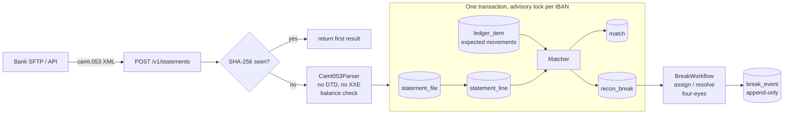

# Capstone 4: Settlement and Reconciliation Pipeline (CAMT.053 ingest, matching, breaks)

> Every evening the bank sends a statement. This service proves that what the bank booked equals what
> our ledger expected, explains every difference, and gives operations a controlled way to clear them.
> Spring Boot 4.0.9, Java 21, StAX, PostgreSQL 17.

## The problem

Our ledger says "we sent 110.00 to supplier X". The bank statement says 100.00 left the account. Was
there a fee? A partial payment? A bug? Reconciliation compares two independent records of the same
money and turns every disagreement into a **break**: a typed, owned, audited item someone must resolve.
Regulators and auditors expect breaks to be explained, not deleted.

Bank files are untrusted input, may arrive twice, may be corrected and re-sent, and may be large. The
pipeline must be safe, idempotent and explainable.

| Concern | Fix | Canonical lesson |
|---|---|---|
| Hostile XML (XXE, entity expansion) | StAX with DTDs and external entities **disabled** | [Secure coding](../../docs/content/tracks/track-11-security-observability/lesson-18-secure-coding/index.md) |
| Truncated or corrupted file | Opening + credits − debits must equal closing balance, or reject | [ISO 20022](../../docs/content/tracks/track-04-banking-systems/lesson-07-iso-20022/index.md) |
| Same file delivered twice | SHA-256 of the bytes is `UNIQUE`; re-delivery returns the first result | [Idempotency patterns](../../docs/content/tracks/track-05-transaction-integrity/lesson-12-idempotency-patterns/index.md) |
| Two files for one account processed at once | `pg_advisory_xact_lock(hashtext(iban))` + `UNIQUE(ledger_item_id)` on matches | [Pessimistic locking and advisory locks](../../docs/content/tracks/track-05-transaction-integrity/lesson-17-pessimistic-locking/index.md) |
| Matching rules | Pure, unit-tested `Matcher`: exact → mismatch → fuzzy → leftovers | [Scenario I: reconciliation mismatches](../../docs/content/tracks/track-05-transaction-integrity/lesson-10-scenario-i-reconciliation/index.md) |
| Breaks "fixed" without trace | Workflow OPEN → INVESTIGATING → RESOLVED, append-only `break_event`, optimistic locking, four-eyes on large write-offs | [Audit trails](../../docs/content/tracks/track-05-transaction-integrity/lesson-21-audit-trails/index.md) |

## Architecture



Matching rules, in order:

| # | Rule | Outcome |
|---|---|---|
| 1 | Same `EndToEndId`, amount, direction | `MATCHED (EXACT)` |
| 2 | Same `EndToEndId`, different amount or direction | `AMOUNT_MISMATCH` break |
| 3 | No id (`NOTPROVIDED`): one unmatched ledger item with the same amount and direction, value date within ±2 days | `MATCHED (FUZZY_AMOUNT_DATE)` |
| 3b | …more than one candidate | `AMBIGUOUS` break (a human chooses; never guess) |
| 4 | Bank line left over | `MISSING_IN_LEDGER` (fees, unexpected credits, fraud) |
| 5 | Ledger item left over and older than 2 days | `MISSING_IN_BANK` (newer ones are *in transit*, not breaks) |
| 6 | Bank reference seen before | `DUPLICATE_IN_BANK` |

A later statement that books a missing item **auto-resolves** the old `MISSING_IN_BANK` break, with an
audit event.

## Key decisions and trade-offs

| Decision | Why | Cost / when not to |
|---|---|---|
| StAX streaming parser, local names only | Memory stays flat; works for any camt.053.001.xx version | Supports a subset: one statement per file, one `TxDtls` per entry (no batch bookings). |
| Reject an unbalanced file outright | A partial file silently creates false breaks | Operations must chase the bank for a corrected file. |
| Same statement id, different bytes → 409 | A silent "replace" would rewrite history | Corrections need a manual, audited path. |
| Fuzzy match only when the candidate is unique | A wrong auto-match hides a real break; a false break only costs time | More manual work for same-amount payments. |
| Timing tolerance before `MISSING_IN_BANK` | Banks book a day or two later; flagging immediately creates noise | A real loss is seen 2 days later. Tune per bank and rail (instant rails need minutes). |
| Four-eyes on write-offs above 100.00 | Standard control against one person hiding losses | Slower resolution; the threshold is illustrative. |
| One transaction per file | All-or-nothing ingest; simple recovery | Very large files hold the lock longer (see load test). |

## How to run

```bash
cd examples
mvn test -pl capstone-4-reconciliation -am      # 15 tests: parser and matcher unit tests + PostgreSQL integration
```

macOS with Docker Desktop: `export DOCKER_HOST=unix://$HOME/.docker/run/docker.sock` if needed.

```bash
export DB_URL=jdbc:postgresql://localhost:5432/recon DB_USER=recon DB_PASSWORD=...
mvn spring-boot:run -pl capstone-4-reconciliation
curl -s -X POST localhost:8080/v1/statements -H 'Content-Type: application/xml' \
     --data-binary @capstone-4-reconciliation/src/test/resources/camt053/statement-2026-11-10.xml
curl -s 'localhost:8080/v1/breaks?status=OPEN'
curl -s -X POST localhost:8080/v1/breaks/<id>/assign  -H 'Content-Type: application/json' -d '{"actor":"ana","version":0}'
curl -s -X POST localhost:8080/v1/breaks/<id>/resolve -H 'Content-Type: application/json' \
     -d '{"actor":"ana","resolution":"WRITE_OFF","comment":"Monthly account fee","version":1}'
```

The sample statement (`src/test/resources/camt053/statement-2026-11-10.xml`, an illustrative fictional
account) contains one line for each interesting case: exact match, amount mismatch, fuzzy match and an
unbooked bank fee.

## Tests (what each one proves)

| Test | Proves |
|---|---|
| `Camt053ParserTest.parsesTheStatement` | Balances, entries, `NOTPROVIDED`, remittance info |
| `rejectsXxePayloads` | An external-entity payload is refused, not expanded |
| `rejectsAStatementThatDoesNotBalance` | A 0.01 discrepancy rejects the file |
| `rejectsAmountsWithTooManyDecimals` | `2.505 GBP` is invalid (no silent rounding) |
| `MatcherTest` (4) | Every outcome type; ambiguity is not guessed; direction matters |
| `ingestMatchesAndRaisesBreaks` | End to end on the sample file: 2 matches, 3 breaks |
| `reDeliveredFileIsIdempotent` | Same bytes twice → same file id, no duplicate lines or breaks |
| `sameStatementIdWithDifferentContentIsAConflict` | Corrected re-send is refused |
| `lateBankBookingAutoResolvesTheMissingInBankBreak` | Next day's statement clears the break with an audit event |
| `workflowEnforcesAssigneeVersionAndFourEyes`, `largeWriteOffNeedsADifferentApprover` | Stale version → 409, only the assignee resolves, 500.00 write-off needs a second person |
| `httpUploadAndProblemDetails` | 201 then 200 on re-upload, 422 problem+json for a bad file |

Real output (2026-11-12):

```text
Tests run: 4, Failures: 0, Errors: 0, Skipped: 0 -- in com.fintechmastery.recon.Camt053ParserTest
Tests run: 7, Failures: 0, Errors: 0, Skipped: 0 -- in com.fintechmastery.recon.ReconciliationIntegrationTest
Tests run: 4, Failures: 0, Errors: 0, Skipped: 0 -- in com.fintechmastery.recon.MatcherTest
BUILD SUCCESS
```

## Load test

```bash
mvn test -pl capstone-4-reconciliation -am -Dgroups=load
```

One 10,000-entry statement (about 2.1 MB) against 10,000 ledger items, 1% of them with a different
amount. Measured once on an Apple M1 Pro laptop, PostgreSQL in Docker. **Illustrative only:**

```text
LOAD capstone-4: 10000 lines (2177 KB) ingested and matched in 9.0 s; matched 9900, breaks {AMOUNT_MISMATCH=100}
```

Nearly all the time is row-by-row `INSERT`s (about 30,000 round trips). The first optimisation is batch
inserts (`JdbcClient` → `JdbcTemplate.batchUpdate` or `COPY`). The second is chunked commits per 1,000
lines with a resumable checkpoint, which also shortens the advisory-lock hold time.

## Known limits

- camt.053 subset only (see above); no camt.052 (intraday) or camt.054 (notifications).
- The ledger side is fed by a helper (`expect(...)`); in production it is a CDC or Kafka feed from the
  payment and wallet services (capstones 1 and 2).
- No file transport (SFTP polling, PGP/signature checks); add them before parsing.
- The analyst identity comes from the request body. In production it comes from the authenticated principal.
- Many-to-one matching (one bank line settling several ledger items) is not implemented.

## Build it yourself in about 12 hours

| Step | Hours | Done when |
|---|---|---|
| 1. Parser for the sample file + balance check + XXE test | 2.5 | Parser tests green |
| 2. Matcher as a pure function, rule by rule, test first | 2.5 | Matcher tests green |
| 3. Schema, ingest transaction, file idempotency, advisory lock | 2 | Ingest + re-delivery tests green |
| 4. Break workflow, optimistic locking, four-eyes, audit events | 2 | Workflow tests green |
| 5. Auto-resolve on late booking; HTTP layer and problem details | 1.5 | All 15 green |
| 6. 10k-line load test, write the batch-insert note, rehearse | 1.5 | You can explain each break type with an example |

## How I would explain this in an interview

"It reconciles our ledger with the bank's end-of-day camt.053 statement. The parser is streaming StAX
with DTDs disabled, because bank files are untrusted, and it rejects any file whose entries do not add up
from opening to closing balance. Ingest is idempotent on the file's SHA-256 and serialised per account
with an advisory lock. Matching is a pure function: exact on end-to-end id, then a unique fuzzy candidate
on amount, direction and date, and everything left over becomes a typed break. Ledger items younger than
the bank's booking lag are 'in transit', not breaks, which keeps the noise down. Breaks go through a
workflow with optimistic locking, an append-only history and a four-eyes rule for large write-offs,
because the real product of reconciliation is an explanation an auditor accepts."

## The 5 hardest follow-up questions

1. **"Why not auto-match on amount alone when there is no reference?"**
   Payments of the same amount are common (salaries, subscriptions). A wrong match hides two real breaks
   behind one fake match. So fuzzy matching requires a unique candidate within a date window, and
   ambiguity goes to a human. False breaks cost minutes; false matches can cost an audit finding.

2. **"The bank re-sends yesterday's statement with one line changed. What happens?"**
   Different bytes, so a different SHA-256, but the same statement id → 409. Silently replacing it would
   change matches and breaks after people acted on them. A correction is handled explicitly: reverse the
   old import with an audit trail, then import the new one.

3. **"How do you know reconciliation itself is correct?"**
   The matcher is a pure function with a test per rule. The file-level invariant (opening + entries =
   closing) is checked. Per run, every bank line ends up in exactly one of matched or break
   (`statement_line` count = matches + line breaks), which is cheap to assert and alert on.

4. **"Statements with 5 million lines?"**
   Stream-parse into a staging table with `COPY`. Commit in chunks with a checkpoint. Match with SQL joins
   on indexed `end_to_end_id` instead of in-memory maps, then do fuzzy matching only on the leftovers.
   Partition by account so accounts run in parallel; the advisory lock is already per account.

5. **"What is the difference between this and the wallet's internal reconciliation (capstone 2)?"**
   Internal reconciliation checks our own data against itself (cached balance vs postings) and should
   never fail. External reconciliation checks us against an independent party, and some breaks are
   *normal* (fees, timing). Different expectations, different alerting: any internal break pages someone;
   external breaks are triaged by age and amount.

## See also

- [Track 04: Financial reconciliation architecture](../../docs/content/tracks/track-04-banking-systems/lesson-12-reconciliation/index.md)
- [Track 05: Balance reconciliation strategies](../../docs/content/tracks/track-05-transaction-integrity/lesson-22-balance-reconciliation/index.md)
- [Track 04: ISO 20022](../../docs/content/tracks/track-04-banking-systems/lesson-07-iso-20022/index.md)
- [Track 08: PostgreSQL locking](../../docs/content/tracks/track-08-database/lesson-04-postgresql-locking/index.md)
