## في دقيقة واحدة

هذا المسار هو المرحلة الأخيرة قبل مقابلات مستوى المهندس الأول ومستوى Staff في التقنية المالية والأنظمة الموزعة واسعة النطاق بـ Java وSpring. وله خمسة أجزاء: **500 سؤال وجواب تقني ومعماري**، و**10 تحديات برمجية** بحلول مرجعية مختبرة، و**100 سؤال اختيار من متعدد قائم على سيناريوهات**، و**300 نصيحة للمقابلات**، وهذه **الخطة لـ 12 ساعة**. وكل ذلك يتسع في **12 ساعة (720 دقيقة)**، وهو مجموع أزمنة الدروس. والطريقة هي ممارسة الاسترجاع: تجيب أولًا، ثم تتحقق. فهذا ما يحوّل المعرفة إلى إجابات تستطيع قولها تحت الضغط.

## ميزانية الـ 12 ساعة

| الكتلة | الدروس | المحتوى | الدقائق | المجموع التراكمي |
|---|---|---|---|---|
| 0. التهيئة | 1 | هذه الخطة | 15 | 0:15 |
| 1. المال وJava | 2، 3 | الأسئلة 1-100: الأنظمة المالية، ولغة Java | 80 | 1:35 |
| 2. التزامن وJVM | 4، 5 | الأسئلة 101-200: التزامن، والخيوط الافتراضية، وJVM، وجمع المهملات | 80 | 2:55 |
| 3. Spring | 6، 7 | الأسئلة 201-300: نواة Spring والبيانات، والأمان، وBatch، والمراسلة، والذكاء الاصطناعي | 80 | 4:15 |
| 4. الأنظمة الموزعة | 8، 9 | الأسئلة 301-400: الأسس والأنماط | 80 | 5:35 |
| 5. البيانات والبنية | 10، 11 | الأسئلة 401-500: قواعد البيانات، والبنية، والتشغيل، والقيادة | 80 | 6:55 |
| 6. البرمجة | 12، 13 | التحديات C01-C10 (حل اثنين، وقراءة ثمانية) | 120 | 8:55 |
| 7. الاختبار الذاتي | 14، 15 | أسئلة الاختيار 1-100، مع النتيجة | 60 | 9:55 |
| 8. النصائح | 16، 17 | النصائح 1-300 | 60 | 10:55 |
| 9. المراجعة النهائية | 18 | أخطاؤك، والعروض، والقصص، وقائمة اليوم السابق | 65 | 12:00 |

```mermaid
gantt
    title 12-hour final prep (minutes)
    dateFormat X
    axisFormat %s
    section Learn
    Orientation            :0, 15
    Q&A 1-500 (10 banks)   :15, 415
    section Practise
    Coding C01-C10         :415, 535
    Self-test MCQ 1-100    :535, 595
    section Consolidate
    Tips 1-300             :595, 655
    Final review           :655, 720
```

## قواعد الإيقاع

- **بنوك الأسئلة: 40 دقيقة لكل 50 سؤالًا**، أي نحو 45 ثانية لكل سؤال. أجب بصوت عالٍ لمدة تصل إلى 30 ثانية، ثم افتح الإجابة، وتحقق من الآلية ونمط الإخفاق، وعلّم ✓ / ~ / ✗.
- **البرمجة: 60 دقيقة لكل درس.** حل تحديًا واحدًا من الصفر في 25 دقيقة مؤقتة مع اختبارات. ثم اقرأ الحلول الأربعة الأخرى في نحو 7 دقائق لكل منها، مع التركيز على الحالات الحدية وملاحظات التزامن.
- **الاختبار الذاتي: 30 دقيقة لكل 50 سؤالًا**، دون مراجع، أي نحو 35 ثانية لكل سؤال. ولا تفتح الدروس أثناء الاختبار؛ وراجع الشروح بعد ظهور النتيجة.
- **النصائح: 30 دقيقة لكل 150 نصيحة.** تصفحها بنحو 12 ثانية لكل نصيحة، وانسخ العشر التي تمس نقاط ضعفك في صفحة واحدة.
- **الاستراحات:** من 5 إلى 10 دقائق كل 80 إلى 90 دقيقة. والاستراحات تُحسب من الـ 12 ساعة، فخذها بين الكتل لا في وسطها.

## الفرز: حين يكون لديك أقل من 12 ساعة

| الوقت المتاح | افعل هذا |
|---|---|
| **6 ساعات** | بنوك الأسئلة التي تقيّم نفسك فيها بأضعف درجة (4 بنوك، 160 دقيقة)، ودرسا البرمجة 12-13 قراءةً فقط (60)، والاختباران الذاتيان (60)، والنصائح الجزء 2 (30)، والمراجعة النهائية (50). |
| **3 ساعات** | الاختبار الذاتي أولًا (60) لإيجاد نقاط الضعف؛ ثم أقسام الأسئلة المطابقة لإجاباتك الخاطئة فقط (60)؛ والتحديات C02 وC03 وC08 قراءةً فقط (30)؛ وقائمة المراجعة النهائية (30). |
| **ساعة واحدة** | الاختبار الذاتي الجزء 1 (30)؛ ونصائح "فخاخ المقابلات الشائعة" (10)؛ وخمسة عروض تصميم في 60 ثانية بصوت عالٍ (15)؛ وقائمة اليوم السابق (5). |

استراتيجية المراجعة السريعة لأي بنك: اقرأ الأسئلة فقط، وأجب عن كل منها في جملة واحدة، وافتح فقط ما لا تستطيع الإجابة عنه. وقائمة ✗ من هذه الجولة هي قائمة دراستك.

## تقويمات مقترحة

- **يومان × 6 ساعات:** اليوم الأول الكتل 0-4 (الأسئلة 1-400 مع التهيئة)؛ واليوم الثاني الكتلة 5، والبرمجة، والاختبار الذاتي، والنصائح، والمراجعة النهائية.
- **ثلاثة أيام × 4 ساعات:** اليوم الأول الكتل 0-3؛ واليوم الثاني الكتل 4-6؛ واليوم الثالث الكتل 7-9.
- **ست أمسيات × ساعتان:** كتلة واحدة كل أمسية، مع المراجعة النهائية في مساء اليوم السابق للمقابلة.

## تابع نتيجتك

احتفظ بسطر واحد لكل بنك: أعداد ✓ / ~ / ✗، ونتيجة الاختبار الذاتي لكل جزء. والبنك الذي فيه أكثر من 10 ✗ يحصل على جولة ثانية في المراجعة النهائية. واستهدف 85% على الأقل في كل جزء من الاختبار الذاتي.

## انظر أيضًا

- [المسار 15: دليل المقابلات](#/tracks/track-15/lessons/track-15-lesson-01) (قصص STAR، وجولة التصميم، والمقابلات التجريبية)
- [المسار 14: تصميم الأنظمة لمقابلات التقنية المالية](#/tracks/track-14/lessons/track-14-lesson-01)
- [خطة الدراسة لـ 30 أسبوعًا](#/study-plan)

<!-- KNOWLEDGE-CHECK
[
  {
    "id": "kc-1701-01",
    "question": "لديك 3 ساعات فقط قبل مقابلة. ماذا تفعل أولًا؟",
    "options": [
      "اقرأ كل الأسئلة الخمسمئة بسرعة",
      "خذ الاختبار الذاتي لإيجاد نقاط الضعف، ثم ادرس فقط أقسام الأسئلة المطابقة",
      "اكتب التحديات البرمجية العشرة كلها من الصفر",
      "اقرأ النصائح الثلاثمئة كلها"
    ],
    "correct": 1,
    "explanation": "الاختبار أولًا يخبرك أين تنفق الوقت القليل المتاح؛ وقراءة كل شيء تشتته."
  },
  {
    "id": "kc-1701-02",
    "question": "ما الطريقة الموصى بها للعمل على بنك أسئلة؟",
    "options": [
      "اقرأ كل إجابة بعناية، ثم السؤال",
      "انسخ كل إجابة في ملاحظاتك",
      "أجب بصوت عالٍ أولًا، ثم افتح الإجابة وعلّم ✓ / ~ / ✗",
      "تجاوز الأسئلة عن مواضيع تستخدمها في العمل بالفعل"
    ],
    "correct": 2,
    "explanation": "ممارسة الاسترجاع (الإجابة قبل التحقق) تبني التذكر تحت الضغط أفضل بكثير من إعادة القراءة."
  }
]
-->

<!-- PRACTICAL-CHALLENGE
{
  "id": "pc-1701",
  "title": "جهّز خطتك لـ 12 ساعة",
  "description": "حوّل الميزانية إلى تواريخ ولوحة نتائج قبل أن تبدأ.",
  "tasks": [
    {
      "id": "pc-1701-01",
      "description": "اختر تقويمًا (يومان، أو ثلاثة أيام، أو ست أمسيات) وضع كل كتلة في مفكرتك بدقائقها."
    },
    {
      "id": "pc-1701-02",
      "description": "أنشئ لوحة نتائج بسطر لكل بنك أسئلة (أعداد ✓ / ~ / ✗) وسطر لكل جزء من الاختبار الذاتي (النتيجة من 50)."
    },
    {
      "id": "pc-1701-03",
      "description": "قيّم نفسك الآن من 1 إلى 5 في المجالات العشرة للأسئلة، لتقارن بنتائجك في النهاية."
    }
  ]
}
-->
