## In one minute

This track is the last stretch before senior and staff interviews for FinTech and large-scale distributed systems roles in Java and Spring. It has five parts: **500 technical and architectural Q&As**, **10 coding challenges** with tested reference solutions, **100 scenario-based multiple-choice questions**, **300 interview tips**, and this **12-hour plan**. Everything fits in **12 hours (720 minutes)**, the total of the lessons' times. The method is retrieval practice: you answer first, then check. That's what moves knowledge into answers you can give under pressure.

## The 12-hour budget

| Block | Lessons | Content | Minutes | Running total |
|---|---|---|---|---|
| 0. Orientation | 1 | This plan | 15 | 0:15 |
| 1. Money and Java | 2, 3 | Q&A 1-100: financial systems, Java language | 80 | 1:35 |
| 2. Concurrency and JVM | 4, 5 | Q&A 101-200: concurrency, virtual threads, JVM, GC | 80 | 2:55 |
| 3. Spring | 6, 7 | Q&A 201-300: Spring core/data, security, batch, messaging, AI | 80 | 4:15 |
| 4. Distributed systems | 8, 9 | Q&A 301-400: foundations and patterns | 80 | 5:35 |
| 5. Data and architecture | 10, 11 | Q&A 401-500: databases, architecture, operations, leadership | 80 | 6:55 |
| 6. Coding | 12, 13 | Challenges C01-C10 (attempt two, read eight) | 120 | 8:55 |
| 7. Self-test | 14, 15 | MCQ 1-100, scored | 60 | 9:55 |
| 8. Tips | 16, 17 | Tips 1-300 | 60 | 10:55 |
| 9. Final review | 18 | Your misses, pitches, stories, day-before checklist | 65 | 12:00 |

```mermaid
gantt
    title 12-hour final prep (minutes)
    dateFormat X
    axisFormat %s
    section Learn
    Orientation            :0, 15
    Q&A 1-500 (10 banks)   :15, 415
    section Practise
    Coding C01-C10         :415, 535
    Self-test MCQ 1-100    :535, 595
    section Consolidate
    Tips 1-300             :595, 655
    Final review           :655, 720
```

## Pacing rules

- **Q&A banks: 40 minutes per 50 questions**, so about 45 seconds each. Answer aloud for up to 30 seconds, open the answer, check the mechanism and the failure mode, and mark ✓ / ~ / ✗.
- **Coding: 60 minutes per lesson.** Solve one challenge from scratch, timed at 25 minutes, with tests. Then read the other four solutions at about 7 minutes each, focusing on the edge cases and the concurrency notes.
- **Self-test: 30 minutes per 50 questions**, closed book, about 35 seconds each. Don't open lessons mid-test; review the explanations after scoring.
- **Tips: 30 minutes per 150.** Skim at about 12 seconds each and copy the 10 that hit your weak spots onto one page.
- **Breaks:** 5–10 minutes every 80–90 minutes. Breaks come out of the 12 hours, so take them between blocks, not inside them.

## Triage: when you have less than 12 hours

| Time you have | Do this |
|---|---|
| **6 hours** | Q&A banks you rate yourself weakest in (4 banks, 160 min), coding lessons 12-13 reading only (60), both self-tests (60), tips part 2 (30), final review (50). |
| **3 hours** | Self-test first (60) to find weak areas; then only the Q&A sections matching your wrong answers (60); coding challenges C02, C03 and C08 reading only (30); final review checklist (30). |
| **1 hour** | Self-test part 1 (30); the "Common interview traps" tips (10); five 60-second design pitches aloud (15); the day-before checklist (5). |

Fast-review strategy for any bank: read only the questions, answer each in one sentence, and open only those you can't answer. Your ✗ list from that pass is your study list.

## Suggested calendars

- **Two days × 6 hours:** day 1 blocks 0-4 (Q&A 1-400 plus orientation); day 2 block 5, coding, self-test, tips, final review.
- **Three days × 4 hours:** day 1 blocks 0-3; day 2 blocks 4-6; day 3 blocks 7-9.
- **Six evenings × 2 hours:** one block per evening, with the final review the evening before the interview.

## Track your score

Keep one line per bank: ✓ / ~ / ✗ counts, and the MCQ score per part. A bank with more than 10 ✗ gets a second pass in the final review. Aim for at least 85% in each self-test part.

## See also

- [Track 15: Interview Playbook](#/tracks/track-15/lessons/track-15-lesson-01) (STAR stories, design round, mock interviews)
- [Track 14: System design for fintech interviews](#/tracks/track-14/lessons/track-14-lesson-01)
- [30-week study plan](#/study-plan)

<!-- KNOWLEDGE-CHECK
[
  {
    "id": "kc-1701-01",
    "question": "You have only 3 hours before an interview. What should you do first?",
    "options": [
      "Read all 500 Q&As quickly",
      "Take the self-test to find weak areas, then study only the matching Q&A sections",
      "Write all 10 coding challenges from scratch",
      "Read all 300 tips"
    ],
    "correct": 1,
    "explanation": "Testing first tells you where to spend the little time you have; reading everything spreads it too thin."
  },
  {
    "id": "kc-1701-02",
    "question": "What is the recommended way to work through a Q&A bank?",
    "options": [
      "Read each answer carefully, then the question",
      "Copy every answer into notes",
      "Answer aloud first, then open the answer and mark ✓ / ~ / ✗",
      "Skip questions about topics you already use at work"
    ],
    "correct": 2,
    "explanation": "Retrieval practice (answering before checking) builds recall under pressure far better than rereading."
  }
]
-->

<!-- PRACTICAL-CHALLENGE
{
  "id": "pc-1701",
  "title": "Set up your 12-hour plan",
  "description": "Turn the budget into dates and a scoreboard before you start.",
  "tasks": [
    {
      "id": "pc-1701-01",
      "description": "Pick a calendar (two days, three days or six evenings) and put every block in your diary with its minutes."
    },
    {
      "id": "pc-1701-02",
      "description": "Create a scoreboard with one row per Q&A bank (✓ / ~ / ✗ counts) and one per self-test part (score out of 50)."
    },
    {
      "id": "pc-1701-03",
      "description": "Rate yourself 1-5 on the ten Q&A domains now, so you can compare with your results at the end."
    }
  ]
}
-->
